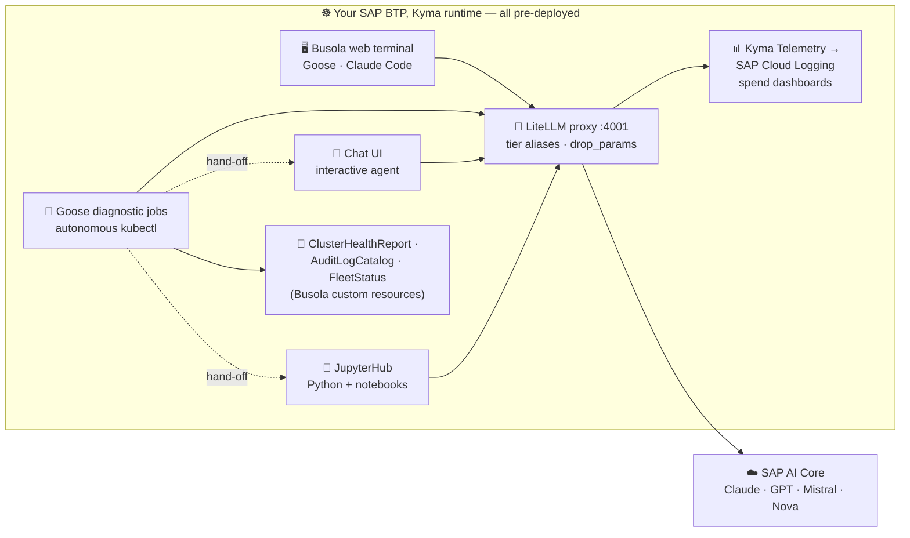
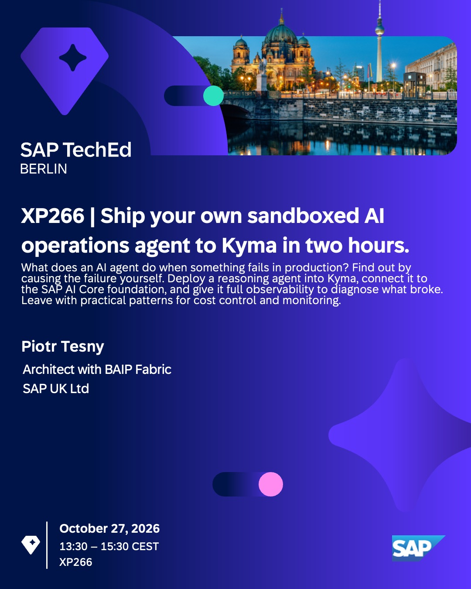

# XP266 - Ship your own sandboxed AI operations agent to Kyma in two hours

## Description

This repository contains the material for the SAP TechEd 2026 session **XP266 - Ship your own sandboxed AI operations agent to Kyma in two hours**.

> [!IMPORTANT]
> What does an AI agent do when something fails in production? Find out by causing the failure yourself. Deploy a reasoning agent into Kyma, connect it to the SAP AI Core foundation, and give it full observability to diagnose what broke. Leave with practical patterns for cost control and monitoring.

## Overview

Modern Kubernetes operations need more than dashboards — they need **reasoning**.  
In this hands-on you meet a **fully in-cluster, sandboxed AI operations agent** running on **SAP BTP, Kyma runtime** and talking to **SAP AI Core**.  
It's a [Goose](https://github.com/aaif-goose/goose) agent with live `kubectl` access: it investigates the cluster autonomously and writes its findings as **Busola** in-cluster health reports.  
It also streams its **LLM** spend to **SAP Cloud Logging** — all routed through a **LiteLLM proxy** and deployed declaratively with **KRO**.

> [!NOTE]
> **New to the jargon?**
>
> - **Kyma** — SAP's managed Kubernetes runtime on BTP.
> - **Busola** — the Kyma dashboard.
> - **Goose** — an open-source agentic CLI (the reasoning agent).
> - **LiteLLM proxy** — the in-cluster gateway that routes model calls to SAP AI Core.
> - **SAP AI Core** — SAP's model-serving platform (Claude · GPT · Mistral · Nova).
> - **KRO** — *Kubernetes Resource Orchestrator*; packages the whole stack as one declarative unit.
> - **CLS** — *SAP Cloud Logging*; SAP's OpenSearch-based observability service.

👉 The whole premise is in the title: the agent is **sandboxed**.

- ✅ Giving an AI agent a shell and a kubeconfig normally means a bad prompt — or a prompt-injection — can delete your workloads or leak a token.
- ✅ Here the **sandbox itself is the guardrail**: each agent runs in a disposable, per-session pod that _by construction_ cannot reach the internet or the API server, and never holds the LLM key — it sends a sentinel, and the gateway injects the real key at the edge.
- ✅ The same container image runs at three trust levels — **contained** (no cluster access), **scoped-ops** (read-only), or **web terminal** (whatever your own account is allowed to do) — pick the level that matches each workload.
- ✅ It is the **100% stock** NVIDIA OpenShell + Kubernetes `agent-sandbox` chart on Kyma, no fork.

👉 The sandbox blocks the agent **from the outside**
- ✅ Kubernetes RBAC refuses writes
- ✅ there is no network route to the internet
- ✅ and the LLM key never enters the pod.  

👉 A prompt-injected or buggy agent hits the exact same walls as a well-behaved one — it cannot argue its way out, because the walls are not written in the prompt.  
👉 That is why you can let it run unsupervised.

> [!TIP]
> The sandboxing story has its own deep-dive on the SAP Community:
> [**Ship your own sandboxed AI operations agent to Kyma in two hours**](https://community.sap.com/t5/technology-blog-posts-by-sap/teched2026-xp266-ship-your-own-sandboxed-ai-operations-agent-to-kyma-in-two/ba-p/14492281).
> _(The post was written against the OpenShell alpha; the workshop runs a newer beta — the sandbox model is the same.)_

Everything is **already deployed and wired up for you** on your personal Kyma runtime — the provisioning and bootstrapping are done. Your two hours are spent **understanding how the pieces fit and playing with the running system**:

- 🩺 **experiment with the diagnostics' prompts** and watch the Cluster Health Reports change ([Exercise 1](exercises/ex1/));
- 💬 chat with the **interactive chat agent** ([Exercise 2](exercises/ex2/));
- 📓 explore **OpenShell sandboxes** with **JupyterHub notebooks** ([Exercise 3](exercises/ex3/));
- 🛡️ watch a **sandboxed agent** hit its guardrails — denied the internet and the API server ([Exercise 4](exercises/ex4/));
- ⚙️ run the **OpenShell-admin** and **NVIDIA** GitHub Actions workflows ([Exercise 4](exercises/ex4/) · [Exercise 5](exercises/ex5/));
- 💰 and close with the **spend dashboards** ([Exercise 6](exercises/ex6/)).

The **LLM gateway** (calling SAP AI Core through the proxy) and the **in-cluster web terminal** are covered in the appendices.  
<table style="width: 100%; border-collapse: collapse; background-color: #f5f5f5;" border="1">
<tbody>
<tr style="height: 193px;">
<td style="width: 71.6%; height: 193px;">

This is the **self-hosted agent layer** of the SAP AI landscape — everything below runs **inside your Kyma runtime** and reaches SAP AI Core through one proxy.

</td>
</tr>
</tbody>
</table>

## Requirements

> [!IMPORTANT]
> Everything is **pre-provisioned and pre-deployed** for you — there is no infrastructure to install or configure. You only need:
>
> - ✅ The **provided TechEd laptop**, with the **Chrome browser** and a **public internet connection**.
> - ✅ Your personal **SAP BTP, Kyma runtime** (`xp266-NNN`) — the **Busola URL** and single sign-on are handed out at the start of the session.
> - ✅ A **GitHub account** — several exercises run as **GitHub Actions** workflows. If you don't have one, [sign up](https://github.com/signup) before the session (or at the very start).

> [!IMPORTANT]
> - ✅ The session content is provided *exclusively* on the public **SAP-samples** GitHub.
> A couple of exercises are implemented as CI/CD [GitHub Actions workflows](https://docs.github.com/en/actions/get-started/understand-github-actions) (GHA).  
> - ✅ To run them you need to **fork this repository to your own GitHub account and enable GitHub Actions on your fork**.  
> - ✅ That is the only setup, it is all done in the browser, and it is **required** for the GHA-based exercises.
>
> 👉 Walk-through: [Appendix 0 — Fork this repo & enable GitHub Actions](exercises/Appendices/0-fork-this-repo/) (about 2 minutes).

> [!IMPORTANT]
> **Security is paramount — you never handle a credential.** 
> The GHA exercises use GitHub's OIDC-delegated authentication, so there are **no Kubernetes or BTP credentials to copy anywhere** ([why OIDC](https://docs.github.com/en/actions/concepts/security/openid-connect#benefits-of-using-oidc)):
> - ✅ The GitHub Actions workflow acts as the [OIDC provider](https://docs.github.com/en/actions/concepts/security/openid-connect).
> - ✅ Every Kyma runtime in the landscape is pre-configured to **trust GitHub's token issuer** (via the built-in Gardener OIDC shoot extension).
> - ✅ **SAP Cloud Identity Services** (the BTP platform IDP) is federated with the GitHub Actions OIDC provider.
> - ✅ As a result, **short-lived** [tokens](https://docs.github.com/en/actions/concepts/security/openid-connect#understanding-the-oidc-token) are fetched and rotated automatically on your behalf, for both Kubernetes and BTP operations.

> [!NOTE]
> 👉 Personal devices ought not to be used for this session — please use the **provided TechEd laptop**.  
> 👉 Every exercise runs in the browser — Busola, JupyterHub, and GitHub Actions.  
> 👉 No local `kubectl`, no IDE, no cloud account, **nothing to install**.  

## Exercises

- 🧭 [Getting Started](exercises/ex0/) — access your Kyma runtime and tour the pre-deployed AI-ops stack
- 📋 [Exercise 1 - Trigger and shape the Cluster Health Reports](exercises/ex1/) — drive and shape diagnostic reports, experiment with your own prompts
- 💬 [Exercise 2 - Chat with the interactive agent](exercises/ex2/) — the interactive chat UI, and the hand-off from the diagnostic jobs
- 📒 [Exercise 3 - Explore OpenShell sandboxes with JupyterHub notebooks](exercises/ex3/) — drive the OpenShell sandbox lifecycle from Python and run an agent inside a sandbox
- 🛠️ [Exercise 4 - Your sandboxed agent: OpenShell practice with Kyma](exercises/ex4/) 🔧 — run the tools image as a runtime-isolated `Sandbox` with a contained LLM provider; watch the egress guardrail deny the apiserver and the internet
  - **4a** *(easy path)* — run it as a **GitHub Action**
  - **4b** *(do-it-yourself)* — do it by hand in the **in-cluster web terminal**
- 🤖 [Exercise 5 - External agents: Pi, opencode & Qwen via OpenRouter](exercises/ex5/) 🔧 — add an external provider; run three terminal coding agents against free OpenRouter models in a still-contained sandbox
  - **5a** *(easy path)* — run it as a **GitHub Action**
  - **5b** *(do-it-yourself)* — do it by hand in the **in-cluster web terminal**
- 📊 [Exercise 6 - Observability and spend](exercises/ex6/) — Kyma Telemetry to SAP Cloud Logging, the LiteLLM spend dashboards; the closing activity of the session

### Appendix

- 🚦 [Appendix 0 - Fork this repo & enable GitHub Actions](exercises/Appendices/0-fork-this-repo/) *(one-time setup — mandatory before GHA exercises)*
- 🔀 [Appendix 1 - The LLM gateway: LiteLLM and SAP AI Core](exercises/Appendices/1-llm-gateway/) — how the proxy routes to SAP AI Core, and call it yourself
- 🖥️ [Appendix 2 - The Busola web terminal](exercises/Appendices/2-web-terminal/) 🔧 *(optional)* — run Goose and Claude Code against your cluster, in-browser
- 🐍 [Appendix 3 - SAP AI Core from Python](exercises/Appendices/3-sap-ai-core-python/) — the JupyterHub SAP AI Core track: chat, embeddings, tool calling, and the diagnostic hand-off in Python
- 📘 [Appendix 4 - OpenShell: concepts & architecture](exercises/Appendices/4-openshell-concepts/) — the why, risks, protection layers, architecture, and glossary behind the sandboxed-agent hands-on
- 🌐 [Appendix 5 - External agents & the OpenRouter provider model](exercises/Appendices/5-openrouter-provider/) — how an external provider plugs into the OpenShell sandbox model, and OpenRouter vs SAP AI Core

> [!IMPORTANT]
> - ✅ **Every exercise can be completed entirely in the browser — no laptop terminal is required.**
> - ✅ A few exercises offer an *optional* in-cluster web-terminal step, always marked **🔧 Go deeper (optional)**.
> - ✅ Wherever one appears there is a **UI** (Busola) or **Run workflow** (GitHub Actions) way to reach the same result.
> - ✅ Whatever your level, you can succeed with clicks alone.

> [!NOTE]
> Every step is copy-paste ready — the two hours are short by design. If you fall behind, each exercise is self-contained; jump to whichever interests you most.

## See it live — SAP TechEd 2026 (XP266)

**XP266 | Ship your own sandboxed AI operations agent to Kyma in two hours.**

> What does an AI agent do when something fails in production? Find out by causing the failure yourself. Deploy a reasoning agent into Kyma, connect it to the SAP AI Core foundation, and give it full observability to diagnose what broke. Leave with practical patterns for cost control and monitoring.

<table>
<tr>
<td align="center" width="30%">
 
<b>Piotr Tesny</b> speaker
</td>
<td>

|  |  |
|---|---|
| **Session code** | XP266 |
| **Type** | Hands-on workshop |
| **Venue** | Messe Berlin — Messedamm 22, 14055 Berlin |
| **Room** | Hands-On Room 6 |
| **Date** | 27 October 2026 (conference runs 27–29 October) |
| **Time** | 13:30 – 15:30 |

</td>
</tr>
</table>

## Contributing
Please read the [CONTRIBUTING.md](./CONTRIBUTING.md) to understand the contribution guidelines.

## Code of Conduct
Please read the [SAP Open Source Code of Conduct](https://github.com/SAP-samples/.github/blob/main/CODE_OF_CONDUCT.md).

## How to obtain support

Support for the content in this repository is available during the actual time of the online session for which this content has been designed. Otherwise, you may request support via the [Issues](https://github.com/SAP-samples/teched2026-XP266/issues/new) tab.

## License
Copyright 2026 SAP SE or an SAP affiliate company and teched2026-XP266 contributors. Please see our [LICENSE](LICENSE) for copyright and license information. Detailed information including third-party components and their licensing/copyright information is available [via the REUSE tool](https://api.reuse.software/info/github.com/SAP-samples/teched2026-XP266).
