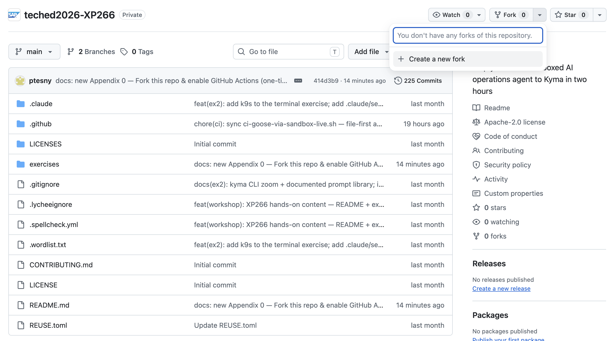
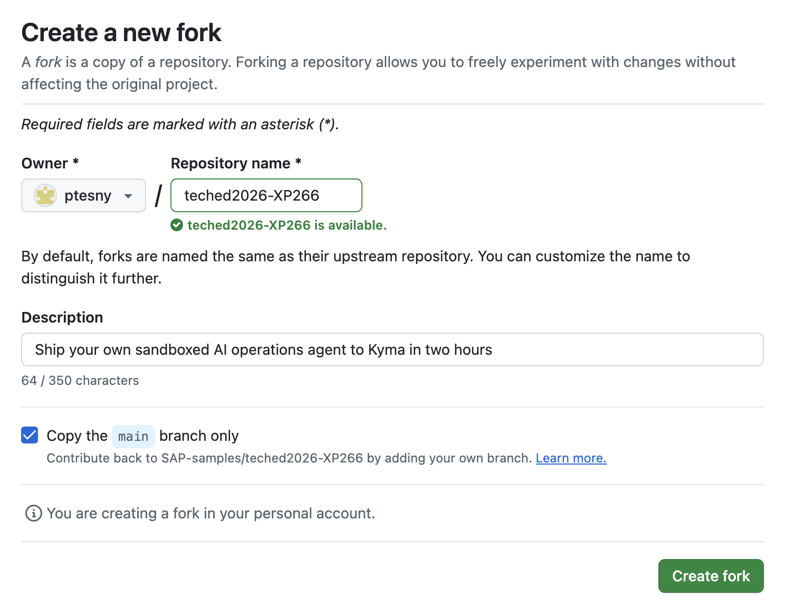
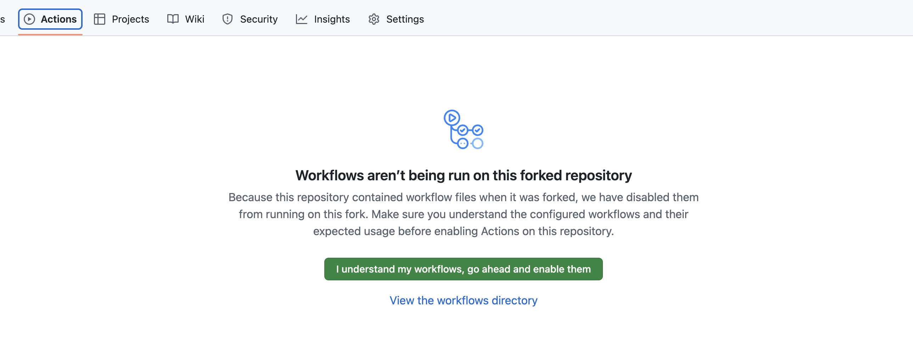

# Appendix 0 — Fork this repo & enable GitHub Actions 🚦 *(one-time setup)*

> [!IMPORTANT]
> This step is **mandatory before you start any exercise that runs as a GitHub Actions (GHA) workflow**. The two-hour workshop assumes you already finished this appendix — if you haven't, do it now.
> You need **about 2 minutes** and a GitHub account.

**Why fork at all?** The GHA-based exercises run **in YOUR GitHub Actions**, not in SAP's. That gives you:
- 🔐 **No credentials to copy.** GHA mints a short-lived OIDC token during each run → SAP IAS / Keycloak federates it → your Kyma cluster trusts it. Nothing to paste anywhere, no `kubeconfig` to download. ([Why OIDC](https://docs.github.com/en/actions/concepts/security/openid-connect#benefits-of-using-oidc).)
- 🧪 **A workspace you own.** You can edit the workflows, re-run them, inspect the logs. SAP-samples is read-only; your fork is yours.
- 📦 **Zero local install.** Click **Run workflow** from your fork in Chrome — no `gh` CLI, no `kubectl`, nothing to download.

**Contents**

- 🧑‍💻 [Appendix 0.1 — Sign up for GitHub (skip if you already have an account)](#appendix-01---sign-up-for-github)
- 🍴 [Appendix 0.2 — Fork this repository](#appendix-02---fork-this-repository)
- ⚙️ [Appendix 0.3 — Enable GitHub Actions on your fork](#appendix-03---enable-github-actions-on-your-fork)
- ✅ [Appendix 0.4 — Sanity check: run your first workflow](#appendix-04---sanity-check-run-your-first-workflow)

## Appendix 0.1 - Sign up for GitHub

> [!TIP]
> **Skip this step** if you already have a GitHub account you can sign in to on the workshop laptop.

1. Open [github.com](https://github.com/) in Chrome.
2. Click **Sign up for GitHub** (top right). Alternatively, click **Continue with Google** to use a Google social login — fastest path if you have a Google account.
3. Follow the prompts — email, username, password, email verification. Keep the username short-ish; it will appear in URLs you share during the workshop.
4. Once logged in, make sure the browser tab is on `github.com` with your new account — the next step forks a repo into *this* account.

## Appendix 0.2 - Fork this repository

1. Open the main page of this workshop repo: **[github.com/SAP-samples/teched2026-XP266](https://github.com/SAP-samples/teched2026-XP266)**.
2. Click **Fork** (top right of the repo header).

<table style="width: 100%; border-collapse: collapse; background-color: #f5f5f5;" border="1">
<tbody>
<tr>
<td>

  

</td>
</tr>
</tbody>
</table>

3. On the **"Create a new fork"** page, make sure the **Owner** is your GitHub account (not an organisation you don't want this in). Leave everything else at its default. Click **Create fork**.

<table style="width: 100%; border-collapse: collapse; background-color: #f5f5f5;" border="1">
<tbody>
<tr>
<td>

  

</td>
</tr>
</tbody>
</table>

4. GitHub redirects you to your copy of the repo at **`https://github.com/<your-username>/teched2026-XP266`**. Confirm the top-left reads *"<your-username>/teched2026-XP266· forked from SAP-samples/teched2026-XP266"*.

## Appendix 0.3 - Enable GitHub Actions on your fork

Forks have GitHub Actions **disabled by default** as a safety measure. Enable them explicitly:

1. On your fork's main page, click the **Actions** tab (top of the repo).
2. GitHub shows a yellow banner: *"Workflows aren't being run on this forked repository"* with a green **"I understand my workflows, go ahead and enable them"** button.
3. Click the green button.

<table style="width: 100%; border-collapse: collapse; background-color: #f5f5f5;" border="1">
<tbody>
<tr>
<td>

  

</td>
</tr>
</tbody>
</table>

4. The Actions tab reloads with the workflow list visible. You are good to go.

## Appendix 0.4 - Sanity check: run your first workflow

Nothing to fix — just a 10-second smoke test that your fork + GHA are wired up right.

1. On your fork, open the **Actions** tab.
2. In the left sidebar, pick any workflow with a **`workflow_dispatch`** trigger (the ones you'll use in the exercises). A good smoke-test choice: a read-only / introspection workflow if one is present, or just skim the list and confirm **"Run workflow"** appears on at least one entry.
3. If you see a workflow with a **Run workflow** button on the right, your fork is correctly set up.

> [!NOTE]
> **Don't** actually run anything cluster-affecting here — that's what the exercises are for, and they walk you through which workflow fires what. This appendix is just the one-time plumbing.

## Done

You now have:
- ✅ A GitHub account signed in on this laptop.
- ✅ A personal fork of `SAP-samples/teched2026-XP266`.
- ✅ GitHub Actions enabled on your fork.

Head back to the [main README](../../../README.md#exercises) and pick your first exercise, or jump straight to [Exercise 0 — Getting Started](../../ex0/README.md) to sign in to Busola and tour the AI-ops stack.
