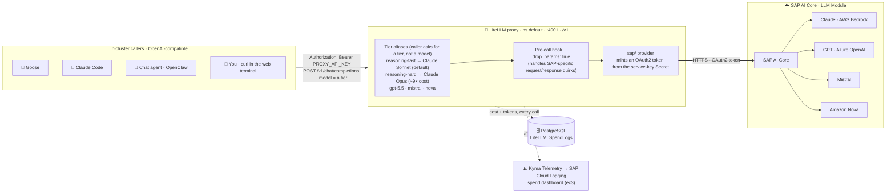

# Appendix 1 - The LLM gateway: LiteLLM and SAP AI Core

👉 Your agent never talks to a model provider directly.

Every LLM call goes through an in-cluster **LiteLLM proxy**, which routes to **SAP AI Core** — SAP's orchestration layer in front of Claude (via AWS Bedrock), GPT (via Azure OpenAI), Mistral, and Amazon Nova.

In this exercise you inspect the running proxy, understand *why* it's there, and **call SAP AI Core yourself** through it.

> [!NOTE]
> **Everyone:** Appendix 1.1 is a pure Busola click-through — that's all you need to understand the gateway.  
> **🔧 Go deeper (optional):** 1.2 and 1.3 call the proxy yourself from the **in-cluster web terminal** — the Busola terminal introduced in [Appendix 2](../2-web-terminal/README.md) (the **`>_`** terminal icon, top-right of the toolbar). If you'd rather not use a terminal, skip them — you'll see the exact same call made for you in later exercises (and from Python in [Appendix 3](../3-sap-ai-core-python/README.md)).

**Contents**

- 🔀 [Understand the proxy](#appendix-11---understand-the-proxy)
- 📡 [Call SAP AI Core through the proxy](#appendix-12---call-sap-ai-core-through-the-proxy--optional--go-deeper)
- 🔁 [Same API, different model](#appendix-13---same-api-different-model--optional--go-deeper)


## Appendix 1.1 - Understand the proxy

1. In Busola, go to **namespace `default` → Workloads → Deployments** and open **`litellm-proxy`**. It listens on port **4001** and exposes an **OpenAI-compatible** API at `/v1`.

<table style="width: 100%; border-collapse: collapse; background-color: #f5f5f5;" border="1">
<tbody>
<tr style="height: 193px;">
<td style="width: 71.6%; height: 193px;">

<div>



</div>
</td>
</tr>
</tbody>
</table>

2. Open **namespace `default` → Configuration → Config Maps → `litellm-proxy-config`** and look at `config.yaml`. Three things to notice:

   - **The `sap/` provider.** Each model is routed as `sap/<model>` — LiteLLM obtains an OAuth2 token and calls SAP AI Core. Example: `anthropic--claude-4.6-sonnet` → `sap/anthropic--claude-4.6-sonnet`.
   - **Tier aliases.** Callers reference a *tier*, not a specific model, so the backing model can be rotated centrally without touching every agent:
     - `reasoning-fast` → Claude Sonnet (routine work — the default)
     - `reasoning-hard` → Claude Opus (deep reasoning; ~9× the cost per call)
   - **`drop_params: true`.** SAP AI Core rejects unknown parameters, so LiteLLM silently drops them instead of failing. This is mandatory for the SAP path.

> [!TIP]
> Why a proxy at all? One place for **routing** (tiers → models), **cost tracking** (every call is logged to PostgreSQL and shown on the spend dashboard), **auth** (the SAP AI Core credentials live in one Secret, not in every agent), and **quirk-handling** (a pre-call hook works around SAP-specific request/response oddities).

## Appendix 1.2 - Call SAP AI Core through the proxy 🔧 *(optional — go deeper)*

1. In Busola, open a **web terminal**: click the **`>_`** terminal icon in the top-right of the toolbar (a shell pod opens in the browser).

2. Fetch the proxy key from its Secret and store it in a variable:

   Command:
   ```bash
   PROXY_KEY=$(kubectl get secret llm-proxy-credentials -n default \
     -o jsonpath='{.data.PROXY_API_KEY}' | base64 -d)
   echo "key length: ${#PROXY_KEY}"
   ```
   Output:
   ```
   key length: 40
   ```

3. Send a chat completion to the `reasoning-fast` tier (Claude Sonnet on SAP AI Core):

   Command:
   ```bash
   curl -s http://litellm-proxy.default.svc.cluster.local:4001/v1/chat/completions \
     -H "Authorization: Bearer $PROXY_KEY" -H 'Content-Type: application/json' \
     -d '{"model":"reasoning-fast","messages":[{"role":"user","content":"In one sentence, what is SAP BTP, Kyma runtime?"}]}' \
     | jq -r '.choices[0].message.content'
   ```
   Output (wording will vary — it's a live model):
   ```
   SAP BTP, Kyma runtime is a fully managed, Kubernetes-based environment on SAP Business
   Technology Platform for building and running cloud-native, extensible applications.
   ```

You just called SAP AI Core, in your own cluster, with no API key of your own — the proxy handled routing and authentication.

## Appendix 1.3 - Same API, different model 🔧 *(optional — go deeper)*

The whole point of the OpenAI-compatible API is that swapping models is a one-word change.

Try the deep-reasoning tier and an OpenAI model:

Command:
```bash
for MODEL in reasoning-hard gpt-5.5; do
  echo "=== $MODEL ==="
  curl -s http://litellm-proxy.default.svc.cluster.local:4001/v1/chat/completions \
    -H "Authorization: Bearer $PROXY_KEY" -H 'Content-Type: application/json' \
    -d "{\"model\":\"$MODEL\",\"messages\":[{\"role\":\"user\",\"content\":\"Name one Kyma module in 3 words.\"}]}" \
    | jq -r '.choices[0].message.content'
done
```

> [!NOTE]
> List everything the proxy can route to with:
> `curl -s http://litellm-proxy.default.svc.cluster.local:4001/v1/models -H "Authorization: Bearer $PROXY_KEY" | jq -r '.data[].id'`

## Summary

You inspected the LiteLLM proxy, learned how it routes to SAP AI Core (the `sap/` provider, tier aliases, `drop_params`), and called SAP AI Core through it from your cluster — first the `reasoning-fast` tier, then other models with a one-word change.

Every agent in this workshop uses exactly this path.

Back to - [Overview](../../../README.md)
