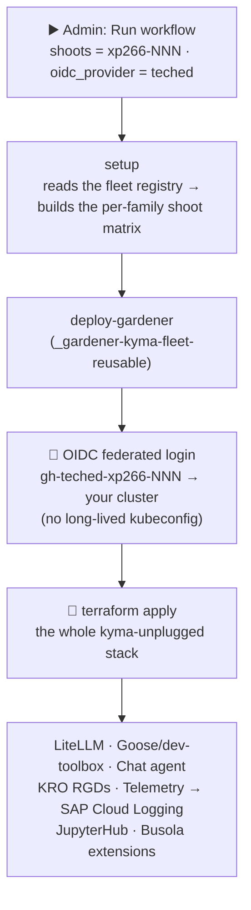

# Appendix 4 - The making of your runtime (Day-1 operations)

Throughout this workshop you were told *"everything is already deployed for you."* This appendix shows **how**.

> [!IMPORTANT]
> **Reference / instructor track — you don't run this.** The Day-1 provisioning pipeline lives in the SAP-internal fleet repository, **not** in your fork, so students can't run it. It's here as a **read-along** so you can see how your runtime was assembled.

A single GitHub Actions workflow — **`all-fleets-admin`** — provisions and reconciles the *entire* stack you've been exploring: the LiteLLM proxy, the Goose diagnostic jobs, the interactive chat agent, the KRO resource graphs, the telemetry pipelines, the dashboards, and JupyterHub.

It's `terraform apply` under the hood, so on an already-provisioned runtime it is an **idempotent reconcile** — it converges the cluster to the declared state; it does **not** tear anything down or rebuild it.

**Contents**

- ⚙️ [How it runs](#how-it-runs)
- 🔍 [Explore the steps](#explore-the-steps)

## How it runs

1. From the fleet repository's **Actions** tab, the **`all-fleets-admin`** workflow is dispatched with **Run workflow**.
 

2. In the left list of workflows, **`all-fleets-admin`** is selected, then **Run workflow** (top-right).
 

3. The inputs target a single runtime — only two change from their defaults:

   | Input | Set it to | Why |
   |---|---|---|
   | **`shoots`** | your **`xp266-NNN`** | target *your* runtime only |
   | **`oidc_provider`** | **`teched`** | mint the `gh-teched-xp266-NNN` OIDC token + use the public runner |
   | `idp` | *(leave default)* | `kyma4signavio` |
   | `kyma_version` | *(leave default)* | |
   | `namespace` | *(leave default)* | |

4. On dispatch, the run federates in (short-lived OIDC token) and reconciles the cluster — the live log shows every step.

> [!NOTE]
> **No secrets in your hands.** The workflow authenticates to your cluster with a short-lived **GitHub OIDC token** (`id-token: write`), federated as `gh-teched-<your-shoot>` — there is no kubeconfig or cloud credential to copy anywhere. This is the same upfront-federated-identity pattern that provisioned your runtime in the first place.

## Explore the steps

In the run's log, each job connects to what you learned:

1. **`setup` → "Build per-family shoot matrices"** — reads the fleet registry at runtime and works out that your `xp266-NNN` is a *gardener-teched* shoot, routing it to the Gardener reusable workflow. Open the **Fleet Reference** in the run **Summary** to see the whole fleet it *can* target.
 

2. **`deploy-gardener` → the OIDC login step** — watch it exchange the GitHub OIDC token for cluster access. No password, no stored kubeconfig.

3. **`deploy-gardener` → `terraform apply`** — this is the heart of it. Scroll the plan/apply output and spot the pieces you met:
   - the **`litellm-proxy`** Deployment + config ([Appendix 1](../1-llm-gateway/README.md))
   - the **`dev-toolbox`** CronJobs and `ClusterHealthReport` CRD ([Exercise 1](../../ex1/README.md))
   - the **KRO** ResourceGraphDefinitions that assemble the chat agent ([Exercise 2](../../ex2/README.md))
   - the **Telemetry** `MetricPipeline` to SAP Cloud Logging ([Exercise 3](../../ex3/README.md))
   - the **JupyterHub** release ([Exercise 4](../../ex4/README.md))

> [!TIP]
> On an already-provisioned runtime most resources report **no change** — that's the point of a declarative pipeline: the apply is a *reconcile*, so re-running is safe and mostly a no-op. If you tweaked something in an earlier exercise, watch `terraform` notice and converge it back.

> [!IMPORTANT]
> This is the "self-hosted AI ops" story end to end: **one workflow, one `terraform apply`, one federated identity** stands up an entire sandboxed AI-operations platform on SAP BTP, Kyma runtime — reproducibly, per student, with nothing hand-clicked. Everything else in this workshop was just exploring what this one run produced.

## Summary

You saw how the `all-fleets-admin` workflow federates in with a short-lived OIDC token and reconciles every component you played with — the declarative, reproducible pipeline behind the whole workshop.

---

🎉 **That's the workshop.**

You've met the whole self-hosted, sandboxed AI-ops stack — the LiteLLM gateway, the in-cluster agents, the autonomous diagnostic jobs, the interactive chat agent, the observability, the guardrails, the JupyterHub playground, and finally the one workflow that builds it all — running on **SAP BTP, Kyma runtime** and reasoning through **SAP AI Core**.

Now you know how the pieces fit, and how to reproduce and build on them.

> [!TIP]
> **Want to go one level deeper on isolation?** [Exercise 5](../../ex5/README.md) 🔧 *(advanced / instructor-demo)* runs the
> same tools image as a **runtime-isolated OpenShell `Sandbox`** with a contained LLM provider — the agent reasons
> through SAP AI Core while the egress guardrail physically denies the apiserver and the internet. It needs the
> `openshell` CLI + admin access, so it's an operator/instructor track — but it's the strongest containment tier in the stack.

Back to - [Overview](../../../README.md)
