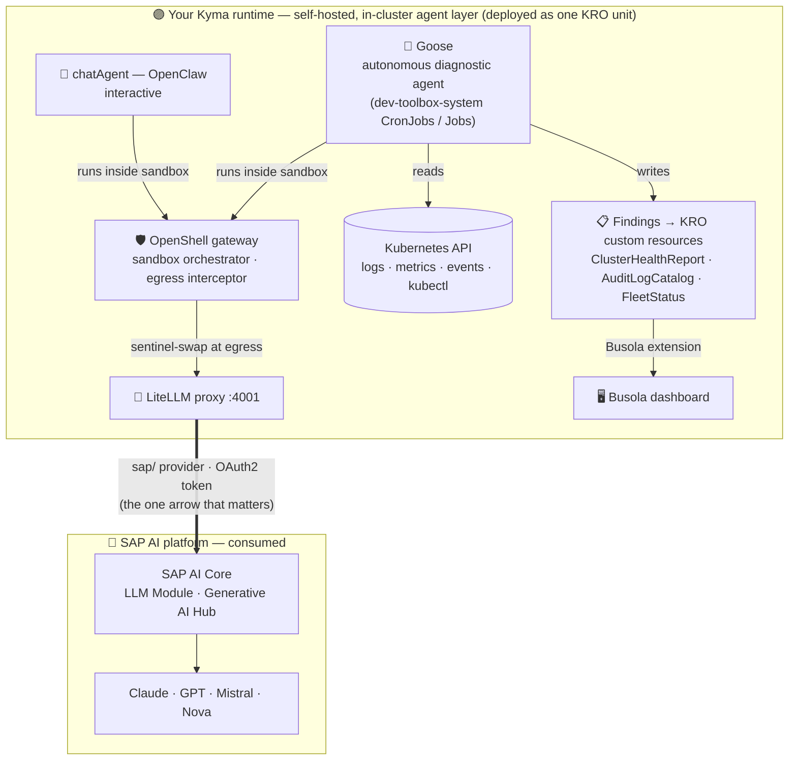
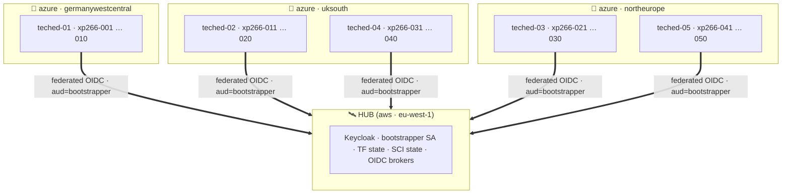

# Getting Started — access your Kyma runtime and tour the AI-ops stack

In this exercise you sign in to your **pre-provisioned** SAP BTP, Kyma runtime, get oriented in **Busola** (the Kyma dashboard), and take a quick tour of the AI operations stack that is **already running** for you.  
You will not deploy anything — everything is in place; you are here to understand it and play with it.

> [!NOTE]
> Each attendee has their own runtime named `xp266-NNN` (for example `xp266-011`). Wherever you see `xp266-NNN` below, use the number you were given.  
> Your Busola URL and sign-in details are handed out at the start of the session.

**Contents**

- 🧭 [Find your cluster and sign in to Busola](#exercise-01---find-your-cluster-and-sign-in-to-busola)
- 📦 [See what is already deployed](#exercise-02---see-what-is-already-deployed-optional)


## Exercise 0.1 - Find your cluster and sign in to Busola

Everything starts at the **Cluster Directory** — one launcher page for the whole TechEd fleet.  
From here you pick your runtime, read your sign-in details, and jump straight into the right dashboard.  
Open the directory URL you were given:

```
https://busola.xp266-NNN.<workshop-domain>/clusterdir/
```

<p float="left">
  
</p>

The page is organised top-to-bottom:

| Section | What it's for |
|---|---|
| **Navigate to your Kyma cluster** | Pick your runtime with the **selector** (top-right), e.g. `xp266-NNN`. The card shows your **User login** (`XP266-NNN`, `xp266-nnn@education.cloud.sap`) and the shared **Instructor login** (`XP266-000`) — plus two ways in (below). |
| **Cluster launchpad** | One-click deep-links into every endpoint for the selected cluster — Cluster Health, Fleet Status + Spend, Audit Log, Jobs, and the apps (dev-toolbox, LiteLLM Spend, JupyterHub, Chat agent). Follows the selector. |
| **LiteLLM spend** + **Appendix** | Today's spend, plus this cluster's raw access variants and the other fleet clusters — you can ignore these for now. |

**Two ways in:**

| Login | What it does | When to use |
|---|---|---|
| **Token-based** (`…-federated` / `…-sa-token`) | opens Busola already authenticated with a service-account / federated token — **no second sign-in** (you were already authenticated at the oauth2-proxy gateway) | **frictionless, recommended** — mirrors the headless, CI/CD-style access the automation uses |
| **OIDC** (`xp266-NNN` / `…-external`) | sign in to Busola **interactively** with your workshop identity | the full interactive login flow; **not** suited to headless / automated environments |

Now sign in:

1. In the **Navigate to your Kyma cluster** card, select your runtime and click the **Token-based login** entry `xp266-NNN-federated` — the frictionless path (or just open your Busola URL directly: `https://busola.xp266-NNN.<workshop-domain>/`).

2. The first dashboard you open this session takes you through the gateway (oauth2-proxy) to sign in with the workshop identity provider (single sign-on). After that you land directly on the Busola **Cluster Overview** for your runtime — the token-based entry needs no further Busola sign-in.
<br>

> [!NOTE]
> **How sign-in works.** Your runtime's dashboards all authenticate against one **Keycloak** realm, which *brokers*
> several corporate identity providers.  
> For TechEd the default is **SAP IAS** — enter your workshop account and you are
> straight in.  
> If you are an **SAP employee** (an `@sap.com` address), IAS automatically forwards you to **SAP corporate
> single sign-on** (with 2FA); the first time it quietly links that to your account, so you never see an "account already
> exists" prompt.  
> Either way you end up in the same Busola session — no passwords are stored by the workshop.

> [!TIP]
> The **Cluster Overview** shows one or more **banner cards** with handy shortcut **buttons** into the workshop features (dashboards, quick actions). If you dismiss a card, it **stays hidden in that browser**. To bring it back: open your browser's DevTools (**F12**) → **Application ▸ Local Storage** → your Busola site, delete the `hideBanner…` entry, and reload.

## Exercise 0.2 - See what is already deployed *(optional)*

Your runtime's **self-hosted, in-cluster agent layer** — the LiteLLM proxy, the Goose diagnostic jobs, the interactive chat agent, JupyterHub, the telemetry and spend pipeline — was deployed for you declaratively with **KRO** (Kubernetes Resource Orchestrator) as a single unit.  
Your agent **consumes** the SAP AI platform — it hosts no model itself.  
Every LLM call goes down to **SAP AI Core** (SAP's LLM Module / Generative AI Hub) and the generation comes back.  

```text
every LLM call  ──▶  LiteLLM proxy  ──▶  SAP AI Core  (Claude · GPT · Mistral · Nova)
```

You'll follow that **LiteLLM → SAP AI Core** arrow in the next exercise.



**Same picture, ASCII (for the terminal / plain-text reader):**

```
   ┌─ 🟣 Your Kyma runtime (xp266-NNN) ────────────────────────────────────────────┐
   │        self-hosted, in-cluster agent layer (deployed as one KRO unit)          │
   │                                                                                │
   │   ┌──────────────────────┐    reads logs/      ┌─────────────────────────┐    │
   │   │ 🪿 Goose             │ ◀── metrics/events ─│  Kubernetes API         │    │
   │   │ autonomous diagnostic│    (read-only       │  (your cluster's state) │    │
   │   │ (CronJobs / Jobs in  │     kubectl)        └─────────────────────────┘    │
   │   │  dev-toolbox-system) │                                                    │
   │   └──────┬──────┬────────┘                                                    │
   │          │      │ writes findings                                             │
   │          │      ▼                                                             │
   │          │  ┌───────────────────────────────────────────────────────────────┐ │
   │          │  │ 📋 KRO custom resources                                       │ │
   │          │  │     ClusterHealthReport · AuditLogCatalog · FleetStatus       │ │
   │          │  └──────┬────────────────────────────────────────────────────────┘ │
   │          │         │ Busola extension (one widget per CR type)                │
   │          │         ▼                                                          │
   │          │  ┌──────────────────────────────┐                                  │
   │          │  │ 🖥  Busola dashboard          │                                  │
   │          │  └──────────────────────────────┘                                  │
   │          │                                                                    │
   │          │ runs inside sandbox                                                │
   │          ▼                                                                    │
   │   ┌──────────────────────────────┐    ┌──────────────────────────────┐        │
   │   │ 🛡 OpenShell gateway          │◀───│ 💬 chatAgent (OpenClaw)       │        │
   │   │   sandbox orchestrator       │    │   interactive                 │        │
   │   │   egress interceptor         │    └──────────────────────────────┘        │
   │   └─────────────┬────────────────┘                                            │
   │                 │ sentinel-swap at egress                                     │
   │                 ▼                                                             │
   │   ┌──────────────────────────────┐                                            │
   │   │ 🔀 LiteLLM proxy  port 4001  │                                            │
   │   └─────────────┬────────────────┘                                            │
   └─────────────────┼────────────────────────────────────────────────────────────┘
                     │  sap/ provider · OAuth2 token
                     │  (the one arrow that matters)
                     ▼
   ┌─ 🔵 SAP AI platform — consumed ───────────────────────────────────────────────┐
   │                                                                                │
   │   ┌──────────────────────────────────────────────┐                             │
   │   │  SAP AI Core                                 │                             │
   │   │   LLM Module · Generative AI Hub             │                             │
   │   └────────────────────┬─────────────────────────┘                             │
   │                        ▼                                                       │
   │   ┌──────────────────────────────────────────────┐                             │
   │   │   Claude · GPT · Mistral · Nova              │                             │
   │   └──────────────────────────────────────────────┘                             │
   │                                                                                │
   └────────────────────────────────────────────────────────────────────────────────┘
```


> [!TIP]
> Want the full story behind this stack? Read the deep-dive on the SAP Community:
> [**Autonomous Diagnostics on Kyma Unplugged: Goose + LiteLLM + KRO + SAP AI Core in Production**](https://community.sap.com/t5/technology-blog-posts-by-sap/autonomous-diagnostics-on-kyma-unplugged-goose-litellm-kro-sap-ai-core-in/ba-p/14435287).

## The TechEd 2026 landscape at a glance

👉 Here is the whole fleet — one picture. Your `xp266-NNN` cluster is one of **50 student runtimes**, grouped into **5 shards of 10** across **3 Azure regions**, all **federated to a single hub** (on AWS, separate from the student runtimes) that holds the shared identity + state.

```
                 ┌────────────────────────────────────────────┐
                 │  🛰  HUB  ·  aws / eu-west-1                │
                 │                                            │
                 │    keycloak    SCI state     bootstrapper  │
                 │    TF state    OIDC brokers                │
                 └─────────────────────┬──────────────────────┘
                                       │  federated OIDC
                                       │  (aud=bootstrapper)
            ┌──────────────────────────┼──────────────────────────┐
            ▼                          ▼                          ▼
    ┌───────────────┐          ┌───────────────┐          ┌───────────────┐
    │   azure /     │          │   azure /     │          │   azure /     │
    │  germany-     │          │   uksouth     │          │ northeurope   │
    │  westcentral  │          │               │          │               │
    ├───────────────┤          ├───────────────┤          ├───────────────┤
    │  teched-01    │          │  teched-02    │          │  teched-03    │
    │  001–010      │          │  011–020      │          │  021–030      │
    │               │          ├───────────────┤          ├───────────────┤
    │  (10 shoots)  │          │  teched-04    │          │  teched-05    │
    │               │          │  031–040      │          │  041–050      │
    │               │          │  (20 shoots)  │          │  (20 shoots)  │
    └───────────────┘          └───────────────┘          └───────────────┘
       10 students                20 students                20 students
```

**Same picture, Mermaid-rendered:**



**What that means in practice:**

| | |
|---|---|
| 🧭 **Where you are** | Your `xp266-NNN` lives in exactly one shard (the shard = `(NNN-1) / 10 + 1`). Your shard-mates share your Azure region. |
| 🔐 **Who vouches for you** | Your runtime trusts the hub's identity (`OpenIDConnect` CR `quovadis-federated`). The automation (CI, Goose, the dev-toolbox jobs) authenticates via a short-lived token minted on the hub — no cloud credential lives on your runtime. |
| 🗺️ **Where the shared state lives** | A few things are hub-wide (the Keycloak realm config, the SCI integration state, the Terraform state secrets). Your runtime reads them on demand; it never writes to the hub. |
| 🧘 **Why cross-cloud** | The hub runs on an SAP-managed AWS Kyma shoot (purpose-built for control-plane work). The student runtimes run on Azure where the workshop capacity is pre-provisioned. Only control-plane calls cross — your student traffic (Busola, dev-toolbox, JupyterHub) stays on Azure. |

> [!NOTE]
> You never interact with the hub directly in this workshop. Everything you do — Busola, dev-toolbox, chat agent, JupyterHub — happens on your own `xp266-NNN` runtime. The hub shows up only as the identity provider that signs you in. If you're curious about the full architecture (hub-side TF state model, trust direction, rollout mechanics), the SRE/architect view lives in the parent repo's `docs/teched2026-landscape-arch.md`.

---

## Summary

You signed in to your Kyma runtime in Busola, met the pre-deployed AI-ops stack (LiteLLM, Goose, the interactive chat agent, JupyterHub, and the KRO custom resources), and saw where it fits in the SAP AI landscape.  
Continue to - [Exercise 1 - Trigger and shape the Cluster Health Reports](../ex1/README.md)
