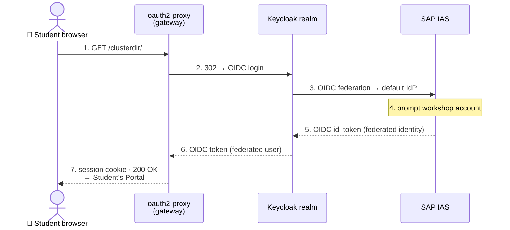
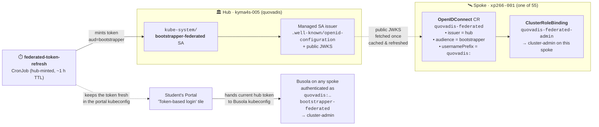
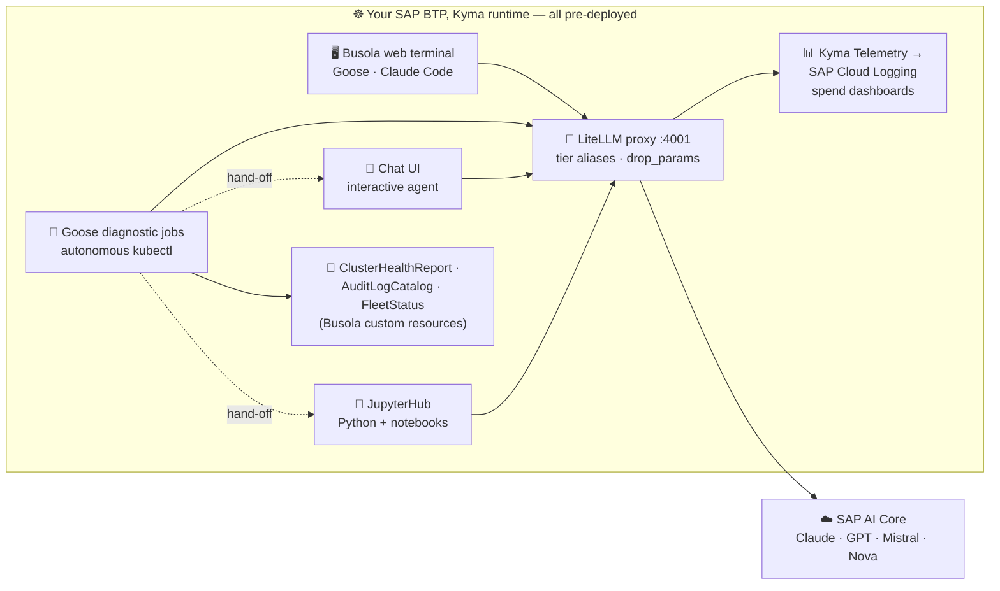
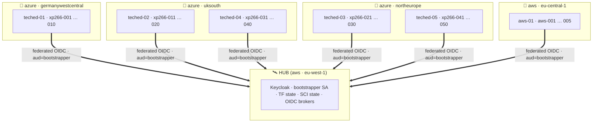

# Getting Started — access your Kyma runtime and tour the AI-ops stack

> ⏱ **~10 min** (host-led introduction — no hands-on needed)

In this exercise:

- 🔐 **Sign in** to your **pre-provisioned** SAP BTP, Kyma runtime.
- 🧭 **Get oriented** in the **Student's Portal** and in **Busola** (the Kyma dashboard).
- 🤖 **Tour the AI-ops stack** that's **already running** for you.
- 🛠️ **No deploys** — everything is in place; you're here to **understand it** and **play with it**.

> [!NOTE]
> Each attendee has their own runtime named `xp266-NNN` (for example `xp266-011`).  
> Wherever you see `xp266-NNN` below, use the number you were given.
>
> 👉 The sign-in details are handed out at the start of the session.

**Contents**

- 🧭 [Sign in to Student's Portal and find your cluster](#-exercise-01---sign-in-to-students-portal-and-find-your-cluster)
- 📦 [See what is already deployed](#-exercise-02---see-what-is-already-deployed-optional)
- 🗺️ [The TechEd 2026 landscape at a glance](#️-exercise-03---the-teched-2026-landscape-at-a-glance-optional)


## 🧭 Exercise 0.1 - Sign in to Student's Portal and find your cluster

- ✅ Everything starts at the **Student's Portal** — one launcher page for the whole TechEd fleet.  
- ✅ From here you pick your runtime or jump straight into the right dashboard.  

👉 Open the student's portal directly or look up its shortened URL:

```
https://busola.xp266-NNN.<tenant>.kyma.dev.sap/clusterdir/
```


<details>
<summary>🎓 <b>Student Portal — short URL per cluster</b> (click to expand)</summary>

<table>
<tr>
<td valign="top">

#### 🔵 🇪🇺 teched-01

🏛️ **[Subaccount cockpit](https://url.sap/46qi70)**

| ☸️ Cluster |
|---|
| [**xp266-001**](https://url.sap/wx372e) |
| [**xp266-002**](https://url.sap/cdt0no) |
| [**xp266-003**](https://url.sap/70yrhh) |
| [**xp266-004**](https://url.sap/1178ld) |
| [**xp266-005**](https://url.sap/x12wf9) |
| [**xp266-006**](https://url.sap/mg3g9t) |
| [**xp266-007**](https://url.sap/58bm4n) |
| [**xp266-008**](https://url.sap/9ftlmk) |
| [**xp266-009**](https://url.sap/nx2tmc) |
| [**xp266-010**](https://url.sap/nk6cp2) |

</td>
<td valign="top">

#### 🔵 🇪🇺 teched-02

🏛️ **[Subaccount cockpit](https://url.sap/asldty)**

| ☸️ Cluster |
|---|
| [**xp266-011**](https://url.sap/6wxoxe) |
| [**xp266-012**](https://url.sap/h4yo05) |
| [**xp266-013**](https://url.sap/0ipmxl) |
| [**xp266-014**](https://url.sap/218lah) |
| [**xp266-015**](https://url.sap/7puiqf) |
| [**xp266-016**](https://url.sap/tj7mqs) |
| [**xp266-017**](https://url.sap/c9ccp7) |
| [**xp266-018**](https://url.sap/c9ewnq) |
| [**xp266-019**](https://url.sap/06p3my) |
| [**xp266-020**](https://url.sap/fxgof1) |

</td>
<td valign="top">

#### 🔵 🇪🇺 teched-03

🏛️ **[Subaccount cockpit](https://url.sap/aiirmx)**

| ☸️ Cluster |
|---|
| [**xp266-021**](https://url.sap/uhc55w) |
| [**xp266-022**](https://url.sap/k36s63) |
| [**xp266-023**](https://url.sap/a5gk5c) |
| [**xp266-024**](https://url.sap/5cxgeo) |
| [**xp266-025**](https://url.sap/hsyaqi) |
| [**xp266-026**](https://url.sap/pgpyn0) |
| [**xp266-027**](https://url.sap/62io1a) |
| [**xp266-028**](https://url.sap/b09h01) |
| [**xp266-029**](https://url.sap/pjcc8r) |
| [**xp266-030**](https://url.sap/a0yj4u) |

</td>
</tr>
<tr>
<td valign="top">

#### 🔵 🇪🇺 teched-04

🏛️ **[Subaccount cockpit](https://url.sap/t7s0ys)**

| ☸️ Cluster |
|---|
| [**xp266-031**](https://url.sap/k1mdm6) |
| [**xp266-032**](https://url.sap/xn841o) |
| [**xp266-033**](https://url.sap/4pxp1o) |
| [**xp266-034**](https://url.sap/wmprmr) |
| [**xp266-035**](https://url.sap/we7aqy) |
| [**xp266-036**](https://url.sap/i6l8j7) |
| [**xp266-037**](https://url.sap/ipar37) |
| [**xp266-038**](https://url.sap/fory6n) |
| [**xp266-039**](https://url.sap/ytjp23) |
| [**xp266-040**](https://url.sap/fe40xx) |

</td>
<td valign="top">

#### 🔵 🇪🇺 teched-05

🏛️ **[Subaccount cockpit](https://url.sap/m299wr)**

| ☸️ Cluster |
|---|
| [**xp266-041**](https://url.sap/hjkb45) |
| [**xp266-042**](https://url.sap/45ym3f) |
| [**xp266-043**](https://url.sap/c6aqhc) |
| [**xp266-044**](https://url.sap/9gyahu) |
| [**xp266-045**](https://url.sap/pt362d) |
| [**xp266-046**](https://url.sap/wxn38h) |
| [**xp266-047**](https://url.sap/mn9e0g) |
| [**xp266-048**](https://url.sap/lbh1i4) |
| [**xp266-049**](https://url.sap/ow820u) |
| [**xp266-050**](https://url.sap/ev92nj) |

</td>
<td valign="top">

#### 🟠 🇺🇸 aws-01

🏛️ **[Subaccount cockpit](https://url.sap/vy7cta)**

| ☸️ Cluster |
|---|
| [**aws-001**](https://url.sap/rtkjd0) |
| [**aws-002**](https://url.sap/etla09) |
| [**aws-003**](https://url.sap/v98stq) |
| [**aws-004**](https://url.sap/q8lj00) |
| [**aws-005**](https://url.sap/myamyu) |

</td>
</tr>
</table>

</details>

> [!NOTE]
> The **Student's Portal** is behind the gateway (oauth2-proxy), so the first time you open it this session you'll go through the workshop identity provider (single sign-on).
>
> - ✅ After that you're authenticated for the whole session — from the **Navigate to your Kyma cluster** card, pick your runtime and click the **Token-based login** entry `xp266-NNN-federated`.
> - ✅ Busola opens **already signed in**, landing on the **Cluster Overview** for your runtime.

<table style="width: 100%; border-collapse: collapse; background-color: #f5f5f5;" border="1">
<tbody>
<tr>
<td align="center" width="50%"><a href="https://github.com/SAP-samples/teched2026-XP266/actions/workflows/all-fleets-student-dashboard.yaml"></a><br/><sub><b>1.</b> Student's Portal — pick your runtime <em>(click the image to open the <code>all-fleets-student-dashboard</code> workflow)</em></sub></td>
<td align="center" width="50%"><br/><sub><b>2.</b> Busola — Cluster Overview, already signed in</sub></td>
</tr>
</tbody>
</table>

The **Student's Portal** main menu is organised top-to-bottom:

| Section | What it's for |
|---|---|
| 🧭 **Navigate to your Kyma cluster** | Pick your runtime with the **selector** (top-right), e.g. `xp266-NNN`. The card shows your **User login** (`XP266-NNN`, `xp266-nnn@education.cloud.sap`) and the shared **Instructor login** (`XP266-000`) — plus two ways in (below). |
| 🚀 **Cluster launchpad** | One-click deep-links into every endpoint for the selected cluster — **Cluster Health Report** (v2/v3/Forensic/Audit), **Fleet Status + Spend**, **Audit Log**, **Jobs**, and the apps (**Diagnostic Tools**, **LiteLLM Spend**, **JupyterHub**, **Chat agent (OpenClaw)**). |
| 🩺 **Cluster Health** | Fleet-wide view of the latest **Cluster Health Report** per cluster (the autonomous Goose output you'll meet in Exercise 1) — HEALTHY / WARNING / CRITICAL at a glance across all 50 runtimes. |
| 🧩 **Modules Health** | Fleet-wide Kyma module versions + state (Istio, API Gateway, Serverless, Telemetry, …). |
| 🖥️ **Busola Web Terminal** | Quick-launch deep-link into the in-cluster web terminal — the pod with pre-installed `goose` / `claude` / `kubectl` / `kyma`. |
| 💰 **LiteLLM spend** | Today's SAP AI Core spend for your runtime, inline (model + caller breakdown). Full dashboards one click away (SAP Cloud Logging). You'll explore this in Exercise 6. |


> [!TIP]
> **Busola** (the Kyma dashboard) may show one or more **banner cards** with handy shortcut **buttons** into the workshop features (dashboards, quick actions).
>
> - If you dismiss a card, it **stays hidden in that browser**.
> - To bring it back: open your browser's DevTools (**F12**) → **Application ▸ Local Storage** → your Busola site, delete the `hideBanner…` entry, and reload.

<details>
<summary>🔐 <b>How sign-in works</b> — click to expand</summary>

Two ways to open **Busola** — same cluster, different identity, different privileges. One table covers how you sign in, who you are on the shoot, and what you can do:

| Login (tile) | How you're authenticated | Who you are on the shoot | What you can do |
|---|---|---|---|
| 🎫 **Token-based** (recommended) | **Hub-minted federated SA token** · no browser · same path the automation uses | `quovadis:…bootstrapper-federated` | **`cluster-admin`** — full write access via `quovadis-federated-admin` CRB |
| 🪪 **OIDC-based** | Interactive **OIDC login** → Keycloak realm → brokered to **SAP IAS** (workshop IdP) | `keycloak:<your-user>` | **`view`** — read-only, safe for workshop browsing; **not** suited to headless / automated environments |

> The two paths produce **two distinct identities** on the same cluster; the shoot's **ClusterRoleBindings** decide the privilege level — not the sign-in flow itself. The two subsections below show each path end-to-end.

**1. You sign in (oauth2-proxy → Keycloak → federated IdP)**

Any `/clusterdir/` hit **always** goes through this chain — the user is **resolved via federation** every time; there is no non-federated route. **End-to-end OIDC** — no SAML anywhere in the path.



**2. Busola rides a federated SA token (hub-and-spokes)**

- 🚫 The **55 TechEd runtimes don't each manage their own admin user identity** for Busola.
- 🏛️ Instead, **one hub** mints a **short-lived ServiceAccount token**.
- 🛰️ **Every spoke pre-trusts the hub** via a Kubernetes **`OpenIDConnect`** authenticator + **`ClusterRoleBinding`**.
- ✨ **One identity, 55 spokes.**



- **Hub** signs the token (SA on `kyma4s-005`); the SA issuer is a public URL (`.well-known` + JWKS)
- **Each spoke** has, applied once at provisioning: an **`OpenIDConnect`** CR that trusts the hub issuer + audience, and a **`ClusterRoleBinding`** that maps the resulting username (`quovadis:…`) to **`cluster-admin`**
- The hub's **`federated-token-refresh` CronJob** keeps the ~1 h token fresh in the kubeconfig the portal hands to Busola — so **you never see the refresh**
- Click the **Token-based login** tile → Busola opens on your spoke, already authenticated, no second prompt. The OIDC-based tile exists for interactive comparison but the token path is the recommended default.

</details>

## 📦 Exercise 0.2 - See what is already deployed *(optional)*

Your runtime's **self-hosted, in-cluster agent layer** is composed of:
- ✅ a LiteLLM proxy, 
- ✅ Goose diagnostic jobs, 
- ✅ an interactive chat agent, 
- ✅ a JupyterHub Openshell Playground, 
- ✅ the telemetry and spend pipeline  

Your agent **consumes** the SAP BAIP platform AICore services — it hosts no model itself.  


<table style="width: 100%; border-collapse: collapse; background-color: #f5f5f5;" border="1">
<tbody>
<tr style="height: 193px;">
<td style="width: 71.6%; height: 193px;">

<div>

Every LLM call goes down to **SAP AI Core** (SAP's LLM Module / Generative AI Hub) and the generation comes back.  


<details>
<summary>👉 Click to expand the AI-ops stack diagram</summary>



</details>

</div>
</td>
</tr>
</tbody>
</table>


```text
every LLM call  ──▶  LiteLLM proxy  ──▶  SAP AI Core  (Claude · GPT · Mistral · Nova)
```

The next exercise walks the **LiteLLM → SAP AI Core** hop end-to-end.


> [!TIP]
> Want the full story behind this stack? Read the deep-dive on the SAP Community:
> [**Autonomous Diagnostics on Kyma Unplugged: Goose + LiteLLM + KRO + SAP AI Core in Production**](https://community.sap.com/t5/technology-blog-posts-by-sap/autonomous-diagnostics-on-kyma-unplugged-goose-litellm-kro-sap-ai-core-in/ba-p/14435287).

## 🗺️ Exercise 0.3 - The TechEd 2026 landscape at a glance *(optional)*


<table style="width: 100%; border-collapse: collapse; background-color: #f5f5f5;" border="1">
<tbody>
<tr style="height: 193px;">
<td style="width: 71.6%; height: 193px;">

<div>

- ✅ Here is the whole fleet — one picture.  
- ✅ Your `xp266-NNN` cluster is one of **50 student runtimes**, grouped into **5 shards of 10** across **3 Azure regions** — plus **one AWS shard** (`aws-001 … 005`) in `eu-central-1`.

<details>
<summary>👉 Click to expand the fleet topology diagram</summary>



</details>

</div>
</td>
</tr>
</tbody>
</table>

**What that means in practice:**  

| | |
|---|---|
| 🧭 **Where you are** | Your `xp266-NNN` lives in exactly one shard.  |
| 🔐 **Who vouches for you** | Your runtime trusts the hub's identity (`OpenIDConnect` CR `quovadis-federated`). The automation (CI, Goose, the Cluster Health cronjobs) authenticates via a short-lived token minted on the hub — no cloud credential lives on your runtime. |
| 🗺️ **Where the shared state lives** | A few things are hub-wide (the Keycloak realm config, the SCI integration state, the Terraform state secrets). Your runtime reads them on demand; it never writes to the hub. |
| 🧘 **Why cross-cloud** | The hub runs on an SAP-managed AWS Kyma shoot (purpose-built for control-plane work). The student runtimes run on Azure where the workshop capacity is pre-provisioned. Only control-plane calls cross — your student traffic (Busola, Cluster Health, JupyterHub) stays on Azure. |

> [!NOTE]
> 👉 You never interact with the hub directly in this workshop.  
> 👉 Everything you do — happens on your own `xp266-NNN` spoke.  
> 👉 The hub shows up only as the identity provider that signs you in.

---

## Summary

🧭 You signed in to the **Student's Portal** and landed in **Busola** on your `xp266-NNN` runtime,

- 📦 met the pre-deployed **AI-ops stack** — LiteLLM proxy, Goose diagnostic jobs, the interactive chat agent, JupyterHub, and the KRO custom resources,
- 🗺️ and saw where it fits in the **TechEd 2026 landscape** — one of 50 spokes trusting the central hub.

### 🗺️ All mermaid diagrams across the workshop

A quick cross-reference — every architecture diagram, grouped by exercise. Each entry jumps to the section; where the diagram sits inside a `<details>` collapsible, click to expand once the section opens.

| Exercise | Diagram | Jump to |
|---|---|---|
| **Ex 0 — orientation** | 🔐 OIDC sign-in sequence (oauth2-proxy → Keycloak → SAP IAS) | [§0.1](#-exercise-01---sign-in-to-students-portal-and-find-your-cluster) |
| | 🏛️ Hub-and-spokes federation (SA token across 55 spokes) | [§0.1](#-exercise-01---sign-in-to-students-portal-and-find-your-cluster) |
| | 📦 AI-ops stack diagram (what's pre-deployed) | [§0.2](#-exercise-02---see-what-is-already-deployed-optional) |
| | 🗺️ Fleet topology (50 spokes · 5 Azure shards + 1 AWS shard · hub) | [§0.3](#️-exercise-03---the-teched-2026-landscape-at-a-glance-optional) |
| **Ex 1 — Diagnostic Toolbox** | 📸 **v1** job (snapshot path) | [ex1 §1 report-generations](../ex1/README.md#️-the-three-report-generations-plus-security-audit-and-forensic-reports) |
| | 🩺 **v2 + audit** (one pod, two sidecars) | [ex1 §1 report-generations](../ex1/README.md#️-the-three-report-generations-plus-security-audit-and-forensic-reports) |
| | 🔬 **v3** (one container, custom prompts, uncapped) | [ex1 §1 report-generations](../ex1/README.md#️-the-three-report-generations-plus-security-audit-and-forensic-reports) |
| | 🔎 **forensic** (post-mortem) | [ex1 §1 report-generations](../ex1/README.md#️-the-three-report-generations-plus-security-audit-and-forensic-reports) |
| **Ex 2 — chat hand-off** | 🔄 Autonomous Jobs write; interactive agent reads (producer-consumer) | [ex2 §2.2](../ex2/README.md#-exercise-22---the-hand-off-ask-about-your-clusters-diagnosis) |
| **Ex 3 — notebooks** | 📦 Family 1 · sandbox lifecycle (`04` / `04b`) | [ex3 §3.2](../ex3/README.md#-exercise-32---openshell-notebooks) |
| | 🪿 Family 2 · adaptive investigators (`05` / `05b` / `05c`) | [ex3 §3.2](../ex3/README.md#-exercise-32---openshell-notebooks) |
| | 🪿 Family 3 · forensic sniffers (`06` / `07`) | [ex3 §3.2](../ex3/README.md#-exercise-32---openshell-notebooks) |
| **Ex 4 — OpenShell** | 🖼️ OpenShell concept diagram (gateway, sandbox, provider, profile) | [ex4 §4.2](../ex4/README.md#-42---introducing-openshell-concepts-providers-and-profiles) |
| **Ex 5 — external agents** | ▶️ Agent run against a free OpenRouter model | [ex5 §5.3](../ex5/README.md#️-53---run-an-agent-against-a-free-model) |
| **Appendix 1 — LLM gateway** | 🧱 LiteLLM proxy architecture | [App 1.1](../Appendices/1-llm-gateway/README.md#appendix-11---understand-the-proxy) |

> [!NOTE]
> ⏱ **How to pace the next 110 minutes.** The workshop is 2 h total: ~10 min here (host-led intro) + ~110 min across ex1–ex6. Recommended split, in order of load:
>
> | Exercise | Suggested time | Role |
> |---|---|---|
> | [🚦 **Appendix 0** — Fork this repo & enable GitHub Actions](../Appendices/0-fork-this-repo/) | **~2 min** | *prerequisite* for ex4a / ex5a GHA runs — can be done while host introduces ex0 |
> | [📋 **ex1** — Cluster Health Reports](../ex1/) | **~30 min** | heart of the workshop — real Goose run + custom prompt |
> | [💬 **ex2** — Interactive chat agent](../ex2/) | **~12 min** | the hand-off: two prompts, mostly reading |
> | [📒 **ex3** — JupyterHub + OpenShell notebooks](../ex3/) | **~20 min** | run **one** notebook end-to-end; peek at the others |
> | [🛠️ **ex4** — OpenShell practice with Kyma](../ex4/) | **~20 min** | 4a easy path (GHA) + 2–3 probes from 4b |
> | [🤖 **ex5** — External agents (OpenRouter)](../ex5/) | **~18 min** | 5a easy path + KRO draft via Busola |
> | [📊 **ex6** — Observability & spend](../ex6/) | **~10 min** | two clicks; 6.3 telemetry is optional |
>
> **Finished early?** Dive into the ✅ *optional* / collapsible sections (ex1.4 "Prove it yourself", ex6 "math behind the dashboards", ex6.3 telemetry path, extra notebooks in ex3).  
> **Running late?** Trim ex3 to one notebook, skip ex5, and defer ex6.3 — **ex1 + ex2 + ex4 are the critical path**.

Continue to - [Exercise 1 - Trigger and shape the Cluster Health Reports](../ex1/README.md)
