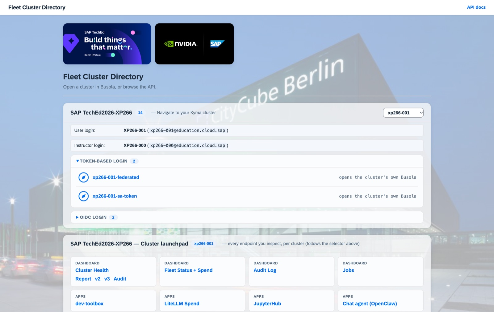
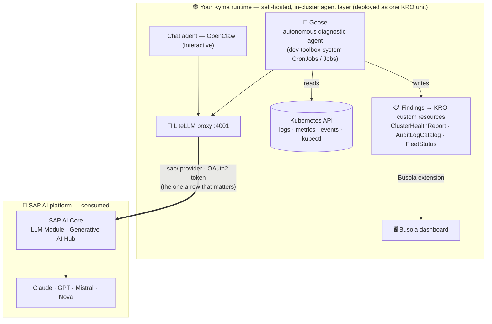

# Getting Started — access your Kyma runtime and tour the AI-ops stack

In this exercise you sign in to your **pre-provisioned** SAP BTP, Kyma runtime, get oriented in **Busola** (the Kyma dashboard), and take a quick tour of the AI operations stack that is **already running** for you.

You will not deploy anything — everything is in place; you are here to understand it and play with it.

> [!NOTE]
> Each attendee has their own runtime named `xp266-NNN` (for example `xp266-011`). Wherever you see `xp266-NNN` below, use the number you were given. Your Busola URL and sign-in details are handed out at the start of the session.

## Exercise 0.1 - Find your cluster and sign in to Busola

Everything starts at the **Cluster Directory** — one launcher page for the whole TechEd fleet.

From here you pick your runtime, read your sign-in details, and jump straight into the right dashboard.

Open the directory URL you were given:

```
https://busola.xp266-NNN.<workshop-domain>/clusterdir/
```

<p float="left">
  
</p>

The page is organised top-to-bottom:

- **SAP TechEd2026-XP266 — Navigate to your Kyma cluster.** Pick your runtime with the **selector** (top right), e.g. `xp266-NNN`. The card then shows your **User login** (`XP266-NNN`, `xp266-nnn@education.cloud.sap`) and the shared **Instructor login** (`XP266-000`), plus two ways in:
  - **Token-based login** — `…-federated` / `…-sa-token`: open Busola already authenticated with a service-account / federated token — **no second sign-in**, because you were already authenticated at the gateway (oauth2-proxy). This is the **frictionless, recommended path for the workshop**, and it mirrors the **headless, CI/CD-style** access that the automation uses.
  - **OIDC login** — `xp266-NNN` (and `…-external`): sign in to Busola **interactively** with your workshop identity. Use this when you want the full interactive login flow; it is **not** suited to headless / automated environments.
- **Cluster launchpad** — one-click deep-links into every endpoint you'll inspect for the selected cluster (Cluster Health, Fleet Status + Spend, Audit Log, Jobs, and the apps — dev-toolbox, LiteLLM Spend, JupyterHub, the Chat agent). It follows the selector.
- **LiteLLM spend** and an **Appendix** (this cluster's raw access variants + the other fleet clusters) round out the page — you can ignore these for now.

Now sign in:

1. In the **Navigate to your Kyma cluster** card, select your runtime and click the **Token-based login** entry `xp266-NNN-federated` — the frictionless path (or just open your Busola URL directly: `https://busola.xp266-NNN.<workshop-domain>/`).

2. The first dashboard you open this session takes you through the gateway (oauth2-proxy) to sign in with the workshop identity provider (single sign-on). After that you land directly on the Busola **Cluster Overview** for your runtime — the token-based entry needs no further Busola sign-in.
<br>

> [!NOTE]
> **How sign-in works.** Your runtime's dashboards all authenticate against one **Keycloak** realm, which *brokers*
> several corporate identity providers. For TechEd the default is **SAP IAS** — enter your workshop account and you are
> straight in. If you are an **SAP employee** (an `@sap.com` address), IAS automatically forwards you to **SAP corporate
> single sign-on** (with 2FA); the first time it quietly links that to your account, so you never see an "account already
> exists" prompt. Either way you end up in the same Busola session — no passwords are stored by the workshop.

> [!TIP]
> The **Cluster Overview** shows one or more **banner cards** with handy shortcut **buttons** into the workshop features (dashboards, quick actions). If you dismiss a card, it **stays hidden in that browser**. To bring it back: open your browser's DevTools (**F12**) → **Application ▸ Local Storage** → your Busola site, delete the `hideBanner…` entry, and reload.

## Exercise 0.2 - See what is already deployed *(optional)*

Your runtime's **self-hosted, in-cluster agent layer** — the LiteLLM proxy, the Goose diagnostic jobs, the interactive chat agent, JupyterHub, the telemetry and spend pipeline — was deployed for you declaratively with **KRO** (Kubernetes Resource Orchestrator) as a single unit.  
Your agent **consumes** the SAP AI platform — it hosts no model itself.  
Every LLM call goes down to **SAP AI Core** (SAP's LLM Module / Generative AI Hub) and the generation comes back.  



```text
every LLM call  ──▶  LiteLLM proxy  ──▶  SAP AI Core  (Claude · GPT · Mistral · Nova)
```

You'll follow that **LiteLLM → SAP AI Core** arrow in the next exercise.

> [!TIP]
> Want the full story behind this stack? Read the deep-dive on the SAP Community:
> [**Autonomous Diagnostics on Kyma Unplugged: Goose + LiteLLM + KRO + SAP AI Core in Production**](https://community.sap.com/t5/technology-blog-posts-by-sap/autonomous-diagnostics-on-kyma-unplugged-goose-litellm-kro-sap-ai-core-in/ba-p/14435287).

## Summary

You signed in to your Kyma runtime in Busola, met the pre-deployed AI-ops stack (LiteLLM, Goose, the interactive chat agent, JupyterHub, and the KRO custom resources), and saw where it fits in the SAP AI landscape.

Continue to - [Exercise 1 - The LLM gateway: LiteLLM and SAP AI Core](../ex1/README.md)
