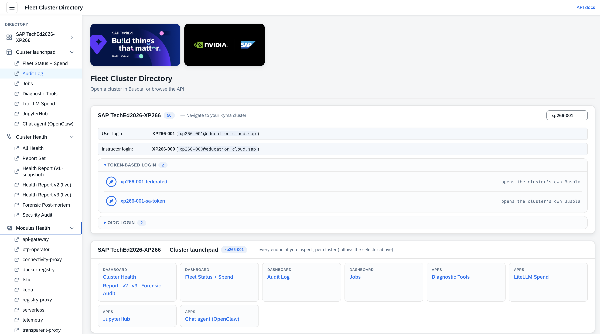
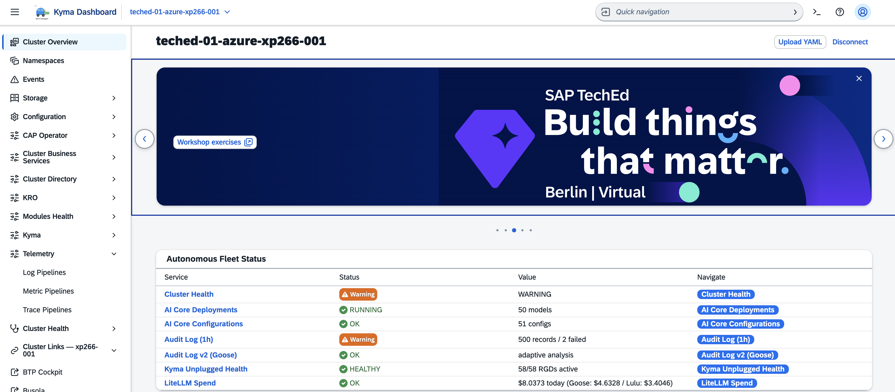
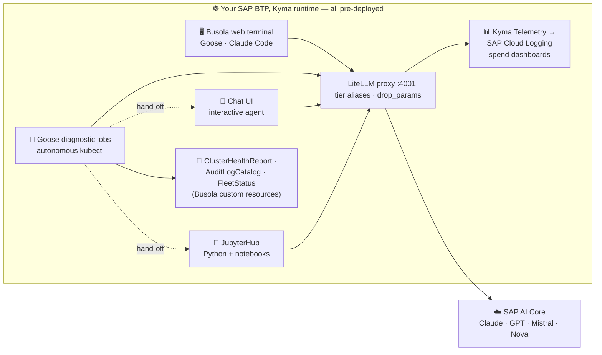
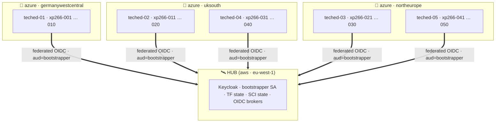

# Getting Started — access your Kyma runtime and tour the AI-ops stack

> ⏱ **~10 min** (host-led introduction — no hands-on needed)

In this exercise you sign in to your **pre-provisioned** SAP BTP, Kyma runtime, get oriented in the **Student's Portal** and in **Busola** (the Kyma dashboard), and take a quick tour of the AI operations stack that is **already running** for you.  
You will not deploy anything — everything is in place; you are here to understand it and play with it.

> [!NOTE]
> Each attendee has their own runtime named `xp266-NNN` (for example `xp266-011`).  
> Wherever you see `xp266-NNN` below, use the number you were given.  
> Your **Student's Portal** URL and sign-in details are handed out at the start of the session.

**Contents**

- 🧭 [Sign in to Student's Portal and find your cluster](#exercise-01---sign-in-to-students-portal-and-find-your-cluster)
- 📦 [See what is already deployed](#exercise-02---see-what-is-already-deployed-optional)


## 🧭 Exercise 0.1 - Sign in to Student's Portal and find your cluster

- ✅ Everything starts at the **Student's Portal** — one launcher page for the whole TechEd fleet.  
- ✅ From here you pick your runtime or jump straight into the right dashboard.  

👉 Open the student's portal:

```
https://busola.xp266-NNN.<workshop-domain>/clusterdir/
```

> [!NOTE]
> The **Student's Portal** is behind the gateway (oauth2-proxy), so the first time you open it this session you'll go through the workshop identity provider (single sign-on).
>
> - ✅ After that you're authenticated for the whole session — from the **Navigate to your Kyma cluster** card, pick your runtime and click the **Token-based login** entry `xp266-NNN-federated`.
> - ✅ Busola opens **already signed in**, landing on the **Cluster Overview** for your runtime.

<table style="width: 100%; border-collapse: collapse; background-color: #f5f5f5;" border="1">
<tbody>
<tr>
<td align="center" width="50%"><br/><sub><b>1.</b> Student's Portal — pick your runtime</sub></td>
<td align="center" width="50%"><br/><sub><b>2.</b> Busola — Cluster Overview, already signed in</sub></td>
</tr>
</tbody>
</table>

The **Student's Portal** main menu is organised top-to-bottom:

| Section | What it's for |
|---|---|
| 🧭 **Navigate to your Kyma cluster** | Pick your runtime with the **selector** (top-right), e.g. `xp266-NNN`. The card shows your **User login** (`XP266-NNN`, `xp266-nnn@education.cloud.sap`) and the shared **Instructor login** (`XP266-000`) — plus two ways in (below). |
| 🚀 **Cluster launchpad** | One-click deep-links into every endpoint for the selected cluster — **Cluster Health Report** (v2/v3/Forensic/Audit), **Fleet Status + Spend**, **Audit Log**, **Jobs**, and the apps (**Diagnostic Tools**, **LiteLLM Spend**, **JupyterHub**, **Chat agent (OpenClaw)**). |
| 🩺 **Cluster Health** | Fleet-wide view of the latest **Cluster Health Report** per cluster (the autonomous Goose output you'll meet in Exercise 1) — HEALTHY / WARNING / CRITICAL at a glance across all 50 runtimes. |
| 🧩 **Modules Health** | Fleet-wide Kyma module versions + state (Istio, API Gateway, Serverless, Telemetry, …). |
| 🖥️ **Busola Web Terminal** | Quick-launch deep-link into the in-cluster web terminal — the pod with pre-installed `goose` / `claude` / `kubectl` / `kyma`. |
| 💰 **LiteLLM spend** | Today's SAP AI Core spend for your runtime, inline (model + caller breakdown). Full dashboards one click away (SAP Cloud Logging). You'll explore this in Exercise 6. |

**Two ways in:**

| Login | What it does | When to use |
|---|---|---|
| **Token-based** | opens Busola already authenticated with a service-account / federated token | **frictionless, recommended** — mirrors the headless, CI/CD-style access the automation uses |
| **OIDC-based** | sign in to Busola **interactively** with your workshop identity | the full interactive login flow; **not** suited to headless / automated environments |

> [!NOTE]
> **How sign-in works.** Your runtime's dashboards all authenticate against one **Keycloak** realm, which *brokers*
> several corporate identity providers.  
> For TechEd students the default is **SAP IAS** — enter your workshop account and you are
> straight in. 


> [!TIP]
> **Busola** (the Kyma dashboard) may show one or more **banner cards** with handy shortcut **buttons** into the workshop features (dashboards, quick actions).
>
> - If you dismiss a card, it **stays hidden in that browser**.
> - To bring it back: open your browser's DevTools (**F12**) → **Application ▸ Local Storage** → your Busola site, delete the `hideBanner…` entry, and reload.

## 📦 Exercise 0.2 - See what is already deployed *(optional)*

Your runtime's **self-hosted, in-cluster agent layer** is composed of:
- ✅ a LiteLLM proxy, 
- ✅ Goose diagnostic jobs, 
- ✅ an interactive chat agent, 
- ✅ a JupyterHub Openshell Playground, 
- ✅ the telemetry and spend pipeline  

Your agent **consumes** the SAP BAIP platform AICore services — it hosts no model itself.  


<table style="width: 100%; border-collapse: collapse; background-color: #f5f5f5;" border="1">
<tbody>
<tr style="height: 193px;">
<td style="width: 71.6%; height: 193px;">

<div>

Every LLM call goes down to **SAP AI Core** (SAP's LLM Module / Generative AI Hub) and the generation comes back.  




</div>
</td>
</tr>
</tbody>
</table>


```text
every LLM call  ──▶  LiteLLM proxy  ──▶  SAP AI Core  (Claude · GPT · Mistral · Nova)
```

The next exercise walks the **LiteLLM → SAP AI Core** hop end-to-end.


> [!TIP]
> Want the full story behind this stack? Read the deep-dive on the SAP Community:
> [**Autonomous Diagnostics on Kyma Unplugged: Goose + LiteLLM + KRO + SAP AI Core in Production**](https://community.sap.com/t5/technology-blog-posts-by-sap/autonomous-diagnostics-on-kyma-unplugged-goose-litellm-kro-sap-ai-core-in/ba-p/14435287).

## 🗺️ The TechEd 2026 landscape at a glance


<table style="width: 100%; border-collapse: collapse; background-color: #f5f5f5;" border="1">
<tbody>
<tr style="height: 193px;">
<td style="width: 71.6%; height: 193px;">

<div>

- ✅ Here is the whole fleet — one picture.  
- ✅ Your `xp266-NNN` cluster is one of **50 student runtimes**, grouped into **5 shards of 10** across **3 Azure regions**

<details>
<summary>👉 Click to expand the fleet topology diagram</summary>



</details>

</div>
</td>
</tr>
</tbody>
</table>

**What that means in practice:**  

| | |
|---|---|
| 🧭 **Where you are** | Your `xp266-NNN` lives in exactly one shard.  |
| 🔐 **Who vouches for you** | Your runtime trusts the hub's identity (`OpenIDConnect` CR `quovadis-federated`). The automation (CI, Goose, the Cluster Health cronjobs) authenticates via a short-lived token minted on the hub — no cloud credential lives on your runtime. |
| 🗺️ **Where the shared state lives** | A few things are hub-wide (the Keycloak realm config, the SCI integration state, the Terraform state secrets). Your runtime reads them on demand; it never writes to the hub. |
| 🧘 **Why cross-cloud** | The hub runs on an SAP-managed AWS Kyma shoot (purpose-built for control-plane work). The student runtimes run on Azure where the workshop capacity is pre-provisioned. Only control-plane calls cross — your student traffic (Busola, Cluster Health, JupyterHub) stays on Azure. |

> [!NOTE]
> 👉 You never interact with the hub directly in this workshop.  
> 👉 Everything you do — happens on your own `xp266-NNN` spoke.  
> 👉 The hub shows up only as the identity provider that signs you in.

---

## Summary

🧭 You signed in to the **Student's Portal** and landed in **Busola** on your `xp266-NNN` runtime,

- 📦 met the pre-deployed **AI-ops stack** — LiteLLM proxy, Goose diagnostic jobs, the interactive chat agent, JupyterHub, and the KRO custom resources,
- 🗺️ and saw where it fits in the **TechEd 2026 landscape** — one of 50 spokes trusting the central hub.

> [!NOTE]
> ⏱ **How to pace the next 110 minutes.** The workshop is 2 h total: ~10 min here (host-led intro) + ~110 min across ex1–ex6. Recommended split, in order of load:
>
> | Exercise | Suggested time | Role |
> |---|---|---|
> | 📋 **ex1** — Cluster Health Reports | **~30 min** | heart of the workshop — real Goose run + custom prompt |
> | 💬 **ex2** — Interactive chat agent | **~12 min** | the hand-off: two prompts, mostly reading |
> | 📒 **ex3** — JupyterHub + OpenShell notebooks | **~20 min** | run **one** notebook end-to-end; peek at the others |
> | 🛠️ **ex4** — Kyma OpenShell CLI | **~20 min** | 4a easy path (GHA) + 2–3 probes from 4b |
> | 🤖 **ex5** — External agents (OpenRouter) | **~18 min** | 5a easy path + KRO draft via Busola |
> | 📊 **ex6** — Observability & spend | **~10 min** | two clicks; 6.3 telemetry is optional |
>
> **Finished early?** Dive into the ✅ *optional* / collapsible sections (ex1.4 "Prove it yourself", ex6 "math behind the dashboards", ex6.3 telemetry path, extra notebooks in ex3).  
> **Running late?** Trim ex3 to one notebook, skip ex4b, and defer ex6.3 — ex1 + ex2 + ex5 + the ex6 click-through are the critical path.

Continue to - [Exercise 1 - Trigger and shape the Cluster Health Reports](../ex1/README.md)
