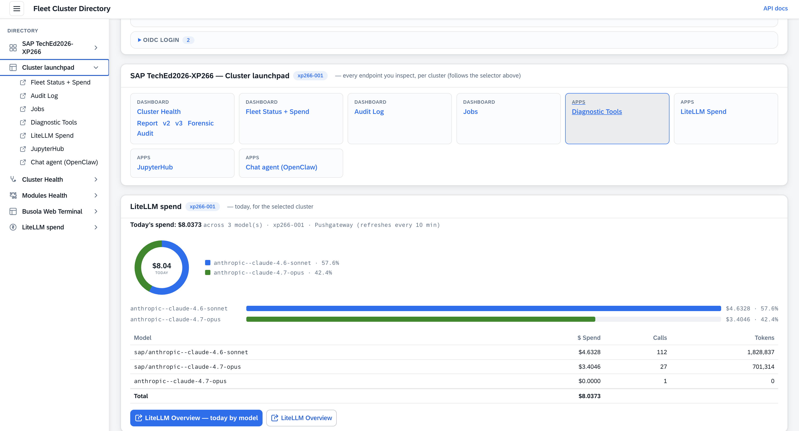
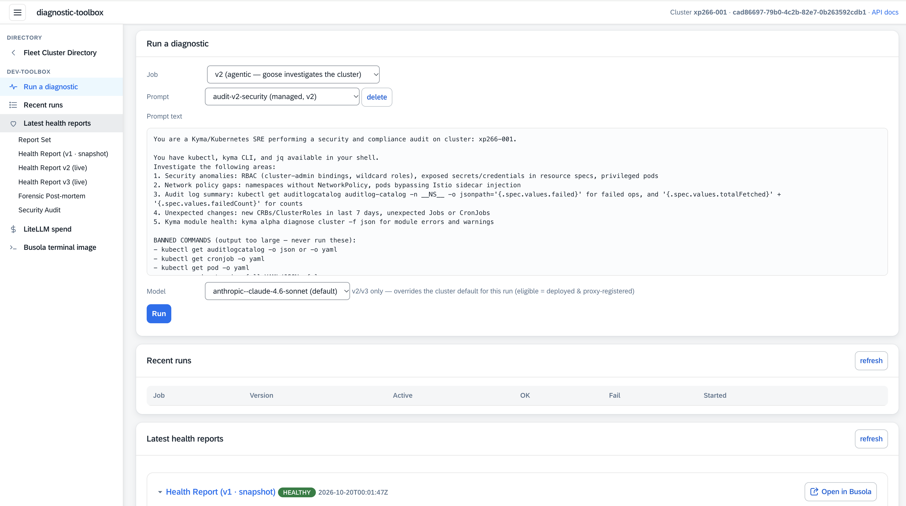
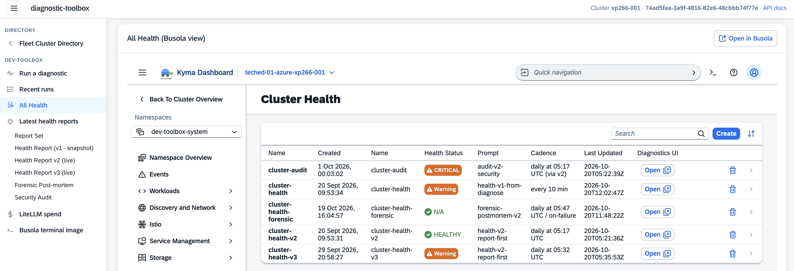
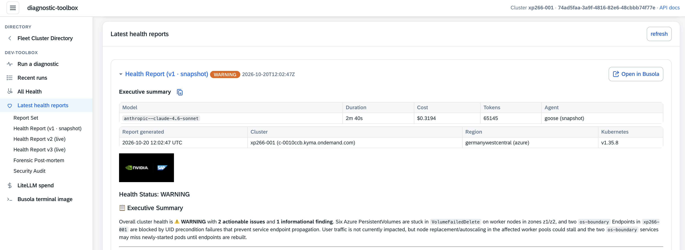
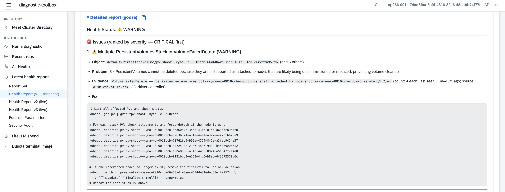
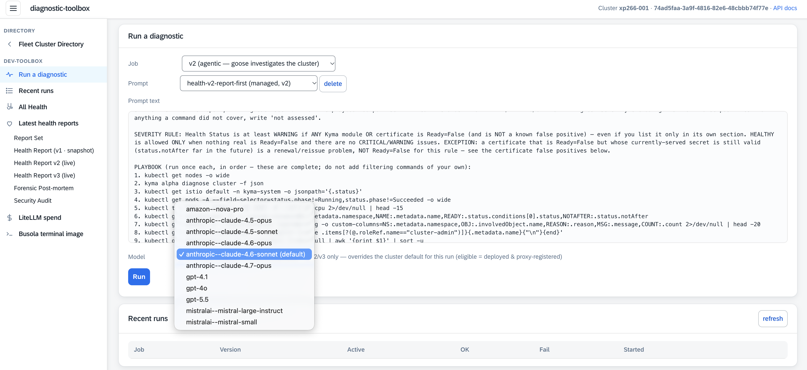
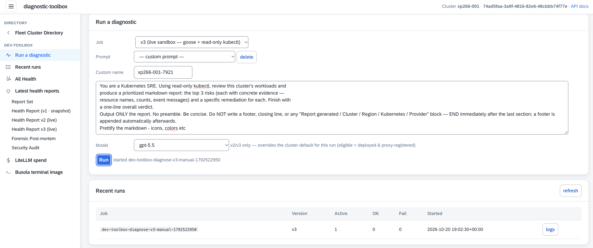
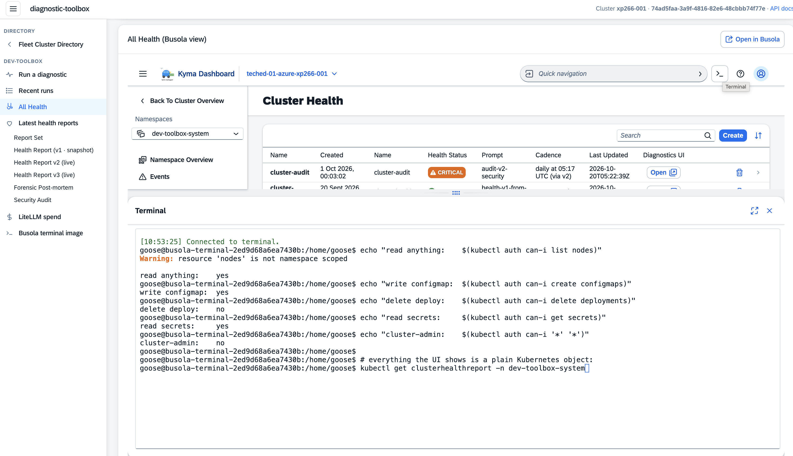

# Exercise 1 - Trigger and shape the Cluster Health Reports

> ⏱ **~30 min**

> [!NOTE]
> 👉 This is the heart of the workshop.
>
> - ✅ A **Goose** agent inspects your cluster on a schedule and writes what it finds as **in-cluster health reports**  
>   — three generations, **v1 / v2 / v3** 
>   — plus a security **audit** and a **forensic post-mortem** that fires when a run skips.  
> - ✅ Every run executes Goose **inside an OpenShell sandbox** (read-only, no internet), reasoning through the LiteLLM proxy → SAP AI Core.
> - ✅ You drive all of it from one place: the **Diagnostic Toolbox** UI.

**Contents**

- 🧰 [The Diagnostic Toolbox portal](#-the-diagnostic-toolbox-portal)
- 📋 [Read the latest reports](#-exercise-11---read-the-latest-reports)
- ▶️ [Trigger a diagnostic run](#️-exercise-12---trigger-a-diagnostic-run)
- ✍️ [Write your own prompt](#️-exercise-13---write-your-own-prompt)
- 🛡️ [The guardrails](#️-exercise-14---the-guardrails-read-reason-but-dont-touch)
  - 🔧 [Prove it yourself](#-prove-it-yourself-optional--go-deeper)

## 🧰 The Diagnostic Toolbox portal

👉 Open the diagnostics either from the **Student's Portal** —

```
https://busola.xp266-NNN.<workshop-domain>/clusterdir/
```

— or directly:

```
https://dev-toolbox.xp266-NNN.<workshop-domain>/
```

<table style="width: 100%; border-collapse: collapse; background-color: #f5f5f5;" border="1">
<tbody>
<tr>
<td align="center" width="50%"><br/><sub><b>1.</b> Student's Portal — click <b>Diagnostic Tools</b> in the launchpad</sub></td>
<td align="center" width="50%"><br/><sub><b>2.</b> Diagnostic Toolbox — reports, run cards, and more</sub></td>
</tr>
</tbody>
</table>

> [!NOTE]
> - ✅ Everything runs on **your own** `xp266-NNN` runtime, so tweak freely — you won't affect anyone else.   
> - ✅ The reports live in namespace `dev-toolbox-system`; each run spins up a short-lived OpenShell sandbox with a **read-only** cluster token.

### 🗂️ The three report generations plus security audit and forensic reports

They trade **fidelity for cost** — all run the same way (Goose in an OpenShell sandbox → LiteLLM → SAP AI Core), but differ in how much live cluster access Goose gets.

<table style="width: 100%; border-collapse: collapse; background-color: #f5f5f5;" border="1">
<tbody>
<tr>
<td>
<div>
<p float="left">
  <a href="#">
  
  </a>
</p>
</div>
</td>
</tr>
</tbody>
</table>

| Report | What Goose sees | Notes |
|---|---|---|
| 🛡️ **audit** · `cluster-audit` | **live**, adaptive **security** investigation | produced as part of a **v2** run — no separate trigger; refresh by running v2 |
| 📸 **v1** · `cluster-health` | a **periodic** `kyma alpha diagnose` snapshot — no live cluster access | cheap, deterministic — catches regressions between runs |
| 🔎 **forensic** · `cluster-health-forensic` | **post-mortem** of the latest v2 run — reads the stored report + LiteLLM spend + Job state and emits a 🎯/🟡/⚪ (CONFIRMED/LIKELY/INCONCLUSIVE) verdict | daily right after v3 + on-failure of v2/v3; also triggerable on-demand |
| 🩺 **v2** · `cluster-health-v2` | **live**, read-only `kubectl` on a leash — a fixed health playbook | the balanced default — also drives the Security Audit, so this is the **highest-spend** run |
| 🔬 **v3** · `cluster-health-v3` | **live**, read-only `kubectl`, real-time and uncapped | the **deepest cut** — a lead list to confirm |


## 📋 Exercise 1.1 - Read the latest reports

1. 👉 In the Diagnostic Toolbox UI, find the **Latest health reports** panel.

   Each report shows an **executive summary** and a **status badge** (HEALTHY / WARNING / CRITICAL). The header also carries a **run-stats** line — **Model · Duration · Cost · Tokens · Agent** — the real SAP AI Core spend and latency of that single run (the same numbers roll up into the spend dashboard).

<table style="width: 100%; border-collapse: collapse; background-color: #f5f5f5;" border="1">
<tbody>
<tr>
<td>
<div>
<p float="left">
  <a href="#">
  
  </a>
</p>
</div>
</td>
</tr>
</tbody>
</table>

   Furthermore, there is a **detailed Goose report** expander with the agent's unedited output.

<table style="width: 100%; border-collapse: collapse; background-color: #f5f5f5;" border="1">
<tbody>
<tr>
<td>
<div>
<p float="left">
  <a href="#">
  
  </a>
</p>
</div>
</td>
</tr>
</tbody>
</table>

> [!TIP]
> The panel auto-refreshes every ~15 s.

2. 👉 Open the same report in **Busola** by clicking the <kbd>&nbsp;🧭&nbsp; Open in Busola ↗ &nbsp;</kbd> button in the right upper corner.

   While a run is in flight, Busola shows a live **Activity** badge (`RUNNING`) and an **Elapsed** timer — the report is a Kubernetes custom resource the agent writes into, so the whole fleet can read it.

> [!TIP]
> These aren't hypothetical checks.  
> In production the same pipeline caught things static monitoring missed — **402 ingress-gateway revisions** piled up in five days (a pod cycling every 17 minutes), **18 leftover cluster-admin bindings** from dev tooling, and a cert-manager ACME solver **stuck for 5+ days** on a DNS mismatch.  
> Reasoning over correlated state finds what probes can't.

## ▶️ Exercise 1.2 - Trigger a diagnostic run

<table style="width: 100%; border-collapse: collapse; background-color: #f5f5f5;" border="1">
<tbody>
<tr>
<td>
<div>
<p float="left">
  <a href="#">
  
  </a>
</p>
</div>
</td>
</tr>
</tbody>
</table>

1. 👉 In the **Run a diagnostic** card, choose a **job** and a **prompt** — start with **v2** (live, balanced).

2. 👉 *(optional)* Pick a **Model**.

   The dropdown is the **intersection** of what's actually deployed and `RUNNING` in your SAP AI Core, and what the LiteLLM proxy is configured to route — so you can only pick a model the proxy will accept. (v2/v3 honour your choice; v1 keeps its fixed model.)

3. 👉 Click **Run**.

   A one-off sandboxed run starts immediately (no waiting for the schedule). Watch the **Recent runs** table; click **logs** on the new row to tail the sandbox and see the extracted *Goose answer*.

4. When it completes, the matching report in **Latest health reports** refreshes — new `lastUpdated`, new sections.

> [!NOTE]
> The sandboxed run is **uncapped** — Goose reasons for as many steps as the task needs; there's no turn budget to tune.  
> What shapes a run is the **prompt** (the recipe — next) and the **model** you pick.  
> The job also **guards the write**: a failed or empty run never overwrites your last good report, so you can experiment freely.

## ✍️ Exercise 1.3 - Write your own prompt

👉 The real power of the Diagnostic Toolbox is this: **you change what Goose investigates by changing the prompt** — no code, no redeploy.

<table style="width: 100%; border-collapse: collapse; background-color: #f5f5f5;" border="1">
<tbody>
<tr>
<td>
<div>
<p float="left">
  <a href="#">
  
  </a>
</p>
</div>
</td>
</tr>
</tbody>
</table>

1. 👉 In the **Run a diagnostic** card, pick the **v3** job (so Goose gets live, real-time `kubectl`), then open the **Prompt** dropdown and choose **— custom prompt —**. 

   Your prompt is saved to your own **adhoc prompt** store under an **auto-generated name** and used for this run — it then appears in the dropdown so you can **reuse** it, and the **delete** button clears it. The shipped **v1/v2/v3 recipes are read-only** in the UI; your custom prompts live alongside them without changing the defaults, so you can experiment safely.

2. 👉 Paste your **prompt text**. For example — a concise variant that forces prettified output and suppresses the auto-footer:

   ```text
   You are a Kubernetes SRE. Using read-only kubectl, review this cluster's workloads and
   produce a prioritized markdown report: the top 3 risks (each with concrete evidence —
   resource names, counts, event messages) and a specific remediation for each. Finish with
   a one-line overall verdict.
   Output ONLY the report. No preamble. Be concise. Do NOT write a footer, closing line, or
   any "Report generated / Cluster / Region / Kubernetes / Provider" block — END immediately
   after the last section; a footer is appended automatically afterwards.
   Prettify the markdown — icons, colors etc.
   ```

   Or a Kyma-aware variant that also pulls in the Kyma CLI (`kyma modules`, `kyma diagnostics`) for module-level signal on top of plain `kubectl`:

   ```text
   You are a Kubernetes SRE. Using read-only kubectl and kyma cli diagnostics and modules commands,
   review this cluster's workloads and modules.
   Produce a prioritized markdown report: the top 3 risks (each with concrete evidence —
   resource names, counts, event messages) and a specific remediation for each. Finish with
   a one-line overall verdict.
   Output ONLY the report. No preamble. Be concise. Do NOT write a footer, closing line, or
   any "Report generated / Cluster / Region / Kubernetes / Provider" block — END immediately
   after the last section; a footer is appended automatically afterwards.
   Prettify the markdown — icons, colors etc.
   ```

3. 👉 Click **Run** once you've pasted the prompt text (step 2).


> [!NOTE]
> ✅ Your prompt runs inside the **same OpenShell sandbox** as the built-in ones: a read-only cluster token, no internet.  
> ✅ So even a prompt you wrote can only **look and reason** — it can't mutate the cluster or exfiltrate anything.

## 🛡️ Exercise 1.4 - The guardrails: read, reason, but don't touch

An agent with `kubectl` is powerful — and, unchecked, dangerous. The reason you can hand it a prompt you wrote and let it loose is that it is **boxed in by construction**, not by asking the model to behave.  
Three overlapping fences wrap every run:

- **A read-only identity.** The run gets a short-lived **`sandbox-viewer`** token — `get`/`list`/`watch` only, with **`secrets` excluded**. It can read the whole picture to reason, but a write or a secret-read is refused by the API server with `403`.
- **No route out.** The run executes inside an **OpenShell sandbox** with no path to the internet; its only egress is the in-cluster LiteLLM proxy. The LLM key is never in the box.
- **An unprivileged pod.** The workload runs **non-root** with a read-only root filesystem and dropped capabilities.

> [!NOTE]
> **Defense in depth.** No single control is trusted alone: the read-only token (can't write or read secrets), the sandbox boundary (no internet, no API-server mutation), non-root + read-only rootfs (can't escalate on the node), and `drop_params` at the proxy (can't send SAP AI Core a malformed request). The agent is useful *because* it's boxed in.

### 🔧 Prove it yourself (optional — go deeper)

👉 Open **All Health** (sidebar) and click the terminal `>_` icon in the top-right of the Busola toolbar — a shell pod opens in the browser.

<table style="width: 100%; border-collapse: collapse; background-color: #f5f5f5;" border="1">
<tbody>
<tr>
<td>
<div>
<p float="left">
  <a href="#">
  
  </a>
</p>
</div>
</td>
</tr>
</tbody>
</table>

👉 In the terminal, ask the API server what the **web-terminal identity** may do, and read the report artifacts directly:

Command:
```bash
echo "read anything:    $(kubectl auth can-i list nodes)"
echo "write configmap:  $(kubectl auth can-i create configmaps)"
echo "delete deploy:    $(kubectl auth can-i delete deployments)"
echo "read secrets:     $(kubectl auth can-i get secrets)"
echo "cluster-admin:    $(kubectl auth can-i '*' '*')"

# everything the UI shows is a plain Kubernetes object:
kubectl get clusterhealthreport -n dev-toolbox-system
```
Output:
```
read anything:    yes
write configmap:  yes
delete deploy:    no
read secrets:     yes
cluster-admin:    no
```

> [!NOTE]
> This is **your** web-terminal identity (your logged-in Kyma kubeconfig) — intentionally broader than the sandbox. The **sandboxed Goose run** uses a different, more restricted token (`sandbox-viewer`: `get`/`list`/`watch` only, **`secrets` excluded**, no mutations). That's the guardrail that matters — not what *you* can do, but what the *agent* can do.

> [!IMPORTANT]
> **Hand-off — remember this for later.** A run's output is a *shared artifact*: the `ClusterHealthReport` / `cluster-audit` custom resources, plus the detailed Goose transcripts.  
> Two downstream consumers read them — the **interactive chat agent** answers questions about the findings, and a **JupyterHub notebook** analyses them in Python.  
> *Jobs produce → agents and notebooks consume.*

## Summary

📋 You read the Cluster Health Reports in the Diagnostic Toolbox UI and in Busola.

- ▶️ triggered a fresh sandboxed run (choosing the model),
- ✍️ wrote your own prompt and watched Goose run it inside a read-only OpenShell sandbox,
- 🛡️ observed the layered guardrails (read-only token, no egress, non-root) that make an autonomous `kubectl` agent safe to run.

Continue to - [Exercise 2 - Chat with the interactive agent](../ex2/README.md)
