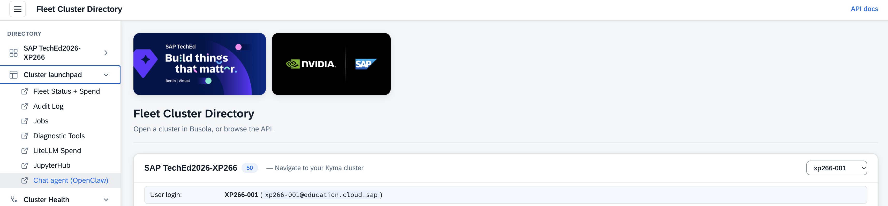
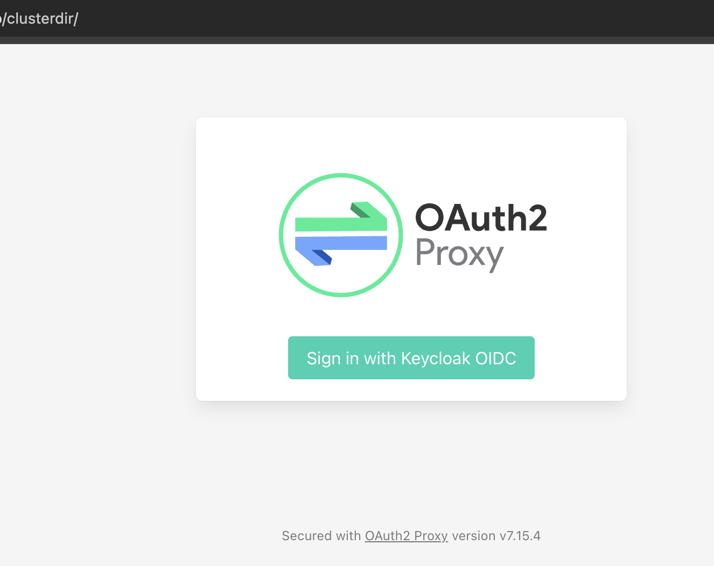
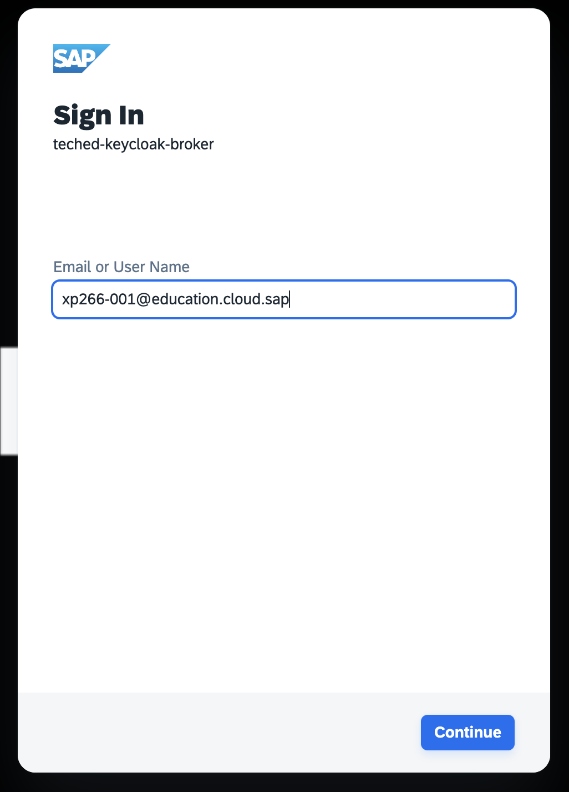
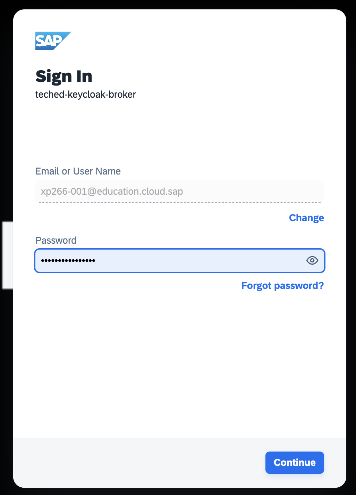
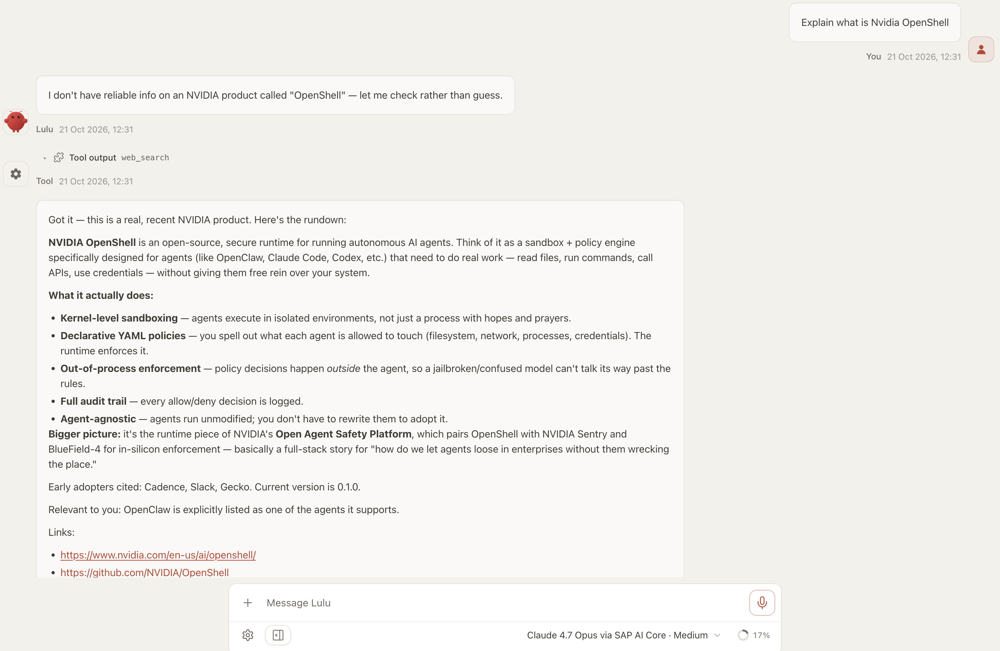
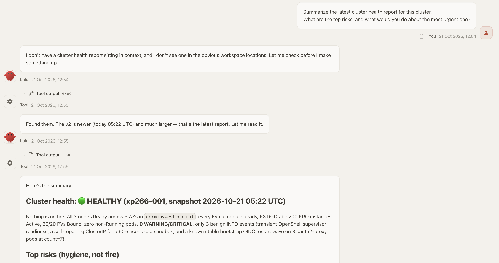

# Exercise 2 - Chat with the interactive agent

> ⏱ **~12 min**

> [!NOTE]
> 👉 This exercise is about the **transition** — the **hand-off**:
> - ✅ an interactive agent picks up where the autonomous one left off
> - ✅ so you can take over the next phase of work, for instance: ask follow-ups, draft fixes, make decisions in natural language.
> - ✅ The Goose diagnostic jobs run **autonomously**.
> - ✅ The other half of the story is an **interactive** AI agent — running in your cluster as a sandboxed workload and, like everything else, routed to SAP AI Core through the LiteLLM proxy.

```
You (browser)  ──▶  Chat UI  ──▶  LiteLLM proxy :4001  ──▶  SAP AI Core (Claude Opus by default)
                      │
                      └── reads the diagnostic artifacts
                          (ClusterHealthReport · goose-raw-* ConfigMaps)
```

**Contents**

- 💬 [Open the chat UI and chat](#-exercise-21---open-the-chat-ui-and-chat)
- 🤝 [The hand-off: ask about your cluster's diagnosis](#-exercise-22---the-hand-off-ask-about-your-clusters-diagnosis)
- ⚖️ [Autonomous vs interactive — when to use which](#autonomous-vs-interactive)


## 💬 Exercise 2.1 - Open the chat UI and chat

1. 👉 Open your chat UI URL in the browser from the student's portal, e.g.:

   ```
   https://busola.xp266-NNN.<workshop-domain>/
   ```

   or directly via:

   ```
   https://openclaw.xp266-NNN.<workshop-domain>/
   ```

2. 👉 You may need to sign in eventually — the sequence looks like this:

<table style="width: 100%; border-collapse: collapse; background-color: #f5f5f5;" border="1">
<tbody>
<tr>
<td align="center" width="25%"><br/><sub><b>1.</b> start from the student portal</sub></td>
<td align="center" width="25%"><br/><sub><b>2.</b> oauth2-proxy gate</sub></td>
<td align="center" width="25%"><br/><sub><b>3.</b> SAP IAS — pick provider</sub></td>
<td align="center" width="25%"><br/><sub><b>4.</b> SAP IAS — credentials</sub></td>
</tr>
</tbody>
</table>

3. 👉 Once signed in, you land on the chat UI. Ask it something general to confirm it's live and reasoning via SAP AI Core:

   ```
   Explain what is NVIDIA OpenShell.
   ```

<table style="width: 100%; border-collapse: collapse; background-color: #f5f5f5;" border="1">
<tbody>
<tr>
<td>
<div>
<p float="left">
  <a href="#">
  
  </a>
</p>
</div>
</td>
</tr>
</tbody>
</table>

<details>
<summary>👉 Sample answer (click to expand)</summary>

```markdown
Got it — this is a real, recent NVIDIA product. Here's the rundown:

**NVIDIA OpenShell** is an open-source, secure runtime for running autonomous AI agents. Think of it as a sandbox + policy engine specifically designed for agents (like OpenClaw, Claude Code, Codex, etc.) that need to do real work — read files, run commands, call APIs, use credentials — without giving them free rein over your system.

**What it actually does:**
- **Kernel-level sandboxing** — agents execute in isolated environments, not just a process with hopes and prayers.
- **Declarative YAML policies** — you spell out what each agent is allowed to touch (filesystem, network, processes, credentials). The runtime enforces it.
- **Out-of-process enforcement** — policy decisions happen *outside* the agent, so a jailbroken/confused model can't talk its way past the rules.
- **Full audit trail** — every allow/deny decision is logged.
- **Agent-agnostic** — agents run unmodified; you don't have to rewrite them to adopt it.

**Bigger picture:** it's the runtime piece of NVIDIA's **Open Agent Safety Platform**, which pairs OpenShell with NVIDIA Sentry and BlueField-4 for in-silicon enforcement — basically a full-stack story for "how do we let agents loose in enterprises without them wrecking the place."

Early adopters cited: Cadence, Slack, Gecko. Current version is 0.1.0.

Relevant to you: **OpenClaw is explicitly listed as one of the agents it supports.**

Links:
- <https://www.nvidia.com/en-us/ai/openshell/>
- <https://github.com/NVIDIA/OpenShell>
- <https://docs.nvidia.com/openshell/home>
```

</details>

> [!NOTE]
> 👉 **Model routing.** 
> - ✅ The chat agent defaults to the `reasoning-hard` tier — **Claude Opus** on SAP AI Core — with automatic fallbacks (Sonnet, GPT-5.5, GPT-4.1, Nova, Mistral) if a model is busy.  
> - ✅ That's why interactive traffic shows up as *Lulu* on the spend dashboard, while the diagnostic jobs (Sonnet) show up as *Goose*.

## 🤝 Exercise 2.2 - The hand-off: ask about your cluster's diagnosis

- ✅ This is a classic **producer-consumer** pattern: the autonomous jobs *produce* the findings; the chat agent *consumes* them to help you make sense of what they are.
- ✅ The Goose **v1** and **v2** jobs already wrote a **Cluster Health Report** and archived their raw findings.

👉 Now ask the *interactive* agent the following:

```
Summarize the latest cluster health report for this cluster. What are the top risks, and what would you do about the most urgent one?
```

<table style="width: 100%; border-collapse: collapse; background-color: #f5f5f5;" border="1">
<tbody>
<tr>
<td>
<div>
<p float="left">
  <a href="#">
  
  </a>
</p>
</div>
</td>
</tr>
</tbody>
</table>

The agent reasons over the diagnostic findings and gives you a conversational, follow-up-able answer — the beginnings of an **on-call assistant**: the overnight autonomous run does the broad sweep, and in the morning you interrogate its findings in plain language.

> [!TIP]
> Follow up conversationally — *"show me the certificate section"*, *"which of these is safe to ignore?"*, *"draft the kubectl command to fix it"*. Same cluster, same SAP AI Core, but now interactive instead of scheduled.

## Summary

<a id="autonomous-vs-interactive"></a>
### Autonomous vs interactive — when to use which

| | 🪿 Goose diagnostic jobs | 💬 Chat agent (this exercise) |
|---|---|---|
| ⏰ **Trigger** | scheduled CronJob (or manual kick) | you, in chat |
| 📄 **Output** | structured `ClusterHealthReport` CR | conversation |
| 🎯 **Best for** | unattended, repeatable, auditable sweeps | ad-hoc questions, "explain this", drafting fixes |
| 🧠 **Model tier** | `reasoning-fast` (Sonnet) | `reasoning-hard` (Opus) |
| 🔀 **Both route through** | **LiteLLM proxy → SAP AI Core** | **LiteLLM proxy → SAP AI Core** |

💬 You chatted with the interactive agent,

- 🔀 saw it route to SAP AI Core (Claude Opus) via the same LiteLLM proxy, and
- 🤝 used it to interrogate the diagnostic findings the autonomous jobs produced — the "autonomous sweep + human follow-up" pattern.

Continue to - [Exercise 3 - Explore OpenShell sandboxes with JupyterHub notebooks](../ex3/README.md)
