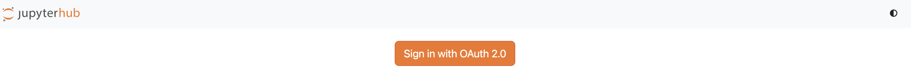
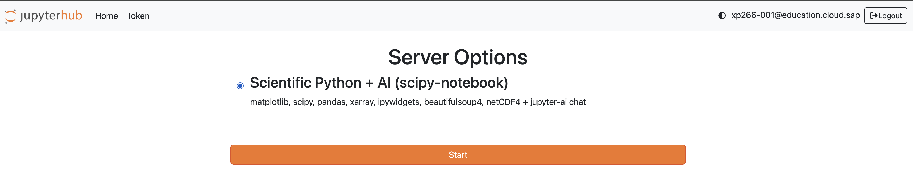
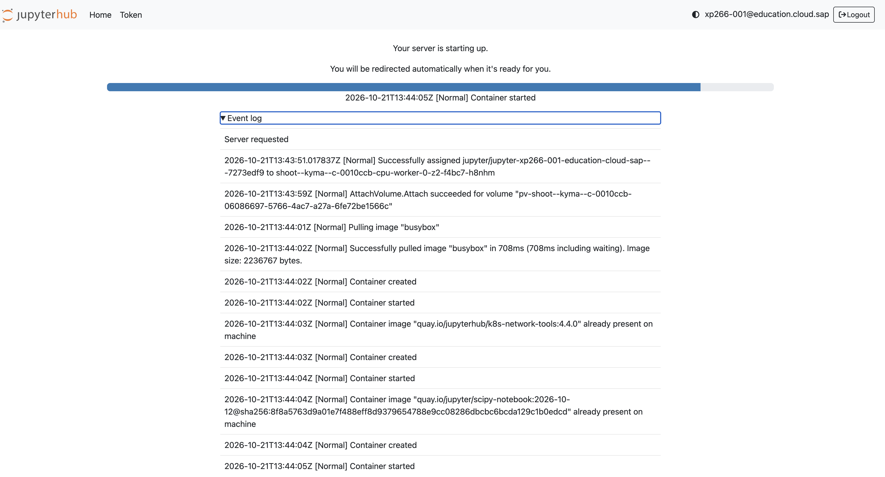
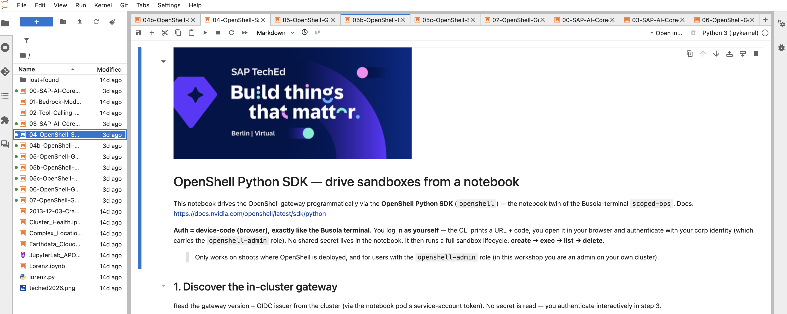
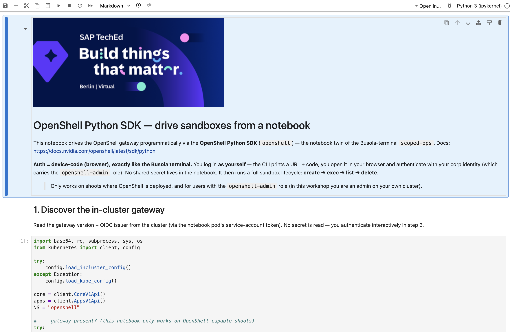
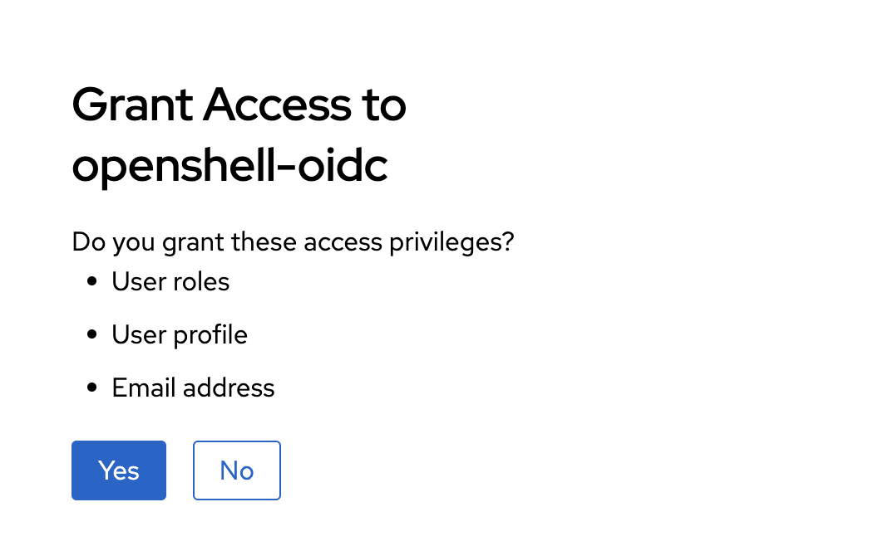
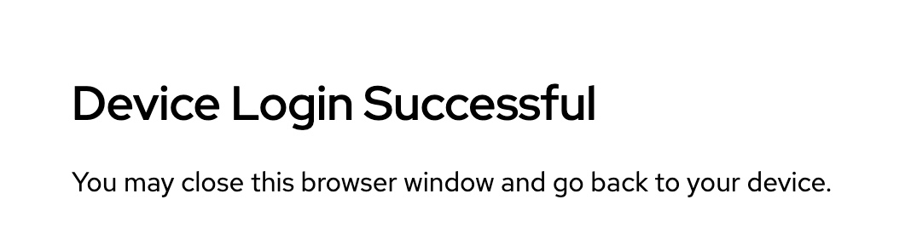
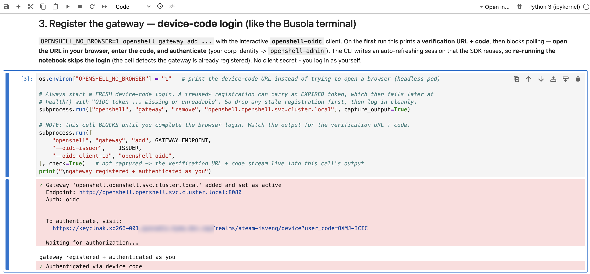
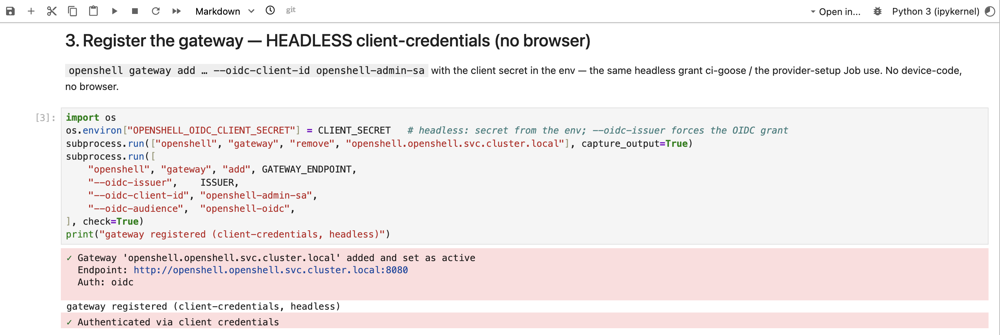

# Exercise 3 - Explore OpenShell sandboxes with JupyterHub notebooks

> [!NOTE]
> 👉 This is your **Python playground**.
>
> - ✅ A full **JupyterHub** runs in your cluster, pre-loaded with notebooks and wired — like everything else — to **SAP AI Core through the LiteLLM proxy**.
> - ✅ Here you drive **OpenShell sandboxes** from Python: create one, run a command inside it, then let an **agent (goose)** investigate your cluster from within a sandbox.

**Contents**

- 🚀 [Sign into JupyterHub](#exercise-31---sign-into-jupyterhub)
- 📒 [OpenShell notebooks](#exercise-32---openshell-notebooks)


## Exercise 3.1 - Sign into JupyterHub

1. 👉 Open your JupyterHub UI URL in the browser from the student's portal, e.g.:

   ```
   https://busola.xp266-NNN.<workshop-domain>/
   ```

   or directly via:

   ```
   https://jupyterhub.xp266-NNN.<workshop-domain>/
   ```

2. 👉 Sign in with single sign-on and click **Start My Server**. After a moment JupyterLab opens.

<table style="width: 100%; border-collapse: collapse; background-color: #f5f5f5;" border="1">
<tbody>
<tr><td align="center"><br/><sub><b>1.</b> sign in</sub></td></tr>
<tr><td align="center"><br/><sub><b>2.</b> start server</sub></td></tr>
<tr><td align="center"><br/><sub><b>3.</b> spawning</sub></td></tr>
</tbody>
</table>

3. 👉 In the file browser (left) you'll find the pre-loaded OpenShell notebooks.

<table style="width: 100%; border-collapse: collapse; background-color: #f5f5f5;" border="1">
<tbody>
<tr>
<td>
<div>
<p float="left">
  <a href="#">
  
  </a>
</p>
</div>
</td>
</tr>
</tbody>
</table>

## Exercise 3.2 - OpenShell notebooks

> [!NOTE]
> - ✅ A **sandbox** is a disposable, per-session pod that _by construction_ can't reach the internet or the cluster API.
> - ✅ Here you drive its whole lifecycle from Python — then put an **agent (goose)** inside the box, reasoning over your cluster from behind the guardrails.

> [!TIP]
> - ✅ The notebooks are **self-explanatory** — read the markdown cells as you go.
> - ✅ Run them cell by cell with the **▶ play** button (or <kbd>Shift</kbd>+<kbd>Enter</kbd>), or in one go via the **⏩ fast-forward** button in the toolbar — same as the top menu **Run → Run All Cells** (or **Kernel → Restart Kernel and Run All Cells…** for a clean state).

<table style="width: 100%; border-collapse: collapse; background-color: #f5f5f5;" border="1">
<tbody>
<tr>
<td>
<div>
<p float="left">
  <a href="#">
  
  </a>
</p>
</div>
</td>
</tr>
</tbody>
</table>

| Notebook | 📦 OpenShell SDK — sandbox lifecycle |
|---|---|
| 📦 [`04-OpenShell-Sandbox-SDK`](#exercise-321---04-openshell-sandbox-sdk) | The `openshell` **CLI** registers the gateway via **device-code** (as you); the **Python SDK** then drives the sandbox lifecycle: **create → exec → list → delete**. |
| 📦 [`04b-OpenShell-Sandbox-SDK-Headless`](#exercise-322---04b-openshell-sandbox-sdk-headless) | Same lifecycle as **04** — but **no `openshell` CLI**, only the **NVIDIA OpenShell Python SDK**; it mints a **client-credentials** token itself (headless, no browser). |

| Notebook | 🪿 OpenShell + goose — live `kubectl` investigation |
|---|---|
| 🪿 [`05-OpenShell-Goose-Diagnostics-Live`](#exercise-323---05-openshell-goose-diagnostics-live) | Richest flavour — the `openshell` **CLI** registers the gateway via **device-code** (as you); the **Python SDK** then opens a sandbox in which the agent gets **live read-only `kubectl`** (`scoped-ops` recipe: `sandbox-viewer` identity + apiserver-read-only + keyless LiteLLM proxy). |
| 🪿 [`05b-OpenShell-Goose-Diagnostics-Live-Headless`](#exercise-324---05b-openshell-goose-diagnostics-live-headless--05c-openshell-sandbox-puresdk) | Same investigation as **05**, run **headless** — the `openshell` **CLI** still registers the gateway, but with **client-credentials** instead of device-code (no browser). |
| 📦 🪿 [`05c-OpenShell-Sandbox-PureSDK`](#exercise-324---05b-openshell-goose-diagnostics-live-headless--05c-openshell-sandbox-puresdk) | Same investigation as **05b**, but with **no `openshell` CLI** — only the **NVIDIA OpenShell Python SDK**; it mints the client-credentials token itself. |

| Notebook | 🪿 OpenShell + goose — triage from a snapshot / stored report |
|---|---|
| 🪿 [`06-OpenShell-Goose-Diagnostics-Snapshot`](#exercise-325---06-openshell-goose-diagnostics-snapshot) | admin-GHA (`ci-goose-via-sandbox.sh`) model — gather a cluster-health **snapshot**, then run **the agent keyless** inside the sandbox to interpret it (no live `kubectl` in the box). |
| 🪿 [`07-OpenShell-Goose-Diagnostics-FromReport`](#exercise-326---07-openshell-goose-diagnostics-fromreport) | Like 06, but feeds **the agent** the **existing** openclaw-ConfigMap reports — `diagnostic` (v1 `kyma diagnose`) + `analysis` (prior v2 agent report) — for a fresh triage over pre-computed data. |

> [!NOTE]
> The `04`–`07` notebooks drive **OpenShell** and need the gateway running on your cluster — your `xp266-NNN` runtime has it.

### Exercise 3.2.1 - `04-OpenShell-Sandbox-SDK`

👉 Open **`04-OpenShell-Sandbox-SDK.ipynb`** and run every cell.

This notebook drives the OpenShell gateway programmatically via the **OpenShell Python SDK** (`openshell`) — the notebook twin of the Busola-terminal `scoped-ops`. Docs: <https://docs.nvidia.com/openshell/latest/sdk/python>.

> [!NOTE]
> - ✅ **Authentication = device-code (browser), exactly like the Busola terminal.** You log in **as yourself** — the CLI prints a URL + code, you open it in your browser and authenticate with your corp identity (which carries the `openshell-admin` role). No shared secret lives in the notebook.
> - ✅ It then runs a full sandbox lifecycle: **create → exec → list → delete**.
> - ✅ Only works on shoots where OpenShell is deployed, and for users with the `openshell-admin` role (in this workshop you are an admin on your own cluster).

> [!NOTE]
> **About the "Grant Access to openshell-oidc" page** you see in the browser during the device-code login — it's the **OAuth 2.0 Device Authorization Grant** confirmation ([RFC 8628](https://datatracker.ietf.org/doc/html/rfc8628)), not an OIDC consent screen. The protocol REQUIRES the user to explicitly approve the device at the browser side so nobody else can hijack the account by polling the device endpoint. Click **Yes** once per notebook session — it can't be suppressed via Keycloak client config.

<table style="width: 100%; border-collapse: collapse; background-color: #f5f5f5;" border="1">
<tbody>
<tr>
<td align="center" width="50%"><br/><sub><b>1.</b> click <b>Yes</b> to approve the device (your browser)</sub></td>
<td align="center" width="50%"><br/><sub><b>2.</b> device approved — you can go back to the JupyterHub screen</sub></td>
</tr>
</tbody>
</table>

> [!NOTE]
> This minimal sandbox is **compute-only**: it has no cluster credentials and no route out.  
> It's the blank canvas; the next step adds an agent and a scoped, read-only cluster identity.

### Exercise 3.2.2 - `04b-OpenShell-Sandbox-SDK-Headless`

👉 Prefer no browser step? Open **`04b-OpenShell-Sandbox-SDK-Headless.ipynb`** and run all cells.

- ✅ A **pure-SDK twin** (no `openshell` CLI) of the previous notebook.
- ✅ The only difference is **authentication** — **no browser, no CLI, no `gateway add`**.
- ✅ The notebook mints a client-credentials token itself (from the `openshell-admin-sa` secret) and hands it to `SandboxClient` directly.
- ✅ Same result, with machine-to-machine authentication.

### Exercise 3.2.3 - `05-OpenShell-Goose-Diagnostics-Live`

👉 Open **`05-OpenShell-Goose-Diagnostics-Live.ipynb`** and run all cells.

That's the **richest flavour**: the agent runs in an OpenShell sandbox with **live read-only `kubectl`** and investigates the cluster itself.

<table style="width: 100%; border-collapse: collapse; background-color: #f5f5f5;" border="1">
<tbody>
<tr>
<td>
<div>
<p float="left">
  <a href="#">
  
  </a>
</p>
</div>
</td>
</tr>
</tbody>
</table>

> [!IMPORTANT]
> **The sandbox is the guardrail, not the prompt.** You can hand the agent any prompt and it still can't mutate your cluster or leak a token — the sandbox enforces it, not the prompt:
> - ✅ the sandbox gets a short-lived read-only **`sandbox-viewer`** identity (`get`/`list`/`watch`, **no secrets**) + the canonical policy (apiserver read-only **+** keyless LiteLLM proxy),
> - ✅ the agent shells out to the allowlisted `kubectl`; no internet,
> - ✅ authentication works both ways — **as you** via **device-code** (`05`) or **headless** via **client-credentials** (`05b` / `05c`); same guardrails apply regardless.

### Exercise 3.2.4 - `05b-OpenShell-Goose-Diagnostics-Live-Headless` / `05c-OpenShell-Sandbox-PureSDK`

👉 Open **`05b-OpenShell-Goose-Diagnostics-Live-Headless.ipynb`** and run all cells.

- ✅ Same live read-only `kubectl` goose investigation as **05** — same policy, same guardrails.
- ✅ The only thing that changes is **authentication**, namely:
  - **05** signs in **as you** via device-code (your browser),
  - **05b** runs **headless** with **client-credentials** (a service-account token minted in-notebook) — no browser, no device-code screen.

👉 Then open **`05c-OpenShell-Sandbox-PureSDK.ipynb`** and run all cells.

Same investigation and same headless authentication as **05b** — **`05c`** is identical to **`05b`**, it just uses the **NVIDIA OpenShell Python SDK** instead of the `openshell` CLI.

<table style="width: 100%; border-collapse: collapse; background-color: #f5f5f5;" border="1">
<tbody>
<tr>
<td>
<div>
<p float="left">
  <a href="#">
  
  </a>
</p>
</div>
</td>
</tr>
</tbody>
</table>

### Exercise 3.2.5 - `06-OpenShell-Goose-Diagnostics-Snapshot`

👉 Open **`06-OpenShell-Goose-Diagnostics-Snapshot.ipynb`** and run all cells.

The **admin-GHA (`ci-goose-via-sandbox.sh`) model**: this notebook gathers a read-only cluster-health **snapshot**, then runs **the agent keyless** inside an OpenShell sandbox to interpret it — the agent reasons over the piped snapshot (**no live `kubectl` in the box**).

- ✅ Keyless = the agent reaches the in-cluster **LiteLLM proxy** (→ SAP AI Core) via the sandbox's `litellm-openai` provider; no real LLM key in the box.
- ✅ Authentication is device-code (your identity), exactly like `04-OpenShell-Sandbox-SDK.ipynb`.
- ✅ Compare its report with the live one from 3.2.3 — same agent, snapshot vs live-kubectl.

### Exercise 3.2.6 - `07-OpenShell-Goose-Diagnostics-FromReport`

👉 Open **`07-OpenShell-Goose-Diagnostics-FromReport.ipynb`** and run all cells.

Like **3.2.5 (B)**, but instead of gathering a live snapshot, this feeds the agent the **existing cluster-health reports** the diagnose job already produced (ConfigMaps in ns `openclaw`, label `app=cluster-health`):

- ✅ `diagnostic` = raw `kyma diagnose` (**v1**),
- ✅ `analysis` = a prior agent report (**v2**).

The agent runs **keyless** in an OpenShell sandbox (ci-goose model — baked policy + `litellm-openai` provider) and produces a **fresh triage** over the pre-computed report. Reuses `cluster-health-reader`'s existing openclaw-ConfigMap read (no extra RBAC). Authentication = device-code, like `04-…`.

## Summary

You signed in to JupyterHub, drove the full **OpenShell sandbox lifecycle** from the Python SDK, and ran an **agent inside a sandbox** — live read-only `kubectl`, a static snapshot, and a report-only triage — watching the same read-only, no-egress guardrails that bound the CLI agent.  
You now have the sandboxed-agent pattern in Python, inside your own Kyma cluster.  
Continue to - [Exercise 4 - Your own sandboxed agent: OpenShell on Kyma](../ex4/README.md)
