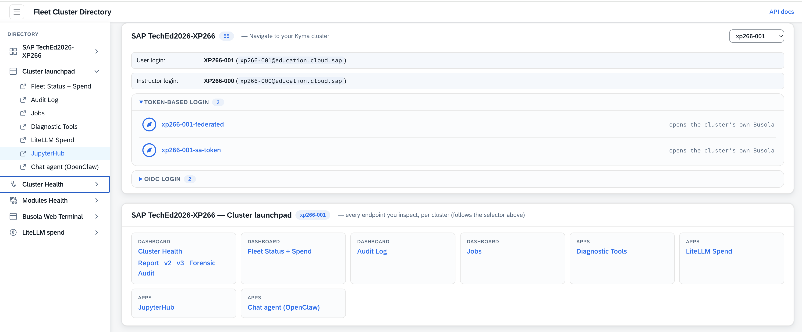
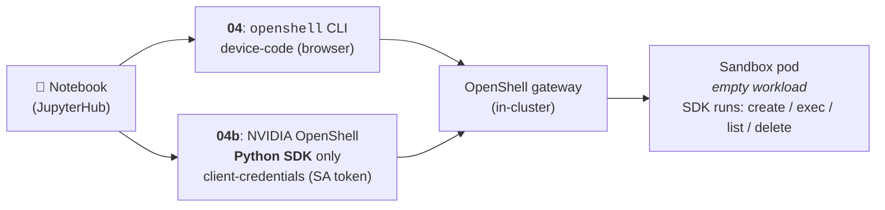
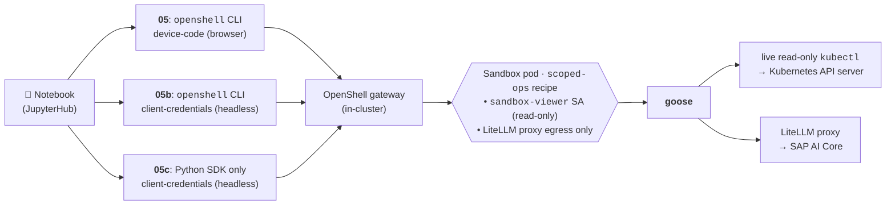
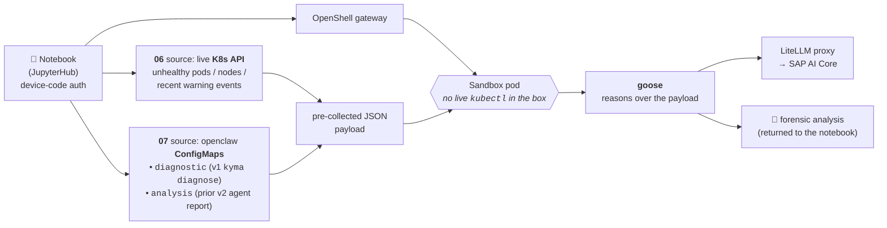

# Exercise 3 - Explore OpenShell sandboxes with JupyterHub notebooks

> ⏱ **~20 min**

> [!NOTE]
> 👉 This is your **Python playground**.
>
> - ✅ A full **JupyterHub** runs in your cluster, pre-loaded with notebooks and wired — like everything else — to **SAP AI Core through the LiteLLM proxy**.
> - ✅ Here you drive **OpenShell sandboxes** from Python: create one, run a command inside it, then let an **agent (goose)** investigate your cluster from within a sandbox.

**Contents**

- 🚀 [Sign into JupyterHub](#-exercise-31---sign-into-jupyterhub)
- 📒 [OpenShell notebooks](#-exercise-32---openshell-notebooks)


## 🚀 Exercise 3.1 - Sign into JupyterHub

1. 👉 Open your JupyterHub playground from the student's portal, e.g.:

   ```
   https://busola.xp266-NNN.<workshop-domain>/
   ```

   or directly via:

   ```
   https://jupyterhub.xp266-NNN.<workshop-domain>/
   ```

   <table style="width: 100%; border-collapse: collapse; background-color: #f5f5f5;" border="1">
   <tbody>
   <tr>
   <td>
   <div>
   <p float="left">
     <a href="#">
     
     </a>
   </p>
   </div>
   </td>
   </tr>
   </tbody>
   </table>

2. 👉 Sign in with single sign-on and click **Start My Server**. After a moment JupyterLab opens.

   <details>
   <summary>📸 Click to expand the sign-in / spawn screenshots</summary>

   <table style="width: 100%; border-collapse: collapse; background-color: #f5f5f5;" border="1">
   <tbody>
   <tr><td align="center"><br/><sub><b>1.</b> sign in</sub></td></tr>
   <tr><td align="center"><br/><sub><b>2.</b> start server</sub></td></tr>
   <tr><td align="center"><br/><sub><b>3.</b> spawning</sub></td></tr>
   </tbody>
   </table>

   </details>

3. 👉 In the file browser (left) you'll find the pre-loaded OpenShell notebooks.

<table style="width: 100%; border-collapse: collapse; background-color: #f5f5f5;" border="1">
<tbody>
<tr>
<td>
<div>
<p float="left">
  <a href="#">
  
  </a>
</p>
</div>
</td>
</tr>
</tbody>
</table>

## 📒 Exercise 3.2 - OpenShell notebooks

> [!NOTE]
> - ✅ A **sandbox** is a disposable, per-session pod that _by construction_ can't reach the internet or the cluster API.
> - ✅ Here you drive its whole lifecycle from Python — then put an **agent (goose)** inside the box, reasoning over your cluster from behind the guardrails.

> [!TIP]
> - ✅ The notebooks are **self-explanatory** — read the markdown cells as you go.
> - ✅ Run them cell by cell with the **▶ play** button (or <kbd>Shift</kbd>+<kbd>Enter</kbd>), or in one go via the **⏩ fast-forward** button in the toolbar — same as the top menu **Run → Run All Cells** (or **Kernel → Restart Kernel and Run All Cells…** for a clean state).

<table style="width: 100%; border-collapse: collapse; background-color: #f5f5f5;" border="1">
<tbody>
<tr>
<td>
<div>
<p float="left">
  <a href="#">
  
  </a>
</p>
</div>
</td>
</tr>
</tbody>
</table>

The notebooks come in **three flavours**, from the simplest to the richest.

👉 Click any family card below for its full wiring — auth path, what runs inside the sandbox, and what the agent sees.

<details>
<summary>📦 <b>Family 1 · sandbox lifecycle</b> — <code>04</code> (device-code CLI) + <code>04b</code> (headless pure-SDK)</summary>

**Goal:** drive the full OpenShell sandbox lifecycle (`create → exec → list → delete`) from Python — no agent inside, no cluster investigation. The "hello world" of the SDK.



- 📦 [`04-OpenShell-Sandbox-SDK`](#exercise-324---04-device-code-cli---lifecycle-variant-optional) — the `openshell` **CLI** registers the gateway via **device-code** (as you); the **Python SDK** then drives the lifecycle.
- 📦 [`04b-OpenShell-Sandbox-SDK-Headless`](#exercise-321---04b-headless-pure-sdk---lifecycle) — pure-SDK twin, **no `openshell` CLI**; mints a **client-credentials** token itself (headless, no browser).
</details>

<details>
<summary>🪿 <b>Family 2 · adaptive investigators</b> — <code>05</code> + <code>05b</code> + <code>05c</code> (live <code>kubectl</code> inside the box)</summary>

**Goal:** put a `goose` agent **inside** the sandbox with the `scoped-ops` recipe — a `sandbox-viewer` identity (read-only, `secrets` excluded) + the LiteLLM proxy, and let it adaptively investigate the cluster.



- 🪿 [`05-OpenShell-Goose-Diagnostics-Live`](#exercise-325---05-device-code-cli--05c-pure-sdk---adaptive-variants-optional) — richest flavour; CLI registers the gateway via **device-code**, SDK opens the sandbox, agent gets **live read-only `kubectl`**.
- 🪿 [`05b-OpenShell-Goose-Diagnostics-Live-Headless`](#exercise-322---05b-headless-cli---adaptive) — same rich flavour, **headless** (CLI uses client-credentials instead of device-code).
- 📦 🪿 [`05c-OpenShell-Sandbox-PureSDK`](#exercise-325---05-device-code-cli--05c-pure-sdk---adaptive-variants-optional) — like `05b`, but **no `openshell` CLI** — only the **NVIDIA OpenShell Python SDK**; mints the client-credentials token itself.
</details>

<details>
<summary>🪿 <b>Family 3 · forensic sniffers</b> — <code>06</code> (snapshot) + <code>07</code> (stored reports)</summary>

**Goal:** keep the agent **boxed-in without live cluster access** — the notebook pre-collects data outside the sandbox and pipes it in. Minimal attack surface; maximum reproducibility.



- 🪿 [`06-OpenShell-Goose-Diagnostics-Snapshot`](#exercise-323---06-snapshot---forensic) — the notebook gathers a **real-time** cluster inventory via the K8s API (unhealthy pods, nodes, warning events), then pipes it to the agent inside the sandbox — **no live `kubectl` in the box**.
- 🪿 [`07-OpenShell-Goose-Diagnostics-FromReport`](#exercise-326---07-from-report---forensic-variant-optional) — same sandbox as 06; the agent reasons over **pre-computed** openclaw ConfigMaps: `diagnostic` (v1 `kyma diagnose`) + `analysis` (prior v2 agent report) from the latest `cluster-health` CronJob run.
</details>

> [!TIP]
> **Suggested notebook rehearsals** — one per family, pick in this order: **`04b`** → **`05b`** → **`06`**.

### Exercise 3.2.1 - `04b` (headless pure-SDK) — 📦 lifecycle

👉 Open **`04b-OpenShell-Sandbox-SDK-Headless.ipynb`** and run all cells.

- ✅ **Pure-SDK sandbox lifecycle** — the **NVIDIA OpenShell Python SDK** drives the full `create → exec → list → delete` loop against the in-cluster gateway.
- ✅ **Headless authentication** — the notebook mints a **client-credentials** token itself (from the `openshell-admin-sa` secret) and hands it to `SandboxClient` directly. **No browser, no `openshell` CLI, no `gateway add`.**
- 💡 The device-code twin **`04`** is covered as an optional variant below ([§3.2.4](#exercise-324---04-device-code-cli---lifecycle-variant-optional)) — same lifecycle result, you sign in via browser instead of client-credentials.

### Exercise 3.2.2 - `05b` (headless CLI) — 🪿 adaptive

👉 Open **`05b-OpenShell-Goose-Diagnostics-Live-Headless.ipynb`** and run all cells.

- ✅ **Live read-only `kubectl` goose investigation** — the agent runs inside the sandbox against a scoped-ops SA token (`get`/`list`/`watch`, `secrets` excluded).
- ✅ **Headless authentication** — `05b` mints a **client-credentials** token in-notebook (service account), so the sandbox session needs **no browser** and **no device-code screen**.
- 💡 The device-code twin **`05`** and the pure-SDK twin **`05c`** are covered as optional variants below ([§3.2.5](#exercise-325---05-device-code-cli--05c-pure-sdk---adaptive-variants-optional)) — same investigation, same guardrails; only the sign-in flow and the client library differ.

<table style="width: 100%; border-collapse: collapse; background-color: #f5f5f5;" border="1">
<tbody>
<tr>
<td>
<div>
<p float="left">
  <a href="#">
  
  </a>
</p>
</div>
</td>
</tr>
</tbody>
</table>

### Exercise 3.2.3 - `06` (snapshot) — 🪿 forensic

👉 Open **`06-OpenShell-Goose-Diagnostics-Snapshot.ipynb`** and run all cells.

This notebook gathers a read-only cluster-health **snapshot**, then runs the agent inside an OpenShell sandbox to interpret it — the agent reasons over the piped snapshot (**no live `kubectl` in the box**).

---

> [!NOTE]
> **Optional variants below** — same families, alternative auth paths. Pick these only if you've finished the three rehearsals above and have time left.

### Exercise 3.2.4 - `04` (device-code CLI) — 📦 lifecycle variant (optional)

👉 Open **`04-OpenShell-Sandbox-SDK.ipynb`** and run every cell.

This notebook drives the OpenShell gateway programmatically via the **OpenShell Python SDK** (`openshell`) — the notebook twin of the Busola-terminal `scoped-ops`. Docs: <https://docs.nvidia.com/openshell/latest/sdk/python>.

> [!NOTE]
> - ✅ **Authentication = device-code (browser), exactly like the Busola terminal.** You log in **as yourself** — the CLI prints a URL + code, you open it in your browser and authenticate with your corp identity (which carries the `openshell-admin` role). No shared secret lives in the notebook.
> - ✅ It then runs a full sandbox lifecycle: **create → exec → list → delete**.
> - ✅ Only works on shoots where OpenShell is deployed, and for users with the `openshell-admin` role (in this workshop you are an admin on your own cluster).

> [!NOTE]
> **About the "Grant Access to openshell-oidc" page** you see in the browser during the device-code login — it's the **OAuth 2.0 Device Authorization Grant** confirmation ([RFC 8628](https://datatracker.ietf.org/doc/html/rfc8628)), not an OIDC consent screen. The protocol REQUIRES the user to explicitly approve the device at the browser side so nobody else can hijack the account by polling the device endpoint. Click **Yes** once per notebook session — it can't be suppressed via Keycloak client config.

<table style="width: 100%; border-collapse: collapse; background-color: #f5f5f5;" border="1">
<tbody>
<tr>
<td align="center" width="50%"><br/><sub><b>1.</b> click <b>Yes</b> to approve the device (your browser)</sub></td>
<td align="center" width="50%"><br/><sub><b>2.</b> device approved — you can go back to the JupyterHub screen</sub></td>
</tr>
</tbody>
</table>

> [!NOTE]
> This minimal sandbox is **compute-only**: it has no cluster credentials and no route out.  
> It's the blank canvas; the next step adds an agent and a scoped, read-only cluster identity.

### Exercise 3.2.5 - `05` (device-code CLI) / `05c` (pure-SDK) — 🪿 adaptive variants (optional)

👉 Open **`05-OpenShell-Goose-Diagnostics-Live.ipynb`** and run all cells.

That's the **richest flavour**: the agent runs in an OpenShell sandbox with **live read-only `kubectl`** and investigates the cluster itself.

<table style="width: 100%; border-collapse: collapse; background-color: #f5f5f5;" border="1">
<tbody>
<tr>
<td>
<div>
<p float="left">
  <a href="#">
  
  </a>
</p>
</div>
</td>
</tr>
</tbody>
</table>

👉 Then open **`05c-OpenShell-Sandbox-PureSDK.ipynb`** and run all cells.

Same investigation and same headless authentication as **`05b`** (§3.2.2) — **`05c`** is identical to `05b` under the hood, it just uses the **NVIDIA OpenShell Python SDK** instead of the `openshell` CLI.

> [!IMPORTANT]
> **The sandbox is the guardrail, not the prompt.** You can hand the agent any prompt and it still can't mutate your cluster or leak a token — the sandbox enforces it, not the prompt:
> - ✅ the sandbox gets a short-lived read-only **`sandbox-viewer`** identity (`get`/`list`/`watch`, **no secrets**) + the canonical policy (apiserver read-only **+** LiteLLM proxy),
> - ✅ the agent shells out to the allowlisted `kubectl`; no internet,
> - ✅ authentication works both ways — **as you** via **device-code** (`05`) or **headless** via **client-credentials** (`05b` / `05c`); same guardrails apply regardless.

### Exercise 3.2.6 - `07` (from-report) — 🪿 forensic variant (optional)

👉 Open **`07-OpenShell-Goose-Diagnostics-FromReport.ipynb`** and run all cells.

Like **3.2.5**, but instead of gathering a live snapshot, this feeds the agent the **existing cluster-health reports**, namely:

- ✅ `diagnostic` = raw `kyma diagnose` (**v1**),
- ✅ `analysis` = a prior agent report (**v2**).

## Summary

🚀 You signed in to JupyterHub and, from Python:

📦 drove the full **OpenShell sandbox lifecycle** — create → exec → list → delete,
🪿 put an **agent inside a sandbox** and watched it reason behind the guardrails:
- 🔎 live read-only `kubectl`,
- 📸 a static snapshot,
- 📄 a report-only triage.

Continue to - [Exercise 4 - Your sandboxed agent: OpenShell practice with Kyma](../ex4/README.md)
