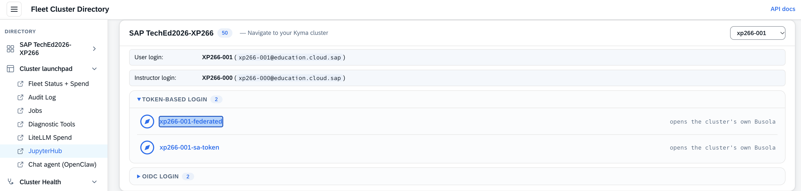
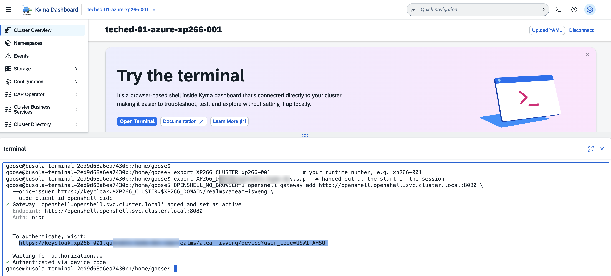
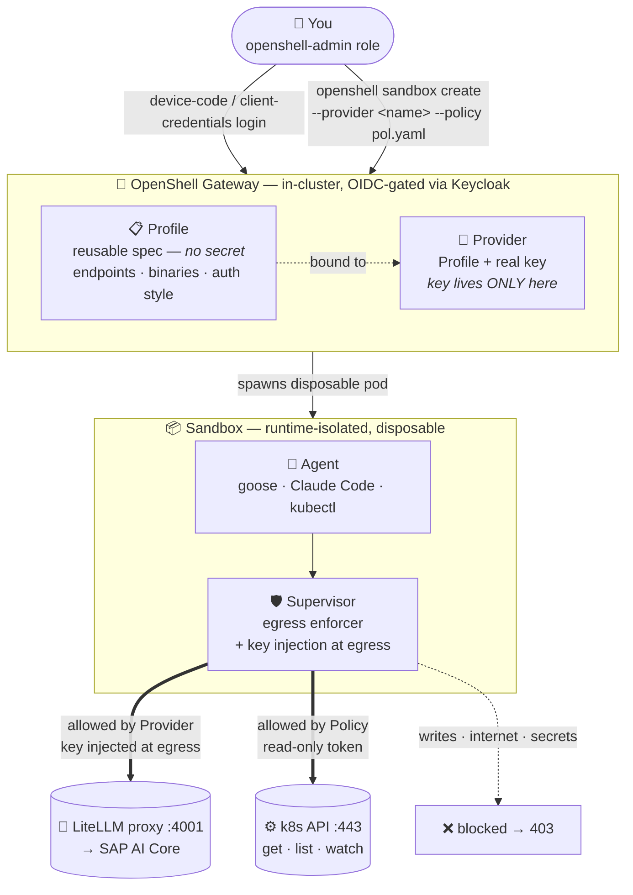

# Exercise 4 - Your sandboxed agent: OpenShell practice with Kyma 🔧

> [!NOTE]
> 👉 **The sandbox itself is the guardrail.**
> - ✅ OpenShell can run the workshop's tools image (`goose` / Claude Code / `kubectl` / `kyma`) inside **runtime-isolated `Sandboxes`** that can reason via SAP AI Core yet are **physically unable** to touch the cluster API or the public internet.
> - ✅ For the nitty-gritty details — the protection layers, the architecture, the glossary — see **Appendix 4**.

👉 This exercise is an **OpenShell practice** — run it either way:

**Contents**

- ⚡ **4a** *(easy path)* — [Run it as a GitHub Action](#4a-easy-path--run-it-as-a-github-action)
- 🛠️ **4b** *(optional)* — [Practice the OpenShell CLI in the in-cluster web terminal](#4b-practice-the-openshell-cli-in-the-in-cluster-web-terminal)

## 4a. Easy path — run it as a GitHub Action

To see **Goose running inside a contained OpenShell sandbox** on your cluster — the production path this exercise builds by hand — **without a terminal**, dispatch one GitHub Actions workflow from your fork:

| Run this workflow | Workflow inputs | What it does |
|---|---|---|
| [**`all-fleets-teched-admin`**](../../../../actions/workflows/all-fleets-teched-admin.yaml) | 👉 Pick<br>• your `student_cluster` (`xp266-NNN`)<br>• a `goose_mode` (`snapshot` / `live`)<br>👉 **Run workflow** → read the run **Summary** (and the report in Busola). | Provisions a **contained OpenShell sandbox** on your cluster and runs **Goose** inside it to produce a Cluster Health report. |

Prefer the hands-on CLI? Continue below.

---

## 4b. Practice the OpenShell CLI in the in-cluster web terminal

You'll walk the full path by hand:

- 🔑 [4.1 terminal & gateway](#41---open-the-terminal-and-reach-the-gateway) — reach the in-cluster OpenShell gateway from the embedded web terminal
- 🔀 [4.2 providers (pre-created)](#42---providers-pre-created--nothing-to-wire) — check the pre-created LLM providers (nothing to wire)
- 📦 [4.3 sandbox](#43---create-a-sandbox-from-the-tools-image-and-use-it) — create a contained sandbox and drive an agent inside it
- 🛡️ [4.4 guardrail](#44---see-the-guardrail-hold) — prove the guardrail holds (writes/egress → `403`)
- 🔎 [4.5 scoped-ops](#45---scoped-ops-an-agent-that-reads-the-cluster-one-command-) — open the read-only **scoped-ops** tier (`kubectl`-on-a-leash)

### 4.1 - Open the terminal and reach the gateway

> [!NOTE]
> - ✅ The `openshell` CLI is **pre-installed in the embedded web terminal** — nothing to download.
> - ✅ The terminal runs *inside* the cluster, so you reach the gateway's in-cluster Service directly (no HTTPS host, no port-forward).
> - ✅ The gateway is **OIDC-gated** — it validates your Keycloak token itself.

1. 👉 Open the **Kyma dashboard** — the Busola of your cluster.

   <table style="width: 100%; border-collapse: collapse; background-color: #f5f5f5;" border="1">
   <tbody>
   <tr>
   <td>
   <div>
   <p float="left">
     <a href="#">
     
     </a>
   </p>
   </div>
   </td>
   </tr>
   </tbody>
   </table>

2. 👉 In Busola, click the **terminal icon** (**`>_`**) in the top-right of the toolbar to open a web terminal.

   <table style="width: 100%; border-collapse: collapse; background-color: #f5f5f5;" border="1">
   <tbody>
   <tr>
   <td>
   <div>
   <p float="left">
     <a href="#">
     _ in the Busola toolbar; the terminal panel shows the full flow (exports, gateway add, device-code URL)" />
     </a>
   </p>
   </div>
   </td>
   </tr>
   </tbody>
   </table>

3. 👉 Set your runtime once, so the commands below are copy-paste (shell names can't have hyphens, hence `XP266_…`):
   ```bash
   export XP266_CLUSTER=xp266-NNN          # your runtime number, e.g. xp266-001
   ```
   ```bash
   export XP266_DOMAIN=<workshop-domain>   # handed out at the start of the session
   ```
4. 👉 Register the gateway. The terminal pod has **no browser**, so use the **device-code (headless) login** (`OPENSHELL_NO_BROWSER=1`):
   ```bash
   OPENSHELL_NO_BROWSER=1 openshell gateway add http://openshell.openshell.svc.cluster.local:8080 \
     --oidc-issuer https://keycloak.$XP266_CLUSTER.$XP266_DOMAIN/realms/ateam-isveng \
     --oidc-client-id openshell-oidc
   ```
   > 💡 **Tip** — Already registered from a previous day? Re-auth instead:
   > ```bash
   > OPENSHELL_NO_BROWSER=1 openshell gateway login openshell
   > ```
   It prints a verification URL and a short code, then waits:
   ```
   To authenticate, visit:
     https://keycloak.xp266-NNN.<workshop-domain>/realms/ateam-isveng/device?user_code=XXXX-XXXX
   Waiting for authorization...
   ```
5. 👉 Open that URL in your **laptop's** browser, sign in (you must hold the **`openshell-admin`** role), and the terminal unblocks:
   ```
   ✓ Authenticated via device code
   ```
6. 👉 Now `openshell sandbox list` works from the terminal — continue with 4.2.

### 4.2 - Providers (pre-created — nothing to wire)

<details>
<summary>🖼️ OpenShell concept diagram — mermaid (rendered)</summary>

<table style="width: 100%; border-collapse: collapse; background-color: #f5f5f5;" border="1">
<tbody>
<tr>
<td>

**Reading the diagram.**

- ✅ You authenticate with Keycloak (device-code from a browser, or client-credentials headless) and issue `openshell sandbox create` to the in-cluster OpenShell Gateway.
- ✅ A **Profile** is a reusable spec — allowed endpoints, which binaries may use them, auth style. No secret.
- ✅ A **Provider** is a Profile bound to a real key — the Gateway pairs them to attach to a sandbox.
- ✅ The key never leaves the Gateway.
- ✅ The Gateway spawns a disposable **Sandbox** pod where the **Agent** (goose / claude / kubectl) talks through the **Supervisor**.
- ✅ The Supervisor intercepts every outbound connection, allows only what the Policy and attached Providers permit, and injects the Provider's key at the wire so the Agent never sees it.
- ✅ Egress to the in-cluster LiteLLM proxy (→ SAP AI Core) and read-only k8s API is allowed; writes, internet, and secret reads come back `403`.



</td>
</tr>
</tbody>
</table>

</details>

Two related concepts, both **already set up** for you on the gateway:

- A **profile** is a reusable *spec* (no secret) — which credential, which auth style, which endpoints egress may reach, which binaries may use it.
- A **provider** is a profile **bound to a real key**; the key lives **only in the gateway**.

List what's there:

```bash
openshell provider profile list     # the specs
```
```
NAME            TYPE      CATEGORY   SOURCE  SCOPE
anthropic       provider  INFERENCE  user    platform
litellm-openai  provider  INFERENCE  user    platform
openrouter      provider  INFERENCE  user    platform
```
```bash
openshell provider list             # the specs bound to a key
```
```
NAME            TYPE            CREDENTIAL_KEYS   CONFIG_KEYS
litellm         anthropic       1                 0
litellm-openai  litellm-openai  1                 0
openrouter      openrouter      1                 0
```

- **`litellm`** (profile `anthropic`) — claude via the in-cluster LiteLLM proxy → SAP AI Core (`x-api-key`, Anthropic-native `/v1/messages`). This is the one you attach in 4.3 (`--provider litellm`).
- **`litellm-openai`** — goose over the OpenAI-compat `/v1/chat/completions` path (`Authorization: Bearer`).
- **`openrouter`** — the external OpenRouter provider (used in the next exercise).

The gateway holds each key; a sandbox created with `--provider <name>` gets only a resolve **sentinel**, swapped for the real key at egress — the box never sees a key.  
*(How these were created — reference only, you don't run it — is in [Appendix 4](../Appendices/4-openshell-concepts/README.md#how-the-providers-were-wired-reference).)*

### 4.3 - Create a sandbox from the tools image and use it

👉 **Create** the sandbox with **both providers**:

```bash
openshell sandbox create --name $XP266_CLUSTER-devbox \
  --from localhost:32137/dev-toolbox-bash:latest \
  --provider litellm --provider litellm-openai --detach -- sleep infinity &
# ^ backgrounded with & — press Enter after it prints "Created sandbox" to get your prompt back
openshell sandbox list        # wait for PHASE=Ready
```

<table style="width: 100%; border-collapse: collapse; background-color: #f5f5f5;" border="1">
<tbody>
<tr>
<td>
<div>
<p float="left">
  <a href="#">
  
  </a>
</p>
</div>
</td>
</tr>
</tbody>
</table>

> [!NOTE]
> The trailing `&` backgrounds the create so it doesn't hold the terminal while the box spins up — **press Enter** after it prints `Created sandbox` to return to your prompt.  
> The sandbox keeps running `sleep infinity`.
>
> Attach **both** inference providers — `litellm` (claude, Anthropic-native) and `litellm-openai` (goose, OpenAI-compat) — so either agent works inside the box; each gets only a resolve sentinel.  
> The box is **contained by default**: its only egress is the providers' endpoint (`litellm-proxy:4001`) — the apiserver, other pods, and the internet are all denied (you'll prove it in 4.4).

> [!TIP]
> **A different option — the hardened Garden-Linux image.** Separately from `dev-toolbox-bash` (used above), your
> cluster also carries **`ops-toolbelt-bash`**: the agent kit (goose + Claude Code + `openshell` + `kubectl`/`kyma`/`k9s`)
> built on **SAP Garden Linux** — a security-hardened, minimal distribution (the same userland Gardener nodes run). It is
> its own image; run that option by pointing `--from` at it:
> ```bash
> openshell sandbox create --name $XP266_CLUSTER-devbox \
>   --from localhost:32137/ops-toolbelt-bash:latest \
>   --provider litellm --provider litellm-openai --detach -- sleep infinity &
> ```
> `cat /etc/os-release` inside shows `Garden Linux 2150.9.0`. The sandbox flow is the same; what differs is the hardened base.

👉 **Prove it reasons through SAP AI Core — two options below.**

#### A — one-shot `exec` (run a command in the box without entering it)

```bash
openshell sandbox exec --name $XP266_CLUSTER-devbox -- bash -c \
  'curl -sS -XPOST http://litellm-proxy.default.svc.cluster.local:4001/v1/messages \
   -H "content-type: application/json" -H "anthropic-version: 2023-06-01" \
   -H "x-api-key: $ANTHROPIC_API_KEY" \
   -d "{\"model\":\"anthropic--claude-4.7-opus\",\"max_tokens\":16,\"messages\":[{\"role\":\"user\",\"content\":\"Reply OK\"}]}"'
```

#### B — interactive shell (`exec` in, then run the same without the wrapper or escaping)

```bash
openshell sandbox exec --name $XP266_CLUSTER-devbox -- bash   # → goose@default--$XP266_CLUSTER-devbox:~$
```

```bash
# inside the sandbox:
curl -sS -XPOST http://litellm-proxy.default.svc.cluster.local:4001/v1/messages \
  -H "content-type: application/json" -H "anthropic-version: 2023-06-01" \
  -H "x-api-key: $ANTHROPIC_API_KEY" \
  -d '{"model":"anthropic--claude-4.7-opus","max_tokens":16,"messages":[{"role":"user","content":"Reply OK"}]}'
```

<table style="width: 100%; border-collapse: collapse; background-color: #f5f5f5;" border="1">
<tbody>
<tr>
<td>
<div>
<p float="left">
  <a href="#">
  
  </a>
</p>
</div>
</td>
</tr>
</tbody>
</table>

> [!NOTE]
> You are now **inside the sandbox** — the prompt reads `goose@default--$XP266_CLUSTER-devbox:~$`. Type **`exit`** to leave the sandbox and return to the Busola web-terminal prompt.

Either way:
```json
{"id":"msg_bdrk_...","model":"anthropic--claude-4.7-opus", ... "content":[{"type":"text","text":"OK"}] ... }
```

> [!TIP]
> The `msg_bdrk_` id prefix is your proof the request round-tripped **SAP AI Core** (Bedrock).

#### C — drive Claude Code from inside the shell

👉 From inside the sandbox shell (option B), point Claude Code at its one allowed endpoint (`litellm-proxy…:4001`), reuse the injected sentinel as the Bearer token, **and pin the SAP AI Core model ids**:

```bash
# inside the sandbox:
export ANTHROPIC_BASE_URL=http://litellm-proxy.default.svc.cluster.local:4001
export ANTHROPIC_AUTH_TOKEN="$ANTHROPIC_API_KEY"   # sent as 'Authorization: Bearer'; supervisor injects the real key at egress
unset  ANTHROPIC_API_KEY                            # drop the x-api-key path — it triggers Claude's "use this custom key?" prompt → hangs headless (see TIP)
export ANTHROPIC_MODEL=anthropic--claude-4.7-opus              # the SAP AI Core model id — WITHOUT this, Claude Code sends its own default id (e.g. "Opus 5"), which the proxy doesn't have → calls fail
export ANTHROPIC_SMALL_FAST_MODEL=anthropic--claude-4.6-sonnet
export CLAUDE_CODE_DISABLE_UNKNOWN_MODEL_WINDOW_ENFORCEMENT=1  # accept the non-standard model id's context window
```

```bash
claude --version
```

```bash
claude -p "In one line, what is Kyma?"
```

<table style="width: 100%; border-collapse: collapse; background-color: #f5f5f5;" border="1">
<tbody>
<tr>
<td>
<div>
<p float="left">
  <a href="#">
  
  </a>
</p>
</div>
</td>
</tr>
</tbody>
</table>

> [!TIP]
> 👉 **Why does the block above copy the key into `ANTHROPIC_AUTH_TOKEN` and `unset` `ANTHROPIC_API_KEY`?**
>
> - ✅ With `ANTHROPIC_API_KEY` set, Claude Code sends it as an `x-api-key` header, which triggers an interactive *"Detected a custom API key — use it?"* prompt — so `claude -p` hangs on a headless run.
> - ✅ Passing the sentinel as `ANTHROPIC_AUTH_TOKEN` instead makes Claude Code emit `Authorization: Bearer`, which has no prompt.
> - ✅ Don't set both variables at once — Claude Code warns *"Both … set · auth may not work."*
> - ✅ The supervisor resolves the sentinel in either header, so both reach SAP AI Core; only Bearer is prompt-free.

> [!NOTE]
> 👉 It's a **reasoning box, not an ops shell**:
>
> - ✅ `kubectl` / `kyma` / `k9s` are installed but **inert** (no cluster token, no route to the API server — you'll prove that in the next step).
> - ✅ For an agent whose `kubectl` / `kyma` actually reach the cluster, use the Busola web terminal; the sandbox trades cluster access for hard isolation.

Type **`exit`** to return to the terminal — the sandbox keeps running (re-enter any time with `openshell sandbox exec --name $XP266_CLUSTER-devbox -- bash`).

### 4.4 - See the guardrail hold

The whole point: from **inside** the sandbox, the cluster API and the internet are unreachable.  
Two layers stack —
(1) the sandbox has **no service-account token and no cluster CA**, so nothing can even *authenticate* to the API; and
(2) it has **no direct network route out at all** — egress is intercepted **transparently** by the supervisor (there's no
`HTTPS_PROXY` to point at): it opens connections **only** to policy-allowed hosts.

The contained tier allows just
`litellm-proxy…:4001`; every other host is **refused** (the name may resolve to a synthetic intercept address, but the
connection never completes).  
A bare `kubectl` won't demonstrate this cleanly (with no KUBECONFIG it just hits
`localhost:8080`), so probe the network directly with `curl`.

**Probe A — try to reach the apiserver:**
```bash
openshell sandbox exec --name $XP266_CLUSTER-devbox -- bash -c \
  'curl -sS -m 5 -o /dev/null -w "apiserver=%{http_code}\n" http://kubernetes.default.svc.cluster.local/version; echo "exit=$?"'
```
Result — the apiserver host is **not on the allow-list**, so the supervisor refuses the connection:
```
curl: (7) Failed to connect to kubernetes.default.svc.cluster.local port 80: Couldn't connect to server
apiserver=000
exit=7
```

**Probe B — confirm there's no proxy to bypass, and the internet is unreachable:**
```bash
openshell sandbox exec --name $XP266_CLUSTER-devbox -- bash -c \
  'echo "HTTPS_PROXY=${HTTPS_PROXY:-<unset>}"; \
   curl -sS -m 5 -o /dev/null -w "internet=%{http_code}\n" https://api.anthropic.com; echo "exit=$?"'
```
Result — egress is **transparent** (no proxy env to bypass), and any non-allow-listed host is refused:
```
HTTPS_PROXY=<unset>
curl: (7) Failed to connect to api.anthropic.com port 443: Couldn't connect to server
internet=000
exit=7
```

**Probe C — the real LLM key never enters the sandbox (only a sentinel does):**
```bash
openshell sandbox exec --name $XP266_CLUSTER-devbox -- bash -c 'echo "ANTHROPIC_API_KEY=$ANTHROPIC_API_KEY"'
```
The value is a **resolve sentinel** — `openshell:resolve:env:<nonce>_ANTHROPIC_API_KEY` — **not** the real key.  
The
supervisor swaps it for the real key only at the allow-listed egress; echo it inside the box and you get only the token.  
(With an admin kubeconfig you can also confirm the sandbox's service account can't read the key from the cluster:
`kubectl auth can-i get secrets --as=system:serviceaccount:openshell:openshell-sandbox -n openshell` → **no**.)

So the sandbox can reach **only** `litellm-proxy…:4001` (→ SAP AI Core) — the apiserver, other workloads, and the public
internet are all **refused** by the egress broker.  
That containment is **native to the stock OpenShell chart** — no NetworkPolicy required — a
stronger boundary than the RBAC-fenced Busola terminal, which is still an ordinary pod on the
cluster network.  
Clean up when done:

```bash
openshell sandbox delete $XP266_CLUSTER-devbox
```

### 4.5 - Scoped-ops: an agent that *reads* the cluster (one command) 🔎

The contained sandbox (4.3) is a pure **compute** box — zero cluster access.  
The **scoped-ops** tier adds exactly one
capability: a **read-only** view of the cluster, so an agent can *diagnose* (never mutate).  
From the **Busola web
terminal** it's a single command — **`scoped-ops`** — which creates the sandbox, applies the cluster-ops network policy,
mints a short-lived **read-only** token, injects a kubeconfig + the LLM env, and drops you **inside** with `kubectl`,
`goose`, and `claude` already wired:

> [!IMPORTANT]
> **What makes this the "scoped" tier vs the contained §4.3 box — two things, both required:**
> 1. **A `--policy` with a `k8s_api` block** that opens the network path to the apiserver (`kubernetes.default.svc:443`, **read-only**, only for the `kubectl`/`kyma` binaries) — on top of the LLM egress the providers already give. The contained box has no such path, so its §4.4 apiserver probe is refused.
> 2. **A read-only identity** — `scoped-ops` mints a short-lived `sandbox-viewer` SA token (`get`/`list`/`watch`, **secrets excluded**) and injects a kubeconfig. Network access alone isn't enough; the apiserver still needs a credential.
>
> Together: `kubectl get` / `kyma alpha diagnose` work, while writes and secret-reads return `403`. The LLM keys still never enter the box (both agents stay sentinel-contained); the one real credential injected is that minimal read-only kubectl token.

```bash
scoped-ops                     # or give it a name:  scoped-ops $XP266_CLUSTER-devbox
#   >> creating scoped-ops sandbox 'ops-…' from …/dev-toolbox-bash (policy applied at CREATE) …
#   >> minting a short-lived (2h) sandbox-viewer token + injecting creds …
#   >> entering 'ops-…' …
#   >> scoped-ops agent ready — read-only cluster + goose/claude via SAP AI Core. Try:
#      kubectl get nodes   |   goose run --text '…'   |   claude -p '…'
```
> [!TIP]
> **The hardened Garden-Linux option applies here too:** `scoped-ops --from ops-toolbelt-bash` runs this same read-only
> tier on the `ops-toolbelt-bash` image instead of the default `dev-toolbox-bash`. (`scoped-ops` also accepts a full ref
> or `OPS_IMAGE=…`; a bare short name expands to your cluster's registry.)
You're now inside the box (`[<shoot>] goose@default--…:~$` — the prompt shows your logical shoot name, e.g. `xp266-001`),
env auto-loaded.  
Prove the read-only cluster access, then let the agents drive it:

```bash
kubectl get nodes                        # ✓ read-only (a write → 403, refused by RBAC)
```
```bash
# goose — agentic by default: it runs kubectl / kyma itself and reasons over the output:
goose run --text "run 'kubectl get pods -A' and 'kyma alpha diagnose', then summarize any unhealthy workloads and module issues"
```
```bash
# Clean report only — strip goose's tool-call trail + deliberations and print just the final answer. `--output-format
# json` emits the whole session; the tiny extractor keeps the assistant text AFTER the last tool call:
goose run --quiet --output-format json --text 'which pods are unhealthy and why, any orphaned pvcs?' \
| python3 -c '
import sys, json
m = json.load(sys.stdin).get("messages", [])
# index of the last message that made a tool call
lt = max([-1] + [
    i for i, x in enumerate(m)
    if any("tool" in b.get("type", "").lower() for b in x.get("content", []))
])
# print the assistant text that comes AFTER the last tool call
print("\n".join(
    b.get("text", "")
    for x in m[lt + 1:] if x.get("role") == "assistant"
    for b in x.get("content", []) if b.get("type") == "text"
).strip())
'
```
```bash
# claude — give it an IMPERATIVE, tool-directed prompt. A bare question ('which pods are unhealthy?') makes Claude
# answer conversationally and ask for context; telling it to RUN the commands makes it act like goose:
claude -p 'Use kubectl to find unhealthy pods and explain why. Run: kubectl get pods -A, then kubectl describe pod / kubectl logs on anything not Running or Completed, and summarize the root causes (CrashLoopBackOff, ImagePullBackOff, OOMKilled, failing probes). Be concise.'
```
Type **`exit`** to leave — the sandbox keeps running (re-enter any time with `openshell sandbox exec --name <name> -- bash`);
`openshell sandbox delete <name>` when you're done.

#### Why it's still contained — just a little wider
- **Network (L7 policy):** exactly two egresses are allowed — the **apiserver** (read-only) and the **LiteLLM proxy**
  (`litellm-proxy…:4001`, for **both** goose and claude). **Both LLM keys stay in the gateway** — each agent sends only the
  injected resolve sentinel, swapped for the real key at egress. The public internet and every other workload stay denied —
  same guardrail you proved in 4.4, just with the apiserver added read-only.
- **RBAC:** the injected token is a dedicated **read-only** identity — `get`/`list`/`watch` only, and **`secrets` are
  excluded** — so `kubectl get`/`describe`/`logs` and `kyma alpha diagnose` work, but writes and secret-reads are refused.
- **Honest trade-off vs 4.3:** the **LLM keys never enter the box** (both agents are sentinel-contained). The one real
  credential scoped-ops injects is the **kubectl token** — the apiserver needs a *real* token, so it's a deliberately
  **minimal, read-only, short-lived (2h)** one. The contained tier (4.3) holds **no** cluster credential at all. Choose the
  tier by how much you trust the workload.

> [!TIP]
> **goose vs claude in one line:** `goose run` runs tools on its own; `claude -p` needs the imperative *"Run … then …"*
> phrasing to act rather than ask.  
> Both reason via SAP AI Core.  
> The terminal image pre-allows read-only
> `kubectl get/describe/logs/top` + `kyma` for Claude Code, so those run without a permission prompt.  
> A deep
> `kyma alpha diagnose istio` will *time out* — it reaches the mesh sidecars directly, which the sandbox's egress doesn't
> allow; the apiserver-based diagnostics work fine.

---

## Summary

You ran the workshop's tools image as a
**runtime-isolated OpenShell `Sandbox`**: wired the inference providers (the agent never holds the key), proved the
egress guardrail (apiserver + internet unreachable, no route to bypass), and opened the read-only **scoped-ops** tier for
cluster diagnostics.  
Under the hood it's a **gated control plane + credential-injecting supervisor + L7 allow-list** riding
the stock **agent-sandbox** runtime — no fork, no extra network config.  
*The sandbox is the guardrail.*

Continue to - [Exercise 5 - External agents: Pi, opencode & Qwen via OpenRouter](../ex5/README.md)  
Back to - [Overview](../../README.md)
