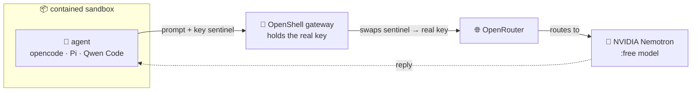

# Exercise 5 - External agents: Pi, opencode & Qwen via OpenRouter 🔧

This exercise runs a **different** contained sandbox. In the earlier exercises the sandbox's only exit was the
in-cluster LiteLLM proxy; here it is **OpenRouter** — one external host, and nothing else. The box still can't reach
the apiserver or the rest of the internet, and the real OpenRouter key never enters it: the gateway holds the key and
the sandbox only ever carries a sentinel.

> [!NOTE]
> How the provider/profile model works and how OpenRouter compares to SAP AI Core are in **[Appendix 5 - External agents & the OpenRouter provider model](../Appendices/5-openrouter-provider/README.md)**.

## ⚡ 5a. Easy path — run it as a GitHub Action

Want to run external coding agents against OpenRouter **without opening a terminal**? Dispatch the GitHub Actions workflow below from your fork. It creates the OpenRouter-enabled contained sandbox on your cluster and runs the coding agent(s) inside it — the run **Summary** gives you a verdict table, each agent's output, and the containment proof.

<!-- MAINTAINER NOTE: the `all-fleets-teched-student-nvidia` workflow link below MUST stay a RELATIVE path
     (`../../../../actions/workflows/…`). GitHub resolves it against the viewer's current fork URL,
     so a student browsing their own fork lands on THEIR fork's Actions tab (which is where their
     admin workflow lives). An absolute `https://github.com/SAP-samples/...` link would always point
     to the upstream public repo instead — where the student cannot dispatch a run. Keep relative.
     Same pattern used in last year's teched README, e.g.
     [k8s-data-context-student](../../../../actions/workflows/k8s-data-context-student.yml). -->

| Run this workflow | Workflow inputs |
|---|---|
| [**`all-fleets-teched-student-nvidia`**](../../../../actions/workflows/all-fleets-teched-student-nvidia.yaml) | 👉 Pick<br>• **`student_cluster`** — type **your** cluster (e.g. `xp266-003`); overwrite the default `xp266-NNN` placeholder<br>• **`agent`** — `pi` / `opencode` / `qwen` / `all-three`<br>• **`model`** — a `:free` OpenRouter model<br>• **`scenario`** — a task preset (pick `custom` to use the free-text prompt field)<br>👉 **Run workflow** → read the run **Summary**. |

> [!NOTE]
> 👉 **Can't run the workflow on your own fork?** No problem —
> - ✅ open the **Actions** tab on this public upstream repo,
> - ✅ find a successful **`all-fleets-teched-student-nvidia`** run, and
> - ✅ read the **Summary** page (verdict table + each agent's output + the containment proof)
> - ✅ plus any step's **execution log**.
>
> 👉 You see the exact same artifacts a dispatcher would, just from someone else's run.

Prefer the Do-It-Yourself path? Continue below.

---

## 🛠️ 5b. OpenShell CLI in the Busola web terminal

You'll walk the full path by hand:

- 🔑 [5.1 Open the terminal and reach the gateway](#-51---open-the-terminal-and-reach-the-gateway) — reach the in-cluster OpenShell gateway from the embedded web terminal
- 📦 [5.2 Create a sandbox with the agents + OpenRouter](#-52---create-a-sandbox-with-the-agents--openrouter) — spin up the OpenRouter-enabled contained sandbox
- ▶️ [5.3 Run an agent against a free model](#️-53---run-an-agent-against-a-free-model) — Pi / opencode / Qwen on a `:free` model
- 🛡️ [5.4 Prove it's still contained](#️-54---prove-its-still-contained) — the sandbox still refuses the apiserver and the public internet
- 🏗️ [5.5 From draft to deployable: a correct KRO RGD](#️-55---from-draft-to-deployable-a-correct-kro-rgd) — close the loop: produce a working KRO ResourceGraphDefinition

### 🔑 5.1 - Open the terminal and reach the gateway

> [!NOTE]
> - ✅ The `openshell` CLI is **pre-installed in the embedded web terminal** — nothing to download.
> - ✅ The terminal runs *inside* the cluster, so you reach the gateway's in-cluster Service directly (no HTTPS host, no port-forward).
> - ✅ The gateway is **OIDC-gated** — it validates your Keycloak token itself.

1. 👉 Open the **Kyma dashboard** — the Busola of your cluster.

   <table style="width: 100%; border-collapse: collapse; background-color: #f5f5f5;" border="1">
   <tbody>
   <tr>
   <td>
   <div>
   <p float="left">
     <a href="#">
     
     </a>
   </p>
   </div>
   </td>
   </tr>
   </tbody>
   </table>

2. 👉 In Busola, click the **terminal icon** (**`>_`**) in the top-right of the toolbar to open a web terminal.

   <table style="width: 100%; border-collapse: collapse; background-color: #f5f5f5;" border="1">
   <tbody>
   <tr>
   <td>
   <div>
   <p float="left">
     <a href="#">
     _ in the Busola toolbar; the terminal panel shows the full flow (exports, gateway add, device-code URL)" />
     </a>
   </p>
   </div>
   </td>
   </tr>
   </tbody>
   </table>

   > 💡 **Tip** — Clear the terminal screen at any point:
   > - ✅ **`Ctrl+L`** — fastest; clears the visible screen, keeps your prompt + scrollback buffer intact.
   > - ✅ **`clear`** — clears the visible screen (some setups also wipe the scrollback).
   > - ✅ **`clear -x`** — clears the visible screen but explicitly **keeps** the scrollback buffer.
   > - ✅ **`reset`** — full terminal re-init; use if the terminal freezes, shows broken escape codes, or is littered with binary artifacts.
   > - ✅ **`printf "\033c"`** — hard reset: wipes the screen AND flushes scrollback (nothing to scroll back to).

3. 👉 Set your runtime once, so the commands below are copy-paste (shell names can't have hyphens, hence `XP266_…`):
   ```bash
   export XP266_CLUSTER=xp266-NNN          # your runtime number, e.g. xp266-001
   ```
   ```bash
   export XP266_DOMAIN=<workshop-domain>   # handed out at the start of the session
   ```
4. 👉 Register the gateway. The terminal pod has **no browser**, so use the **device-code (headless) login** (`OPENSHELL_NO_BROWSER=1`):
   ```bash
   OPENSHELL_NO_BROWSER=1 openshell gateway add http://openshell.openshell.svc.cluster.local:8080 \
     --oidc-issuer https://keycloak.$XP266_CLUSTER.$XP266_DOMAIN/realms/ateam-isveng \
     --oidc-client-id openshell-oidc
   ```
   > 💡 **Tip** — Already registered from a previous day? Re-auth instead:
   > ```bash
   > OPENSHELL_NO_BROWSER=1 openshell gateway login
   > ```
   It prints a verification URL and a short code, then waits:
   ```
   To authenticate, visit:
     https://keycloak.xp266-NNN.<workshop-domain>/realms/ateam-isveng/device?user_code=XXXX-XXXX
   Waiting for authorization...
   ```
5. 👉 Open that URL in your **laptop's** browser, sign in (you must hold the **`openshell-admin`** role), and the terminal unblocks:
   ```
   ✓ Authenticated via device code
   ```
6. 👉 Now `openshell sandbox list` works from the terminal — continue with 5.2.


### 📦 5.2 - Create a sandbox with the agents + OpenRouter

In a web terminal, with your gateway session active.

👉 Pick a current `:free` model:
```bash
export FREE_MODEL=nvidia/nemotron-3-ultra-550b-a55b:free   # a current :free NVIDIA model — swap if it goes paid
```

👉 Then create the sandbox:
```bash
openshell sandbox create --name agents \
  --from localhost:32137/openrouter-agents:latest \
  --provider openrouter \
  --env OPENAI_BASE_URL=https://openrouter.ai/api/v1 \
  --env OPENAI_MODEL=$FREE_MODEL \
  --detach -- sleep infinity &
# ^ backgrounded with & — press Enter after it prints "Created sandbox" to get your prompt back
```

👉 Wait for `PHASE=Ready`:
```bash
openshell sandbox list
```
`--provider openrouter` grants the sandbox egress to `openrouter.ai` (+ `models.dev`) **for the agent binaries only**
and injects the key sentinel.

`--env` passes the base URL + default model (OpenAI-compat agents like Qwen Code need them).

### ▶️ 5.3 - Run an agent against a free model

<table style="width: 100%; border-collapse: collapse; background-color: #f5f5f5;" border="1">
<tbody>
<tr style="height: 193px;">
<td style="width: 71.6%; height: 193px;">

<div>

The sandbox image ships **three** terminal coding agents — all pre-installed, all pointed at OpenRouter.



</div>
</td>
</tr>
</tbody>
</table>

**The NVIDIA Nemotron models.**

- ✅ OpenRouter puts many providers behind one endpoint, and its `:free` tier includes models from NVIDIA's **Nemotron** family.
- ✅ Because the agents call tools, the models must be **chat/completion models with tool-calling**.
- ✅ Other, embedding/rerank models (ids with `-embed-`/`-rerank-`) won't work for this purpose.
- ✅ Two known-good free picks:

| Model | When to use it |
|---|---|
| **`nvidia/nemotron-3-ultra-550b-a55b:free`** | large, higher-quality — your `$FREE_MODEL` default |
| **`nvidia/nemotron-3.5-lightning:free`** | smaller and faster — if the ultra is busy or rate-limited |

The agent never sees the real key, and the sandbox reaches nothing but the gateway's one allowed hop to OpenRouter.

👉 Run each agent in web terminal — same contained sandbox, same model:

| Agent | How to run it? |
|---|---|
| 🧩 [**opencode**](https://opencode.ai) | `openshell sandbox exec --name agents -- opencode run -m openrouter/$FREE_MODEL "Reply with one word: PONG"` → `PONG` |
| 🥧 [**Pi**](https://www.npmjs.com/package/@earendil-works/pi-coding-agent) | `openshell sandbox exec --name agents -- pi -p --model openrouter/$FREE_MODEL "List 3 facts about Kyma."` |
| 🐉 [**Qwen Code**](https://github.com/QwenLM/qwen-code) | `openshell sandbox exec --name agents -- qwen -p "List 3 facts about Kyma."` (takes no `-m`; reads `OPENAI_MODEL` = your `$FREE_MODEL`) |

### 🛡️ 5.4 - Prove it's still contained

The containment is **binary-scoped**, not just host-scoped — the `openrouter` provider's policy only lets the **agent binaries** (`pi` / `opencode` / `qwen`) talk to `openrouter.ai`. Anything else dialing out from the sandbox — including `curl` — is denied, for every host.

👉 First, confirm `curl` can't reach **anywhere** (not even `openrouter.ai`), and the key in the environment is a sentinel:
```bash
openshell sandbox exec --name agents -- sh -c '
  curl -sS -m8 -o /dev/null -w "openrouter.ai (via curl): %{http_code}\n" https://openrouter.ai/api/v1/models
  curl -sS -m8 https://example.com            >/dev/null 2>&1 && echo "example.com: REACHED" || echo "example.com: blocked"
  curl -sS -m8 https://kubernetes.default.svc >/dev/null 2>&1 && echo "apiserver: REACHED"   || echo "apiserver: blocked"
  echo "key in box: $OPENROUTER_API_KEY"
'
```
Expected output:
```
openrouter.ai (via curl): 000       ← even openrouter.ai is blocked for curl (not an allowed binary)
example.com: blocked
apiserver: blocked
key in box: openshell:resolve:env:…      ← a sentinel, NOT the real key
```

👉 Then confirm the agent binaries CAN reach `openrouter.ai` (the one allowed exit):
```bash
openshell sandbox exec --name agents -- opencode run -m openrouter/$FREE_MODEL "Reply with one word: PONG"
```
Expected: `PONG`.

Together: curl blocked for every host, agents work only via the allowed binary + the resolve-sentinel key. Containment is tighter than "only openrouter.ai is allowed" — it's "only `pi`/`opencode`/`qwen` can reach openrouter.ai".

So this is a *different* tier, not a weaker one:

| | scoped-ops (previous) | **external agent (this exercise)** |
|---|---|---|
| LLM | in-cluster LiteLLM → SAP AI Core | **public OpenRouter (keyed, key in gateway only)** |
| Egress | in-cluster proxy only; **no internet** | **`openrouter.ai` + `models.dev` only; nothing else** |
| Cluster | read-only kubectl (sandbox-viewer) | none |
| Key in box | sentinel | sentinel |

### 🏗️ 5.5 - From draft to deployable: a correct KRO RGD

When you ask an agent for *"a KRO ResourceGraphDefinition"*, a free model's first draft is usually **confident but
wrong** — it reaches for OpenAPI schema (`type`/`properties`/`x-kro`), Helm templating (`{{ .spec.x }}`), or invented
fields (`spec.nodes`/`components`/`graph`).  
KRO is a niche CRD the model hasn't memorised.  
That's the real lesson of
this exercise: **the agent drafts, the cluster adjudicates — you iterate.**

👉 Use one of the agents to generate the code — a real coding task against your `:free` model. Pipe its output to a file in the terminal:

```bash
# 🥧 Pi
openshell sandbox exec --name agents -- pi -p --model openrouter/$FREE_MODEL \
  'Write a KRO ResourceGraphDefinition (apiVersion kro.run/v1alpha1) that provisions a Pod which curls the open-meteo weather API for a given latitude/longitude. Output ONLY the YAML, no prose or code fences.' \
  > weather-rgd.yaml
```

```bash
# 🧩 opencode
openshell sandbox exec --name agents -- opencode run -m openrouter/$FREE_MODEL \
  'Write a KRO ResourceGraphDefinition (apiVersion kro.run/v1alpha1) that provisions a Pod which curls the open-meteo weather API for a given latitude/longitude. Output ONLY the YAML, no prose or code fences.' \
  > weather-rgd.yaml
```

```bash
# 🐉 Qwen Code
openshell sandbox exec --name agents -- qwen -p \
  'Write a KRO ResourceGraphDefinition (apiVersion kro.run/v1alpha1) that provisions a Pod which curls the open-meteo weather API for a given latitude/longitude. Output ONLY the YAML, no prose or code fences.' \
  > weather-rgd.yaml
```

👉 **Hand the draft to the chat agent from [Exercise 2](../ex2/README.md)** for a review before you apply it — the chat agent (Claude Opus via SAP AI Core) reliably catches the kind of bugs a `:free` first draft tends to ship:

```bash
cat weather-rgd.yaml
```

Paste the output into the chat UI from ex2 and ask: *"Review this KRO `ResourceGraphDefinition` — what's wrong and how would you fix it?"* Expect it to flag things like:

- ✅ **Collapsed YAML indentation** — free models often emit flat 1-space nesting that `kubectl` rejects as structurally invalid.
- ✅ **Instance `apiVersion`** missing the `kro.run/` group prefix (plain `v1alpha1` → the API server returns `no matches for kind …`).
- ✅ **CEL references** missing the `schema.` prefix — `${name}` → `${schema.metadata.name}`, `${spec.latitude}` → `${schema.spec.latitude}`.
- ✅ **Status mapping** using Crossplane syntax (`valueFrom.resourceRef` / `jsonPath`) instead of KRO's inline CEL (`${weather-pod.status.…}`).
- ✅ **Apply order** — the instance CRD only exists AFTER KRO materialises the RGD; two docs in one `kubectl apply` on a fresh cluster fails on the second one.

This closes the loop started in **ex1 / ex2**: autonomous **Goose** jobs produce artifacts in the cluster, the **chat agent** reviews them in plain language — same SAP AI Core, same contained guardrails, different roles.

👉 Then validate against the API server — the draft almost always fails:
```bash
kubectl apply --dry-run=server -f weather-rgd.yaml   # the API server + KRO reject an invalid RGD
```

> [!IMPORTANT]
> 👉 **The Busola web terminal can't apply this file.** Even once the YAML is fixed, you'll see:
> ```
> resourcegraphdefinitions.kro.run is forbidden:
>   User "system:serviceaccount:busola-terminal:default" cannot create ...
> ```
> That's the terminal pod's ClusterRole — `get`/`list`/`watch *` + `configmaps:CRUD` + `pods/exec:create`, **no `create` on anything else** (same role we inspected in [Exercise 4.4 — Probe C](../ex4/README.md#probe-c--the-real-llm-key-never-enters-the-sandbox-only-a-sentinel-does)). Applying an RGD from the web terminal is a dead end **by design**.
>
> 👉 **Use the Busola browser instead.** The toolbar has an **Upload YAML** button (top-right). Click it, paste or upload the corrected `weather-rgd.yaml`, and apply — Busola runs the apply as **your** signed-in user, not the terminal pod's narrow SA, so the RGD + instance land cleanly.

The chat agent walks you through **KRO's actual simple-schema rules** AND emits a corrected, deployable YAML — iterate from there. That round-trip (draft → chat review → `--dry-run=server` → fix → apply) **is** the skill this exercise is teaching.

Clean up when done: `openshell sandbox delete agents`

## Summary

You added an **external** LLM provider to the contained-sandbox model,

- ran three terminal coding agents (opencode, Pi, Qwen Code) against free OpenRouter models,
- and proved the sandbox still can't reach anything but the one allow-listed endpoint,
- while the real key stays in the gateway.

That's the OpenShell provider model generalizing from "the in-cluster proxy" to "any governed external endpoint."  
Continue to - [Exercise 6 - Observability and spend](../ex6/README.md)  
Back to - [Overview](../../README.md)
