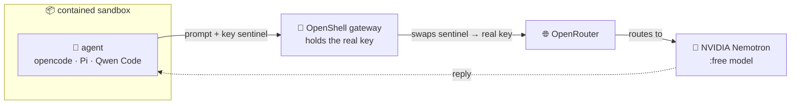

# Exercise 5 - External agents: Pi, opencode & Qwen via OpenRouter 🔧

This exercise runs a **different** contained sandbox. In the earlier exercises the sandbox's only exit was the
in-cluster LiteLLM proxy; here it is **OpenRouter** — one external host, and nothing else. The box still can't reach
the apiserver or the rest of the internet, and the real OpenRouter key never enters it: the gateway holds the key and
the sandbox only ever carries a sentinel.

> [!NOTE]
> How the provider/profile model works and how OpenRouter compares to SAP AI Core are in **[Appendix 5 - External agents & the OpenRouter provider model](../Appendices/5-openrouter-provider/README.md)**.

**Contents**

- ⚡ **5a** *(easy path)* — run it as a **GitHub Action** (see the note below)
- 🛠️ **5b** *(optional)* — the OpenShell CLI in the Busola web terminal:
  - 🔑 [5.1 Open the terminal and reach the gateway](#exercise-51---open-the-terminal-and-reach-the-gateway)
  - 📦 [5.2 Create a sandbox with the agents + OpenRouter](#exercise-52---create-a-sandbox-with-the-agents--openrouter-)
  - ▶️ [5.3 Run an agent against a free model](#exercise-53---run-an-agent-against-a-free-model-)
  - 🛡️ [5.4 Prove it's still contained](#exercise-54---prove-its-still-contained-)
  - 🏗️ [5.5 From draft to deployable: a correct KRO RGD](#exercise-55---from-draft-to-deployable-a-correct-kro-rgd-)

> [!NOTE]
> **Easy path — run it as a GitHub Action.**  
> To run the external coding
> agents against OpenRouter **without a terminal**, dispatch one GitHub Actions workflow from your fork:
>
> | Run this workflow | Workflow inputs | What it does |
> |---|---|---|
> | [**`all-fleets-teched-nvidia`**](../../../../actions/workflows/all-fleets-teched-nvidia.yaml) | 👉 Pick<br>• your `student_cluster` (`xp266-NNN`)<br>• the **`agent`** (`pi` / `opencode` / `qwen` / `all-three`)<br>• a **`model`** (a `:free` OpenRouter model)<br>• a **`scenario`**<br>👉 **Run workflow** → read the run **Summary**: a verdict table, each agent's output, and the containment proof. | Creates the OpenRouter-enabled contained sandbox and runs the coding agent(s) on your cluster. Same agents, same containment, zero local tooling. |
>
> Prefer the hands-on CLI? Continue below.

## Exercise 5.1 - Open the terminal and reach the gateway

The `openshell` CLI is **pre-installed in the embedded web terminal** — nothing to download.  
The terminal runs *inside* the cluster, so you reach the gateway's in-cluster Service directly (no HTTPS host, no port-forward).  
The gateway is **OIDC-gated** — it validates your Keycloak token itself.

1. In Busola, click the **terminal icon** (**`>_`**) in the top-right of the toolbar to open a web terminal.
2. Set your runtime once, so the commands below are copy-paste (shell names can't have hyphens, hence `XP266_…`):
   ```bash
   export XP266_CLUSTER=xp266-NNN          # your runtime number, e.g. xp266-001
   export XP266_DOMAIN=<workshop-domain>   # handed out at the start of the session
   ```
3. Register the gateway. The terminal pod has **no browser**, so use the **device-code (headless) login** (`OPENSHELL_NO_BROWSER=1`):
   ```bash
   OPENSHELL_NO_BROWSER=1 openshell gateway add http://openshell.openshell.svc.cluster.local:8080 \
     --oidc-issuer https://keycloak.$XP266_CLUSTER.$XP266_DOMAIN/realms/ateam-isveng \
     --oidc-client-id openshell-oidc
   #   already registered from a previous day? re-auth instead:
   #   OPENSHELL_NO_BROWSER=1 openshell gateway login openshell
   ```
   It prints a verification URL and a short code, then waits:
   ```
   To authenticate, visit:
     https://keycloak.xp266-NNN.<workshop-domain>/realms/ateam-isveng/device?user_code=XXXX-XXXX
   Waiting for authorization...
   ```
4. Open that URL in your **laptop's** browser and sign in (you must hold the **`openshell-admin`** role). On the **Grant Access to `openshell-oidc`** screen (*User roles · User profile · Email address*), click **Yes**. You'll see **Device Login Successful — you may close this browser window** — close it and return to the terminal, which has unblocked:
   ```
   ✓ Authenticated via device code
   ```

Now `openshell sandbox list` works from the terminal — continue with 5.2.


## Exercise 5.2 - Create a sandbox with the agents + OpenRouter 🔧

In a web terminal, with your gateway session active.

👉 First pick a **current** `:free` model — the lineup **rotates** (models go paid without notice, as `qwen/qwen3.8-27b:free` did). Browse [openrouter.ai/models?max_price=0&q=nvidia](https://openrouter.ai/models?max_price=0&q=nvidia) — free NVIDIA models (this workshop follows NVIDIA's OpenRouter tutorial) — pick a tool-calling chat model and export your choice:
```bash
export FREE_MODEL=nvidia/nemotron-3-ultra-550b-a55b:free   # a current :free NVIDIA model — swap if it goes paid
```

Then create the sandbox:
```bash
openshell sandbox create --name agents \
  --from localhost:32137/openrouter-agents:latest \
  --provider openrouter \
  --env OPENAI_BASE_URL=https://openrouter.ai/api/v1 \
  --env OPENAI_MODEL=$FREE_MODEL \
  --detach -- sleep infinity &
# ^ backgrounded with & — press Enter after it prints "Created sandbox" to get your prompt back
openshell sandbox list        # wait for PHASE=Ready
```
`--provider openrouter` grants the sandbox egress to `openrouter.ai` (+ `models.dev`) **for the agent binaries only**
and injects the key sentinel.

`--env` passes the base URL + default model (OpenAI-compat agents like Qwen Code need them).

## Exercise 5.3 - Run an agent against a free model 🔧

The sandbox image ships **three** terminal coding agents — all pre-installed, all pointed at OpenRouter.



The agent never sees the real key, and the sandbox reaches nothing but the gateway's one allowed hop to OpenRouter.

| Agent | What it is | How you run it |
|---|---|---|
| 🧩 **opencode** | the open-source [opencode.ai](https://opencode.ai) coding agent (one Bun binary) | `opencode run -m openrouter/<id> "…"` (headless) · `opencode` (full-screen TUI) |
| 🥧 **Pi** | [`@earendil-works/pi-coding-agent`](https://www.npmjs.com/package/@earendil-works/pi-coding-agent) — a small Node coding agent | `pi -p --model openrouter/<id> "…"` (headless) · `pi` (TUI) |
| 🐉 **Qwen Code** | [`@qwen-code/qwen-code`](https://github.com/QwenLM/qwen-code) — an **OpenAI-compatible** agent | `qwen -p "…"` (headless) · `qwen` (TUI) — takes **no** `-m` flag; reads `OPENAI_MODEL` (pre-set to your `$FREE_MODEL`) |

**The models — NVIDIA Nemotron, free on OpenRouter.** OpenRouter puts many providers behind one endpoint, and its
`:free` tier includes NVIDIA's **Nemotron** family. Because the agents call tools, the model must be a
**chat/completion model with tool-calling** — embedding/rerank models (ids with `-embed-`/`-rerank-`) will error. Two
known-good free picks:

| Model | When to use it |
|---|---|
| **`nvidia/nemotron-3-ultra-550b-a55b:free`** | large, higher-quality — your `$FREE_MODEL` default |
| **`nvidia/nemotron-3.5-lightning:free`** | smaller and faster — if the ultra is busy or rate-limited |

> [!TIP]
> The `:free` lineup **rotates** — to list the models that are free right now, run:
> ```bash
> openshell sandbox exec --name agents -- curl -s https://openrouter.ai/api/v1/models | grep -o '"id":"[^"]*:free"'
> ```

Run each agent in web terminal — same contained sandbox, same model:

| Agent | Command (→ expected output / note) |
|---|---|
| 🧩 **opencode** | `openshell sandbox exec --name agents -- opencode run -m openrouter/$FREE_MODEL "Reply with one word: PONG"` → `PONG` |
| 🥧 **Pi** | `openshell sandbox exec --name agents -- pi -p --model openrouter/$FREE_MODEL "List 3 facts about Kyma."` |
| 🐉 **Qwen Code** | `openshell sandbox exec --name agents -- qwen -p "List 3 facts about Kyma."` |

## Exercise 5.4 - Prove it's still contained 🔧

The agent reaches OpenRouter — and **nothing else**:  
Command:
```bash
openshell sandbox exec --name agents -- sh -c '
  curl -sS -m8 -o /dev/null -w "openrouter.ai: %{http_code}\n" https://openrouter.ai/api/v1/models
  curl -sS -m8 https://example.com            >/dev/null 2>&1 && echo "example.com: REACHED" || echo "example.com: blocked"
  curl -sS -m8 https://kubernetes.default.svc >/dev/null 2>&1 && echo "apiserver: REACHED"   || echo "apiserver: blocked"
  echo "key in box: $OPENROUTER_API_KEY"
'
```
Output:
```
openrouter.ai: 200
example.com: blocked
apiserver: blocked
key in box: openshell:resolve:env:…      ← a sentinel, NOT the real key
```

So this is a *different* tier, not a weaker one:

| | scoped-ops (previous) | **external agent (this exercise)** |
|---|---|---|
| LLM | in-cluster LiteLLM → SAP AI Core | **public OpenRouter (keyed, key in gateway only)** |
| Egress | in-cluster proxy only; **no internet** | **`openrouter.ai` + `models.dev` only; nothing else** |
| Cluster | read-only kubectl (sandbox-viewer) | none |
| Key in box | sentinel | sentinel |

## Exercise 5.5 - From draft to deployable: a correct KRO RGD 🔧

When you ask an agent for *"a KRO ResourceGraphDefinition"*, a free model's first draft is usually **confident but
wrong** — it reaches for OpenAPI schema (`type`/`properties`/`x-kro`), Helm templating (`{{ .spec.x }}`), or invented
fields (`spec.nodes`/`components`/`graph`).  
KRO is a niche CRD the model hasn't memorised.  
That's the real lesson of
this exercise: **the agent drafts, the cluster adjudicates — you iterate.**

👉 Use **Pi** to generate the code — a real coding task against your `:free` model. Pipe its output to a file in the terminal:
```bash
openshell sandbox exec --name agents -- pi -p --model openrouter/$FREE_MODEL \
  'Write a KRO ResourceGraphDefinition (apiVersion kro.run/v1alpha1) that provisions a Pod which curls the open-meteo weather API for a given latitude/longitude. Output ONLY the YAML, no prose or code fences.' \
  > weather-rgd.yaml
```
(opencode works too: `openshell sandbox exec --name agents -- opencode run -m openrouter/$FREE_MODEL "…" > weather-rgd.yaml`.)

👉 Always validate before trusting — the draft almost always fails:
```bash
kubectl apply --dry-run=server -f weather-rgd.yaml   # the API server + KRO reject an invalid RGD
```

KRO's actual rules (what the drafts get wrong):
- **`spec.schema` is KRO *simple-schema*, not OpenAPI** — each field is `name: type | markers` (types `string`,
  `integer`, `float`, `boolean`; markers `required=true`, `default=…`). No `properties:`, no `required:` list, no `x-kro`.
- **Status fields are CEL strings** that read a created resource by its `id`: `${weatherpod.status.phase}`.
- **Templates substitute instance inputs with CEL** `${schema.spec.<field>}` — **not** `{{ }}`.
- **The instance's `apiVersion` is `kro.run/v1alpha1`** (group `kro.run`), kind = your `schema.kind`.
- KRO is **already installed** on your teched runtime — just `kubectl apply`.

A **corrected, deployable** version (keeps the production touches — namespace, ServiceAccount + RBAC, `securityContext`,
resource limits, two example instances — but uses *real* KRO):

```yaml
---
apiVersion: v1
kind: Namespace
metadata: { name: weather-system }
---
apiVersion: v1
kind: ServiceAccount
metadata: { name: weather-checker, namespace: weather-system }
---
apiVersion: rbac.authorization.k8s.io/v1
kind: Role
metadata: { name: weather-checker, namespace: weather-system }
rules:
  - apiGroups: [""]
    resources: ["pods"]
    verbs: ["get", "list", "watch"]
---
apiVersion: rbac.authorization.k8s.io/v1
kind: RoleBinding
metadata: { name: weather-checker, namespace: weather-system }
roleRef: { apiGroup: rbac.authorization.k8s.io, kind: Role, name: weather-checker }
subjects:
  - { kind: ServiceAccount, name: weather-checker, namespace: weather-system }
---
apiVersion: kro.run/v1alpha1
kind: ResourceGraphDefinition
metadata: { name: weather }          # RGDs are cluster-scoped (no namespace)
spec:
  schema:
    apiVersion: v1alpha1
    kind: Weather
    spec:                            # KRO simple-schema (strings → drop straight into env + the URL)
      name: string | required=true
      latitude: string | required=true
      longitude: string | required=true
      currentFields: string | default="temperature_2m,relative_humidity_2m,wind_speed_10m"
      timezone: string | default="auto"
      sleepSeconds: string | default="3600"
    status:                          # CEL reading the created Pod by its resource id
      podPhase: ${weatherpod.status.phase}
      podIp: ${weatherpod.status.podIP}
      containerImage: ${weatherpod.status.containerStatuses[0].image}
  resources:
    - id: weatherpod
      template:
        apiVersion: v1
        kind: Pod
        metadata:
          name: ${schema.spec.name}
          namespace: weather-system
          labels: { app.kubernetes.io/name: weather-check, app.kubernetes.io/managed-by: kro }
        spec:
          restartPolicy: Never
          serviceAccountName: weather-checker
          securityContext: { fsGroup: 1000 }
          containers:
            - name: weather-query
              image: curlimages/curl:latest
              env:
                - { name: LATITUDE,       value: ${schema.spec.latitude} }
                - { name: LONGITUDE,      value: ${schema.spec.longitude} }
                - { name: CURRENT_FIELDS, value: ${schema.spec.currentFields} }
                - { name: TIMEZONE,       value: ${schema.spec.timezone} }
                - { name: SLEEP_SECONDS,  value: ${schema.spec.sleepSeconds} }
              command: ["/bin/sh", "-c"]
              args:
                - |
                  set -e
                  echo "Weather for $LATITUDE,$LONGITUDE ($CURRENT_FIELDS)"
                  curl -sS "https://api.open-meteo.com/v1/forecast?latitude=$LATITUDE&longitude=$LONGITUDE&current=$CURRENT_FIELDS&timezone=$TIMEZONE" | head -c 4096
                  echo; sleep "$SLEEP_SECONDS"
              resources:
                requests: { cpu: 50m, memory: 64Mi }
                limits:   { cpu: 100m, memory: 128Mi }
              securityContext:
                allowPrivilegeEscalation: false
                runAsNonRoot: true
                runAsUser: 1000
                capabilities: { drop: ["ALL"] }
---
apiVersion: kro.run/v1alpha1       # ← instance of the generated kind, group kro.run
kind: Weather
metadata: { name: berlin, namespace: weather-system }
spec:
  name: weather-berlin
  latitude: "52.52"
  longitude: "13.41"
  currentFields: "temperature_2m,relative_humidity_2m,apparent_temperature,weather_code,wind_speed_10m"
  timezone: "Europe/Berlin"
  sleepSeconds: "1800"
---
apiVersion: kro.run/v1alpha1
kind: Weather
metadata: { name: newyork, namespace: weather-system }
spec:
  name: weather-newyork
  latitude: "40.7128"
  longitude: "-74.0060"
  currentFields: "temperature_2m,relative_humidity_2m,wind_speed_10m"
  timezone: "America/New_York"
  sleepSeconds: "3600"
```

```bash
kubectl apply --dry-run=server -f weather-rgd.yaml   # validate first
```

```bash
kubectl apply -f weather-rgd.yaml                    # then deploy
```

```bash
kubectl -n weather-system get weather,pods
```

```bash
kubectl -n weather-system get weather berlin -o jsonpath='{.status}'   # CEL-derived status
```

> [!NOTE]
> Treat this as *the shape KRO accepts*, not gospel — always `--dry-run=server` first.  
> That round-trip (draft → reject
> → fix) **is** the skill this exercise is teaching.

Clean up when done: `openshell sandbox delete agents`

## Summary

You added an **external, keyed** LLM provider to the contained-sandbox model, ran three terminal coding
agents (opencode, Pi, Qwen Code) against free OpenRouter models, and proved the sandbox still can't reach anything
but the one allow-listed endpoint — with the real key staying in the gateway.  
That's the OpenShell provider model
generalizing from "the in-cluster proxy" to "any governed external endpoint."  
Continue to - [Exercise 6 - Observability and spend](../ex6/README.md)  
Back to - [Overview](../../README.md)
