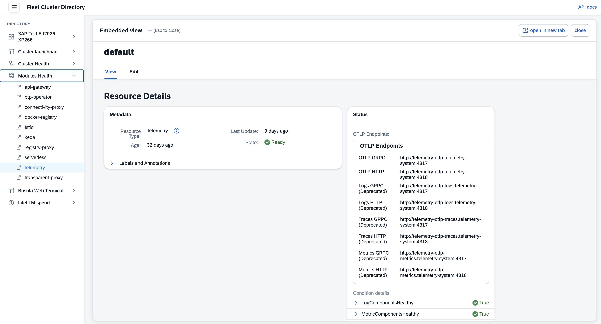
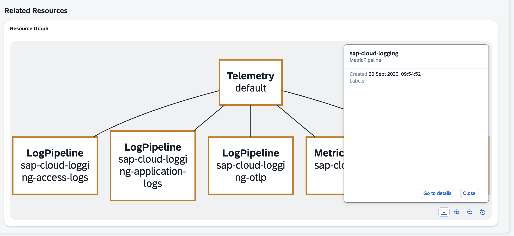
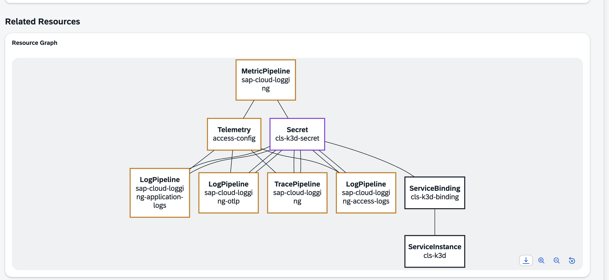
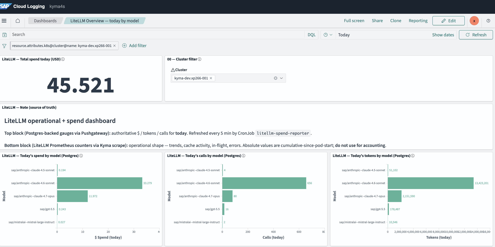
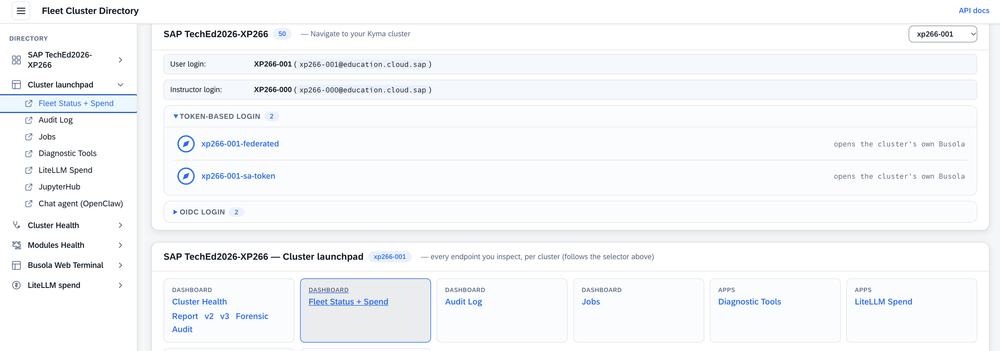
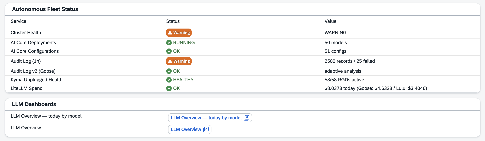

# Exercise 6 - Observability and spend

Running LLMs in production raises an obvious question: **what is this costing, and who is spending it?**  
In this exercise you see how the stack answers that — every call is metered by the LiteLLM proxy, scraped by **Kyma Telemetry**, shipped to **SAP Cloud Logging**, and surfaced as spend you read straight from the **Cluster Directory** portal (one click, no Busola navigation).

```
LiteLLM proxy  ──(Prometheus metrics: spend, tokens, model)──▶  Kyma Telemetry MetricPipeline
                                                                        │
                                                                        ▼
                                                              SAP Cloud Logging (OpenSearch)
                                                                        │
                                              ┌─────────────────────────┴───────────────┐
                                              ▼                                           ▼
                                    LiteLLM Spend dashboard                      LLM Overview dashboard
                                    (one click from the Cluster Directory)       (one click from the Cluster Directory)
```

**Contents**

- 📡 [The telemetry path](#exercise-61---the-telemetry-path-concept)
- 💰 [Open the spend dashboards](#exercise-62---open-the-spend-dashboards)
- 🩺 [The FleetStatus card](#exercise-63---the-fleetstatus-card)


## 📡 Exercise 6.1 - The telemetry path (concept)

1. From the **Student's Portal**, open **Modules Health** and pick the **telemetry** option as depicted below.

   <table style="width: 100%; border-collapse: collapse; background-color: #f5f5f5;" border="1">
   <tbody>
   <tr>
   <td>
   <div>
   <p float="left">
     <a href="#">
     
     </a>
   </p>
   </div>
   </td>
   </tr>
   </tbody>
   </table>

   There, you can look up the **`MetricPipeline`**. It's **cluster-scoped** — one declarative pipe that forwards scraped metrics to SAP Cloud Logging, with no Prometheus server to run and no Grafana to host:

   <table style="width: 100%; border-collapse: collapse; background-color: #f5f5f5;" border="1">
   <tbody>
   <tr>
   <td>
   <div>
   <p float="left">
     <a href="#">
     
     </a>
   </p>
   </div>
   </td>
   </tr>
   </tbody>
   </table>

   <table style="width: 100%; border-collapse: collapse; background-color: #f5f5f5;" border="1">
   <tbody>
   <tr>
   <td>
   <div>
   <p float="left">
     <a href="#">
     
     </a>
   </p>
   </div>
   </td>
   </tr>
   </tbody>
   </table>

   <details>
   <summary>👉 <i>Optional</i> — click to expand the <code>MetricPipeline</code> YAML</summary>

   ```yaml
   apiVersion: telemetry.kyma-project.io/v1alpha1
   kind: MetricPipeline
   metadata:
     name: sap-cloud-logging          # cluster-scoped — one pipeline for the whole cluster
   spec:
     input:
       prometheus:                    # scrape Prometheus-style metrics from these namespaces
         enabled: true
         namespaces:
           include:
             - kube-system            # cilium-agent, cilium-operator, hubble-relay
             - default                # litellm-proxy — the LLM spend metrics
       istio:
         enabled: false
       runtime:                       # kubelet volume metrics → PVC usage as an alertable series
         enabled: true
         resources:
           volume:
             enabled: true
           # pod / container / node / statefulset / deployment / daemonset / job: disabled (keep it lean)
     output:
       otlp:                          # ship via OTLP to SAP Cloud Logging (mTLS)
         endpoint:
           valueFrom:
             secretKeyRef:
               name: sap-cloud-logging       # the CLS ingest Secret (endpoint + client cert/key), pre-created for you
               key: ingest-otlp-endpoint
         headers:
           - name: cluster
             value: xp266-NNN               # tags every metric with your runtime, so fleet dashboards split by cluster
         tls:
           cert:
             valueFrom:
               secretKeyRef:
                 name: sap-cloud-logging
                 key: ingest-otlp-cert
           key:
             valueFrom:
               secretKeyRef:
                 name: sap-cloud-logging
                 key: ingest-otlp-key
   ```

   </details>

> [!NOTE]
> The LiteLLM proxy exposes Prometheus-style metrics (spend per key, tokens in/out, per-model latency). A **pod annotation** marks it for scraping; the `MetricPipeline` (managed by the Kyma **Telemetry** module) ships those metrics out via OTLP to **SAP Cloud Logging**, where they're stored in OpenSearch and visualized.  
> This is the same managed-telemetry pattern SAP BTP gives you for logs, metrics, and traces — you *use* it, you don't operate it.

## 💰 Exercise 6.2 - Open the spend dashboards

The dashboards are one click away from the **Cluster Directory** — no Busola navigation needed.

1. Open the Cluster Directory and scroll to the **LiteLLM spend** section (replace `xp266-NNN` and `<workshop-domain>`):

   ```
   https://busola.xp266-NNN.<workshop-domain>/clusterdir/
   ```

   It shows **today's spend** for your cluster inline — attributed by model and caller — plus two buttons that open the full **SAP Cloud Logging** (OpenSearch) dashboards in a new tab, single sign-on:

   - **LiteLLM Overview — today by model** — today's spend split
   - **LiteLLM Overview** — request volume, token throughput, and per-model latency

   The **LiteLLM Overview — today by model** dashboard looks like this — a headline **Total spend today** gauge, a cluster filter (pre-scoped to your `xp266-NNN`), and three bar charts attributing today's **spend / calls / tokens** per model:
<table style="width: 100%; border-collapse: collapse; background-color: #f5f5f5;" border="1">
<tbody>
<tr>
<td>
<div>
<p float="left">
  <a href="#">
  
  </a>
</p>
</div>
</td>
</tr>
</tbody>
</table>

2. Read the split. You'll see spend attributed by **API key / caller** and by **model**:

   | Caller | Tier / model | Typical share |
   |---|---|---|
   | Goose diagnostic jobs | `reasoning-fast` — Sonnet | steady, scheduled |
   | Chat + terminal agents | `reasoning-hard` — Opus | bursty, interactive |
   | JupyterHub notebooks | whatever you call | your experiments show up here |

> [!TIP]
> This is the pay-off of routing **everything through one proxy**: because no agent talks to a model directly, *every* token is attributable.  
> Trigger a diagnose run or chat with the agent, wait a minute, and watch your own activity appear on the dashboard.

<details>
<summary>🧮 <b>The math behind the dashboards</b> (click to expand)</summary>

Every panel on the LiteLLM Overview dashboards reads the same three Postgres-backed gauges that the dev-toolbox diagnose job pushes every 10 min:

```
litellm_actual_spend_usd  { model, cluster, window="today" }
litellm_actual_calls      { model, cluster, window="today" }
litellm_actual_tokens     { model, cluster, window="today" }
```

Each push is `SUM(spend) WHERE "startTime" >= CURRENT_DATE GROUP BY model` — accumulated-so-far **this UTC day**.

### 1 · The gauge is a **sawtooth that resets at 00:00 UTC**

The label `window="today"` is fixed, but the *value* ramps up through the day and drops back to ~0 at midnight UTC:

| UTC sample | sonnet | opus | means |
|---|---|---|---|
| Oct‑1 23:00 | **24.72** | **13.62** | Oct‑1's final day‑total, still being pushed |
| Oct‑2 00:30 | 0.14 | 0.53 | fresh Oct‑2 total, early |
| Oct‑2 18:30 | 0.28 | 1.01 | Oct‑2 total **now** = $1.30 |

### 2 · The **timezone trap**

OpenSearch's "Today" picker is interpreted in the **browser's** timezone. On a CEST (UTC+2) laptop, local "Today" starts at **22:00 UTC** the previous day — but the gauge doesn't reset until **00:00 UTC = 02:00 CEST**. So from 00:00 to 02:00 local time, "Today" in the picker still carries yesterday's $24.72 peak. Fix: set *Advanced Settings → `dateFormat:tz = UTC`* globally, and pin every `date_histogram` to `time_zone: "UTC"` — now the picker aligns with the gauge's own calendar.

### 3 · Three aggregations, three meanings — pick the right one

| Aggregation | On "Today" | On multi-day | Correct use |
|---|---|---|---|
| **`top_hits`** (size 1, sort by time desc) | latest sample = today ✅ | each model's **latest sample in range** | the **TODAY** headline — tz- & picker-independent |
| **`max`** over the picker | today's total ✅ | the **single biggest day** (NOT a sum) ⚠️ | a single UTC day, never multi-day |
| **`sum_bucket { date_histogram(interval=d, tz=UTC), max(value) }`** | today's total | **sum of each day's max = true windowed total** ✅ | "spend over the selected window" |
| **`date_histogram(interval=d) + max`** as a trend | today's bar | one bar **per UTC day** ✅ | unambiguous **spend-by-day** history |

**The classic wrong answer:** `max` over "Last 7 days" on a sawtooth gauge gives the biggest single day, not the week — because the gauge is already a running total. **`sum_bucket`** fixes this: bucket by UTC day → take `max(value)` in each bucket (= that day's end-of-day running total) → **sum those per-day totals** across the picker. That turns a sawtooth into a true multi-day total.

### 4 · The "Total spend today" headline — a shortcut

A single "all-models" number can't come from the per-model gauge via `top_hits` (that returns one model's latest, not a sum). So the diagnose job pushes **one extra series**:

```
litellm_actual_spend_total { cluster, window="today" }    # = FS_SPEND_TOTAL (same query the FleetStatus card uses)
```

The headline tile is just `top_hits` over that series — **by construction it matches the FleetStatus card** (same value, same calendar, no cross-dashboard drift).

### 5 · Why two dashboards ship

- **LiteLLM Overview** — primary — uses `sum_bucket` per‑model graphs → picker-following windowed totals.
- **LiteLLM Overview — Today (fixed, by model)** — same layout but the per-model graphs use `top_hits` → always "today," ignores the picker.

**TL;DR:** the series is a daily running total that resets at UTC midnight. For "today" use `top_hits` (or the pre-summed `_spend_total`); for a window use `sum_bucket` over a daily histogram; **never** use `max` across more than one day. The timezone picker must be UTC or the first ~2 hours of "Today" show yesterday's peak.

</details>

## 🩺 Exercise 6.3 - The FleetStatus card

1. From the **Student's Portal**, open **Cluster launchpad** and pick the **Fleet Status + Spend** option.

   <table style="width: 100%; border-collapse: collapse; background-color: #f5f5f5;" border="1">
   <tbody>
   <tr>
   <td>
   <div>
   <p float="left">
     <a href="#">
     
     </a>
   </p>
   </div>
   </td>
   </tr>
   </tbody>
   </table>

2. In one click it opens your cluster's **`fleet-status`** card —

   - the aggregated **LiteLLM Spend of the day**,
   - the aggregated view with the **LLM Dashboards** / **SAP Cloud Logging** shortcuts,
   - with no hunting through the Busola navigation tree.
<table style="width: 100%; border-collapse: collapse; background-color: #f5f5f5;" border="1">
<tbody>
<tr>
<td>
<div>
<p float="left">
  <a href="#">
  
  </a>
</p>
</div>
</td>
</tr>
</tbody>
</table>

## Summary

You followed one LLM call's metrics from the LiteLLM proxy through a Kyma Telemetry `MetricPipeline` into SAP Cloud Logging, and read the **LiteLLM Spend** and **LLM Overview** dashboards straight from the **Cluster Directory** — seeing the autonomous-jobs (Sonnet) vs interactive-agents (Opus) spend split that the single-proxy design makes possible.  
Continue to - [Overview](../../README.md)
